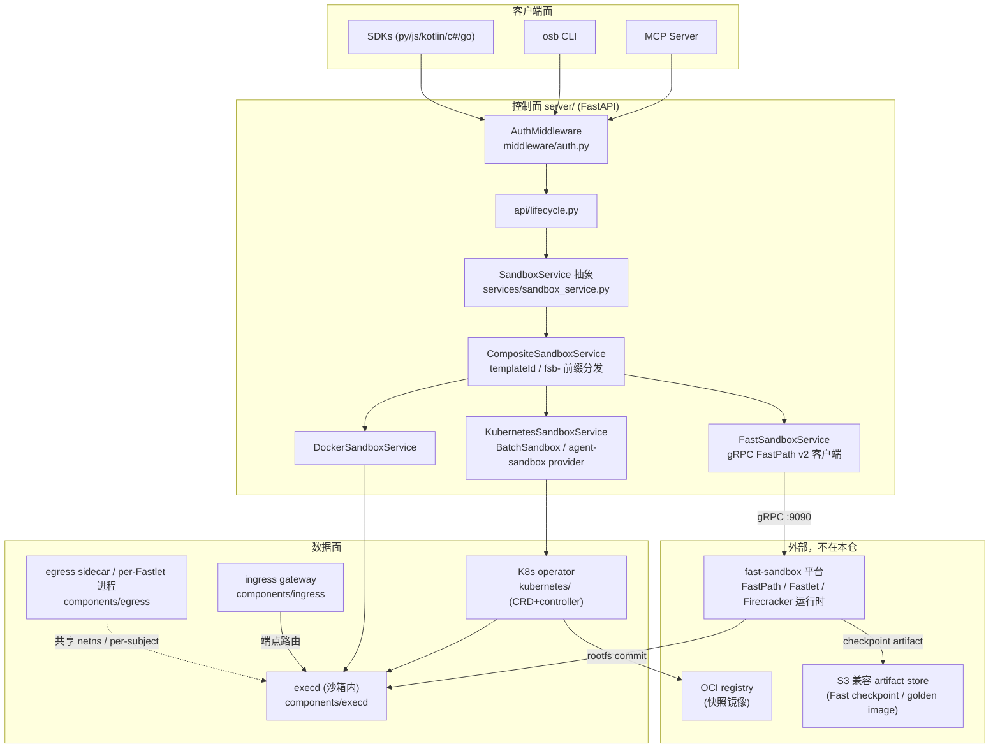

# 04 · OpenSandbox 源码深研（Round 2 线 B · 深研第 1 号）

> 检索日期：2026-10-27（Asia/Shanghai）｜ 源码：`opensandbox-group/OpenSandbox` 浅克隆 `--depth 50`
> **HEAD：`dbcc6d7`**（全哈希 `dbcc6d7f1d30ffd7c45f587ec86d57d565e83738`，2026-10-27 15:28 +0800，`chore(manifests): bump fast-sandbox pin to 0e20b90 (master) (#2438)`）
> 最新正式 release：`release-1.1.1`（2026-10-09，gh API）；最新预发布：`release-1.2.0-rc.2`（2026-10-21）；本地 `git describe` = `release-1.2.0-rc.2-253-gdbcc6d7`（浅克隆口径，仅供参考）
> 仓库口径：GitHub API `created_at=2025-12-17` 是迁移到 `opensandbox-group` 后的新仓时间；`alibaba/OpenSandbox` 经 API 确认重定向到同一仓库，不要用 created_at 推断项目历史。stars 16,201 / forks 1,509 / open issues 145（2026-10-27 gh API 快照）。License：Apache-2.0 [A]
> 证据等级：A=本仓源码/官方文档直接支持；B=可靠独立来源；C=推断待验证；U=未知。性能数字一律标「官方公布，未实测」。

---

## 0. 结论先行

1. **OpenSandbox 本仓是一个「协议 + 控制面 + 容器数据面」仓库，不是完整的 MicroVM 运行时仓库。** [A] 生命周期服务（FastAPI）、Docker/K8s 后端、execd、egress sidecar、ingress、K8s operator（BatchSandbox）都在本仓；但 Fast Sandbox 的 FastPath/Fastlet/Firecracker 运行时在**外部仓库** `opensandbox-group/fast-sandbox`，本仓只有 gRPC 客户端、适配层与 CR 读取。深研本仓能回答控制面与容器路径的全部问题，回答不了 Fastlet 内部实现——那是下一号深研对象。
2. **三条执行路径共用一套生命周期 API**：Docker（本地/单机）、Kubernetes 容器（BatchSandbox 或 kubernetes-sigs/agent-sandbox 两种 provider）、Fast Sandbox（templateId → Firecracker microVM）。分发规则极简：`services/factory.py:create_sandbox_service` 按 `runtime.type` 二选一；K8s 模式下 `CompositeSandboxService.create_sandbox` 以 `templateId` 非空选 Fast 路径，已有沙箱以 ID 前缀 `fsb-` 路由。[A]
3. **隔离是「可插拔的服务器级配置」，不是每请求可选**：默认 runc；运维在 server 配置 `[secure_runtime]` 里选 gVisor（runsc）/ Kata（QEMU）/ Kata-Firecracker / Kata-CLH，启动时校验、不可用就拒绝启动（`services/runtime_resolver.py:validate_secure_runtime_on_startup`）。要同时提供多档隔离，必须部署多个 Server 实例并按端点分流——官方 secure-container 指南明说这「不是安全或租户边界」。[A]
4. **egress 是这个项目最硬的部分**：per-sandbox sidecar（容器路径）独占 NET_ADMIN、主容器被 drop 掉 NET_ADMIN；两层执行（Layer 1 DNS 代理 / Layer 2 `dns+nft` nftables 默认拒绝 + DNS 学习地址集带租约）；平台 overlay `deny.always/allow.always` 优先级高于用户策略且每分钟热重载；启动装不上规则就直接退出，永不以 no-op 方式运行（fail-closed）。[A] **但：全仓 egress Go 代码中没有硬编码的云元数据地址（如 169.254.169.254）阻断**——内网/Pod CIDR 隔离靠运维自备 `deny.always` 文件（官方 network-isolation 指南给的是配方，不是开箱默认）。这是选型时必须自己补的一课。[A：grep 无命中 + 指南原文]
5. **Credential Vault 的设计确实干净，但「只活内存」只对容器路径成立**：容器路径下真实凭证只在 egress sidecar 进程内存里，沙箱内只见假值，出口 HTTPS 由 mitmproxy 按 binding 注入，出站读接口 write-only 脱敏；K8s pause 后 Pod 删除、vault 随之消失，必须由可信控制面重注入。[A] Fast 路径下则多了一份**每沙箱一个的明文 v1 vault 文件**落在 Pod 级 emptyDir（源码三处 `TODO(encryption-at-rest)`），官方建议把该卷设为 `medium: Memory`——引用「Vault 只活内存」时必须带路径限定。[A]
6. **「两套 checkpoint」属实且官方明说互不共享**：Fast 路径把 rootfs+vmstate+memory 写进内容寻址 artifact store（SHA256SUMS 清单、摘要寻址、可跨 Fastlet 恢复）；operator 路径把容器 rootfs commit 成 OCI 镜像（QEMU 契约下另有 VM-state 路径）。两者只共享生命周期 API 与 202 语义。[A]
7. **64ms 创建是真的有出处、也真的有口径**：README 的 Firecracker 64ms P50 来自 2026-10-08 双节点 ACK 实测（暖池、模板已缓存、串行、终点=guest `/ping` 200）。同一份官方实测里：并发 20 时 100 次只成功 51 次（48 次 429 容量拒绝）；pause 到 durable Paused 约 61 秒、**SDK 口径 resume 约 62 秒**（运行时恢复本身只有 ~35ms，差距在端点/网关就绪，官方自己标为未解之谜并警告不要拿运行时数字冒充 resume 数字）。[A：官方公布，未实测；文档自带警告]
8. **与 E2B 无代码关系**：全仓对 "e2b" 的提及只有文档层两处（OSEP-0001 拿 E2B/Modal 做行业对照、pool 提案里把 E2B 当「上层系统」举例），没有任何兼容层、适配器或导入。API 形态是自有 OpenAPI（`specs/`），概念相似纯属同题 convergent design。[A]

---

## 1. 仓库结构地图

顶层（以 HEAD 实际目录为准）：

| 目录 | 职责 | 语言/形态 |
|---|---|---|
| `server/` | 生命周期控制面：FastAPI 服务、Docker/K8s/Fast 三后端、快照/模板仓储、租户、idle-pause 与 renew-intent 集成 | Python |
| `components/execd/` | 沙箱内执行守护进程：命令/会话/PTY/文件/Jupyter 代码执行、bwrap 隔离会话、cgroup 指标 | Go (Gin) |
| `components/egress/` | per-sandbox 出口策略 sidecar（容器路径）；Fast 路径下同代码以 per-Fastlet 共享进程形态运行 | Go |
| `components/ingress/` | 入站网关：header/URI/通配 host 三种路由模式、签名 route scope、wake-on-access | Go |
| `components/nodeagent/` | 节点侧采集代理（sandbox 日志/状态对象落盘与上报，OSEP-0019） | Go |
| `components/internal/` | 运行时组件共享 Go 库（supervisor、logger、telemetry） | Go |
| `kubernetes/` | K8s operator：BatchSandbox/Pool/SandboxSnapshot CRD + controller、task-executor、image-committer、qemu-checkpoint-helper | Go |
| `specs/` | 公共契约源头：`sandbox-lifecycle.yml`、`execd-api.yaml`、`egress-api.yaml`、`diagnostic-api.yml` | OpenAPI |
| `sdks/` | sandbox SDK（Python/JS/Kotlin/C#/Go）、code-interpreter SDK（Python/JS/C#）、MCP server（Python） | 多语言，含生成客户端 |
| `cli/` | `osb` CLI（create/run/file/egress/devops/skills） | Python |
| `console/` | 开发者控制台（React SPA + FastAPI BFF，可选组件） | TS/Python |
| `manifests/charts/` | Helm：base/controller/server/ingress-gateway/node-agent/fast-sandbox + umbrella | Helm |
| `oseps/` | 增强提案 0001–0024（egress FQDN、secure runtime、pause/resume、vault、TLS 拦截等设计原文都在这） | Markdown |
| `tests/` | 跨语言端到端 SDK 测试（python/go/java/js/csharp） | 多语言 |
| `examples/` | 30+ 可运行示例（claude-code、codex-cli、chrome、desktop、playwright、harbor-evaluation 等） | 多语言 |
| `docs/` | VitePress 文档源（architecture/ 下是本深研最重要的二手入口，但结论均已回源码核对） | Markdown |



关键边界（源码可证）：`server/opensandbox_server/services/fast_sandbox/service.py` 文件头注释自述 "FastPath owns mutations and live runtime operations. Kubernetes LIST/WATCH …"——即 Fast 路径下 server 只是**提交意图 + 观察收敛**，不持有运行时真相。[A]

---

## 2. 核心调用链（源码级）

```mermaid
sequenceDiagram
    participant C as Client (SDK/CLI/MCP)
    participant M as AuthMiddleware
    participant L as api/lifecycle.py:create_sandbox
    participant S as SandboxService (Composite)
    participant R as Runtime (Docker/K8s/Fast)
    participant E as execd (沙箱内)
    participant G as egress
    C->>M: POST /v1/sandboxes + OPEN-SANDBOX-API-KEY
    M->>M: dispatch(): 豁免路径/单租户 key 集/多租户 TenantProvider.lookup
    M->>L: 通过后注入 tenant 上下文
    L->>S: create_sandbox(CreateSandboxRequest)
    S->>S: Composite: templateId 非空 → FastSandboxService; 否则 KubernetesSandboxService (Docker 模式无 Composite)
    S->>R: 拉镜像/建 workload/提交 FastPath CreateSandbox (gRPC)
    R->>E: 注入 execd (Docker: 拷贝二进制+bootstrap; K8s: init 容器经 emptyDir; Fast: 模板构建时烤入 guest)
    R->>G: 有 networkPolicy 时挂 sidecar (容器) 或 SET_BINDING 注册 subject (Fast)
    C->>L: GET /v1/sandboxes/{id} 轮询至 Running (创建是异步语义)
    C->>E: GET /v1/sandboxes/{id}/endpoints/{port} 解析 execd 端点后直连 (或经 server proxy / ingress)
    E->>E: NewRouter: runtimeInitGate → accessTokenMiddleware → RunCommand (SSE 流式)
    C->>L: POST /v1/sandboxes/{id}/pause → 202
    L->>R: Docker pause / operator rootfs commit / FastPath PauseSandbox
    C->>L: DELETE /v1/sandboxes/{id} → 回收容器/Pod/CR 与 sidecar
```

逐步对照（文件 : 符号）：

| 步 | 位置 | 说明 |
|---|---|---|
| 认证 | `server/opensandbox_server/middleware/auth.py:AuthMiddleware.dispatch` | 校验 `OPEN-SANDBOX-API-KEY` 头；`/health` 等豁免；单租户模式无 key 配置时**跳过认证**（有 startup guard 兜底警告）；多租户走 `TenantProvider.lookup(api_key)` 并 `set_current_tenant`；proxy 路径在单租户下有严格正则豁免（含 `..` 直接拒绝） [A] |
| 入口 | `server/opensandbox_server/main.py:lifespan` / `_build_tenant_provider` | 装配中间件、路由、租户 provider、renew-intent 与 idle-pause 后台组件 [A] |
| 创建路由 | `server/opensandbox_server/api/lifecycle.py:create_sandbox`（POST /v1/sandboxes） | 路由层只做 schema 校验与服务调用；同文件还有 list/get/patch/delete/pause/resume/renew、`create_snapshot`、endpoints [A] |
| 服务抽象 | `server/opensandbox_server/services/sandbox_service.py:SandboxService` (ABC) | create/list/get/delete/pause/resume/renew/get_endpoint 等统一接口，三后端实现同一契约 [A] |
| 后端选择 | `server/opensandbox_server/services/factory.py:create_sandbox_service` | `runtime.type=docker` → `DockerSandboxService`；`kubernetes` → `KubernetesSandboxService` 并包一层 `CompositeSandboxService(k8s, FastSandboxService)` [A] |
| Fast 分发 | `server/opensandbox_server/services/composite_service.py:CompositeSandboxService.create_sandbox` / `_backend` | create 以 `templateId` 非空为 Fast 选择器；存量操作以 `sandbox_id.startswith("fsb-")` 路由，无独立注册表 [A] |
| Docker 创建 | `services/docker/docker_service.py:DockerSandboxService.create_sandbox` → `_provision_sandbox` → `_prepare_resource_limits` | 异步线程内拉镜像、建 egress sidecar 与主容器、打标签、注册过期定时器（`_schedule_expiration`/`_expire_sandbox`）；重启后 `_restore_existing_sandboxes` 从容器标签恢复计时 [A] |
| K8s 创建 | `services/k8s/kubernetes_service.py:KubernetesSandboxService` + `provider_factory.py` / `batchsandbox_provider.py` / `agent_sandbox_provider.py` | 按 `kubernetes.workload_provider` 选 BatchSandbox 或 agent-sandbox；模板合并、imagePullSecret、RuntimeClass、卷与 egress 注入都在 provider 层 [A] |
| Fast 创建 | `services/fast_sandbox/service.py:FastSandboxService` → `fastpath_client.py:FastPathClient.create_sandbox` | gRPC FastPath v2（:9090）提交；状态从 `sandbox.fast.io` CR 的 LIST/WATCH 观察收敛（`cr_reader.py`） [A] |
| 命令执行 | `components/execd/pkg/web/router.go:NewRouter` → `registerExecutionRoutes` → `pkg/web/controller/codeinterpreting.go:RunCommand` / `command.go` | 客户端先经 lifecycle 解析 execd 端点再**直连 execd**（不经过控制面转发）；execd 侧中间件链：init gate → access token（`X-EXECD-ACCESS-TOKEN`）→ proxy；命令走 SSE 流式，`TimeoutMs` 转 `context` 超时，后台命令有 status/logs 轮询端点；另有 `/code`（Jupyter 内核）、`/session`、`/pty`（WebSocket） [A] |
| 文件 | 同上 `registerFilesystemRoutes`（`/files/*`、`/directories`） | execd 本地文件操作；另有 `/v1/filesystem/:uid/:gid` 身份作用域路由，以子进程按指定 uid/gid 执行 [A] |
| 暂停/恢复 | Docker：`docker_service.py:_pause_sandbox_locked/_resume_sandbox_locked`（先冻主容器、恢复时先解冻 sidecar 顺序相反）；K8s：operator `kubernetes/internal/controller/batchsandbox_pause_resume.go`；Fast：`FastPathClient.pause_sandbox/resume_sandbox` | 三路语义见 §3 [A] |
| 回收销毁 | `delete_sandbox` 各后端实现 + operator finalizer（`kubernetes/internal/utils/finalizer.go`）+ Fast Janitor（外部平台） | 删除同时拆 sidecar、卷与过期跟踪；Fast 路径孤儿资源由外部平台 Janitor 扫除（本仓仅文档述及） [A/B] |

---

## 3. 暂停 / 恢复 / 快照：三套机制，不要混

| 路径 | 机制 | 保存什么 | 恢复语义 | 证据 |
|---|---|---|---|---|
| Docker | 容器 pause/unpause + 快照=本地 OCI 镜像 commit（`services/docker/snapshot_runtime.py:DockerSnapshotRuntime`） | pause 只冻进程；snapshot 存 rootfs 镜像 | unpause 原地解冻；snapshot 另起新沙箱 | [A] |
| K8s operator（BatchSandbox） | 内部 `SandboxSnapshot` CR → image-committer 在源节点经 containerd commit rootfs → 推 OCI registry；resume 重写 BatchSandbox 模板镜像并重建 Pod（`kubernetes/internal/controller/batchsandbox_pause_resume.go`、`kubernetes/cmd/image-committer`） | **只有 rootfs**（进程/内存不保存）；可选 QEMU-in-runc 契约走 `qemu-checkpoint-helper` 保存 QEMU 进程与 guest 内存 | 同一 sandboxId 复活；**仅 replicas=1**；rootfs 只在 snapshot `Succeed` 后才算 durable，OOM/evict 后不保证可恢复（指南明说） | [A] |
| Fast Sandbox | checkpoint = artifact set（`rootfs`+`vmstate`+`memory`+`SHA256SUMS`）写内容寻址 store（S3 兼容），摘要优先、写完才报 Paused；恢复可在**任意 Fastlet**，节点本地 rootfs 是 XFS reflink CoW 副本，块由 DART P2P 分发（`docs/architecture/fast-sandbox/checkpoints.md`、`firecracker.md`，本仓文档；运行时实现在外部仓） | rootfs+VM 状态+guest 内存全量 | 同一 sandboxId、换宿主恢复；路由代际递增，客户端必须重新解析端点；无 checkpoint 的 Paused 不可 resume 只能 reset | [A 文档 / U 运行时源码未读] |

公开 snapshot API 与内部 pause 是两回事：snapshot 把状态发布为可复用 artifact/镜像（新沙箱的起点、新 ID），pause 是同一沙箱的连续性。server 侧由 `services/snapshot_runtime_factory.py:create_snapshot_runtime` + `CompositeSnapshotRuntime._for_source` 按来源沙箱选 Docker/K8s/Fast 三种 `SnapshotRuntime`。[A]

**性能口径警告**（官方 ACK 实测，2026-10-08，双节点，未实测复现）：暖池串行创建 SDK 口径 64.0ms P50；但 pause durable 约 61.14s（其中 VM 冻结转储 11.15s、发布 ~4GiB artifact 45.6s），SDK resume 约 62.66s（3 样本，同节点、checkpoint 已缓存；运行时恢复仅 35.49ms）。官方 performance 文档明确警告不要用运行时数字代替 SDK resume 数字，且并发 20 的一次运行出现 48/100 次容量拒绝。[A：官方公布，未实测]

---

## 4. 隔离实现与安全边界

### 4.1 容器路径（默认与可选档位）

- 默认：普通 Docker/K8s 容器（runc），与宿主共享内核——本项目不改变这个事实，只是提供换档位。
- 换档位：`services/runtime_resolver.py:SecureRuntimeResolver` 把 `[secure_runtime].type` 映射为 Docker OCI runtime（`runsc` 等）或 K8s `runtimeClassName`（`gvisor`/`kata-qemu`/`kata-fc`/`kata-clh`）；`validate_secure_runtime_on_startup` 在启动时实测运行时可用性，不可用拒绝启动。选择粒度是**整个 Server 进程**，多档共存靠多 Server 部署（指南原文：这提供的是确定性选择，不是安全/租户边界）。[A]
- Docker 容器硬化：`services/docker/container_ops.py` 组装 host_config——`security_opt` 含可配置的 `no-new-privileges`、AppArmor/seccomp profile，`cap_drop` 来自 `[docker].drop_capabilities` 配置，`pids_limit` 可配；资源限额在 `_resolve_resource_limits` 转 `mem_limit/nano_cpus` 与 GPU 计数。[A] 注意一处反向证据：为 bwrap 隔离会话（见 4.2）准备的容器路径会**主动放宽**——加 `SYS_ADMIN` 并把 apparmor/seccomp 设为 unconfined（`docker_service.py` 中 isolation 准备段），即该功能与默认硬化是权衡关系，部署时要看清自己开的是哪条。[A]
- K8s 主容器：在启用网络策略时由 `services/k8s/egress_helper.py:build_security_context_for_sandbox_container` 给主容器 drop `NET_ADMIN`；Pod securityContext 的 capabilities/seccomp 由模板与 `security_context.py:build_security_context_from_dict` 透传，平台不强制一套固定 profile——**profile 来自运维模板，不是产品内建基线**。[A]

### 4.2 execd 的进程级第二层：隔离会话

`components/execd/pkg/isolation/` 是本仓容易被漏看的一块：基于 **bubblewrap** 的会话级隔离（`bwrap.go:buildArgv` 拼 namespace/tmpfs/overlay 段、生成 seccomp 过滤器 `seccomp_gen.go`、overlay upper 管理、合并视图），对应 OSEP-0013 Isolated Execution API 与 `pkg/web/controller/isolated_session.go`。定位是「同一沙箱内再隔离单个执行会话的文件视图与系统调用」，不是租户边界；它依赖 bwrap 二进制由 server 侧拷入容器（`services/docker/runtime.py:_copy_bwrap_to_container`，缺失时该能力静默不可用）。[A]

### 4.3 Fast 路径（microVM）

每沙箱一个 Firecracker microVM（KVM、独立 guest 内核），跑在 Fastlet Pod 的 netns 里；guest 无 `NET_ADMIN`、看不见也改不了执行规则；宿主要求在 chart/环境工具里真实校验：kernel ≥5.10、`/dev/kvm`、`/dev/net/tun`、cgroup v2、XFS+reflink、`/dev/shm` 扩容，不满足的节点不打标签不接 microVM 沙箱。Firecracker 版本默认 v1.16.1（节点 DaemonSet 安装）。[A：本仓 `docs/architecture/fast-sandbox/firecracker.md`；运行时源码在外仓，标 U 待深研]

### 4.4 边界小结

| 边界 | 强度来源 | 剩余风险 |
|---|---|---|
| 沙箱↔宿主（容器档） | runc + 可选 gVisor/Kata 换档 + 容器硬化配置 | 默认档仍共享内核；硬化项多为配置驱动，配错即裸奔 |
| 沙箱↔沙箱（网络） | egress sidecar 默认拒绝策略 + 平台 overlay | 依赖运维配置（§5）；无 egress 时 K8s Pod 间默认可达 |
| 沙箱↔外部凭证 | Vault 在 sidecar 注入（§6） | 只覆盖被 binding 匹配的 HTTPS；沙箱内自带凭证不在保护内 |
| 客户端↔端点 | API key + 可选 secureAccess 签名路由（ingress `routescope`/签名校验） | 单租户无 key 模式仅靠 startup guard 提醒 |
| Fast 沙箱↔宿主 | KVM microVM + Fastlet netns 策略 | 运行时不在本仓，无法在本深研内审计 |


---

## 5. 网络与 egress（源码级）

组件：`components/egress/`（Go），入口 `main.go:main` / `parseMode`，模式解析 `pkg/constants/mode.go:ParseEgressMode`（token `dns` 必选 + 可选 `nft`，空 env 回退 dns-only 并打警告——注意：**模式写错是降级不是拒绝**，与 fail-closed 的整体形象有一处不一致，部署检查应覆盖）。

- **形态**：容器路径 = 每沙箱一个 sidecar，与主容器共享网络命名空间（Docker 下主容器以 `container:<sidecar>` 网络模式启动，`docker_service.py:_provision_sandbox`；K8s 下 sidecar 追加进 Pod spec，`egress_helper.py:apply_egress_to_spec`）。sidecar `capabilities.add=["NET_ADMIN"]`，主容器被 drop `NET_ADMIN`——NET_ADMIN 只在 sidecar 手里 [A]。Fast 路径 = 每 Fastlet Pod 一个**共享** egress 进程，按 subject（每 VM 一个 attachment：IP/网关/veth/私有 CIDR）分发策略，VM 经 `SET_BINDING` 注册后处于 deny-first，直到 `sandbox.data-plane-ready` 才放行 [A 文档]。
- **Layer 1（DNS）**：全部 53 端口流量重定向进 sidecar 的 DNS 代理（`pkg/dnsproxy/`）；拒绝域名回 NXDOMAIN，允许域名正常解析并记录解析地址。[A]
- **Layer 2（`dns+nft`）**：nftables 默认丢弃（`pkg/nftables/manager.go`、`pkg/fastsandboxnft/`）；允许流量靠静态规则或 DNS 学习地址集，地址集带**有界租约**+活动连接宽限期，不会「一次允许永久允许」；UDP/QUIC 只能靠 DNS 租约时序。[A]
- **策略与优先级**：`pkg/policy/always_rules.go:MergeAlwaysOverlay` 在每次策略变更时按序合并——平台 `deny.always` → 平台 `allow.always` → 用户策略，first-match，平台 deny 永远压过用户 allow；overlay 文件在 sidecar 镜像内、每分钟热重载，解析/应用失败保留上一份已接受规则。另可设 `reachable.ports.cap` 端口地板（补充集一律 deny）。运行时改策略：容器路径直连 sidecar `PATCH /policy`（`specs/egress-api.yaml`）；Fast 路径走 lifecycle 的 `GET/PUT/PATCH/DELETE /sandboxes/{id}/networkpolicy`，由 server 经 FastPath Actions 下发（`services/fast_sandbox/policy_relay.py`、`network_policy.py`）。[A]
- **fail-closed 实证**：`components/egress/main.go` 对初始策略加载失败、overlay 加载失败、DNS 代理初始化失败、iptables redirect 安装失败一律 `log.Fatalf` 退出；Fast subject 注册即 deny-first。策略迟到可以，开着口迟到不行——官方原文 "policy may be late, never open"。[A]
- **元数据与内网**：全仓检索无硬编码 169.254/链路本地阻断（已 grep `components/egress` 全部 Go 代码与 docs）。官方做法是运维配方：把 Pod CIDR / Service CIDR 写进 `deny.always` 并重打 sidecar 镜像（`docs/guides/network-isolation.md`），该文同时论证了为何不用 K8s 原生 NetworkPolicy（标签不可控、粒度对不上、出站管不住）。**结论：元数据防护 = 策略问题不是产品默认**；若 `defaultAction` 不是 deny 或没配 overlay，沙箱对集群内网的访问取决于部署方，评测时必须按实际部署测，不能按产品名下结论。[A]
- **入站**：`components/ingress/` 反向代理三种模式（header `OpenSandbox-Ingress-To`、URI `/<id>/<port>/`、通配 host）；Fast 路由用签名 `f1.` scope 在 ingress 校验（`pkg/signature`、`pkg/routescope`）；`secureAccess` 时 server 下发端点凭证头。ingress 还承担 wake-on-access（`pkg/wake`）与 renew-intent 事件源。[A]

## 6. Credential Vault（源码级）

实现：`components/egress/pkg/credentialvault/vault.go`（`Store` 类型：`credentials map[string]record` + `bindings` + revision 计数，全在进程内存，`sync.RWMutex` 保护）；对外 API 在 `specs/egress-api.yaml` 与 server 侧 `api/credential_vault.py`（容器路径直连 sidecar 端点，Fast 路径经 `services/fast_sandbox/vault.py` 的 relay + `sanitize_full_revision` 脱敏合并）。[A]

- **注入路径**：可信客户端（宿主侧 SDK/控制面）把真实凭证写进 sidecar；沙箱进程环境变量里只有假值/空值（如示例里的 `ANTHROPIC_API_KEY=fake-key-inside-sandbox`）。出站 HTTPS 被 mitmproxy 透明拦截后，按 binding 的 scheme/host/port/method/path 五元组匹配（恰好一条命中才注入），注入形态含 bearer / basic / apiKey header / customHeaders，以及 path/query/header/body 四个表面的 placeholder 替换（`passthrough` 类型）；读接口一律 write-only，值从所有回读中剥离，注入值进入主动脱敏集防日志泄露。[A]
- **密钥是否进沙箱**：不进沙箱内存、不进环境变量、不进命令行/文件系统/日志——这是设计目标且代码路径自洽（注入发生在 sidecar 的出站方向）。例外与代价：(1) 只保护走 Vault 的凭证，工作负载自己带进来的密钥不受保护；(2) TLS 拦截要求沙箱信任 sidecar CA，这是 L7 能力的固有代价。[A]
- **持久性（路径分化，重要修正）**：容器路径纯内存态——K8s pause 删 Pod 后 vault 清空，resume 后必须由可信控制面重新 create（指南明文流程）；Docker pause 保留进程但 sidecar 一旦被替换同样清空。Fast 路径则为「内存 + 每沙箱一份明文 v1 文件」落在 Pod 级 emptyDir 以便 egress 重启本地恢复与 pause/resume 随 snapshot bundle 携带，源码 `components/egress/fastsandbox_vault_persist.go` 与 `fastsandbox_policy_persist.go` 均有 `TODO(encryption-at-rest): … stored as-is`——即该路径下凭证在节点上有明文落盘窗口，官方建议 vault 卷用 `medium: Memory` 规避落盘。[A]
- **L7 / TLS 拦截状态定性**：官方 egress 文档原文为 "**experimental but production-usable**"——拦截与注入机制本身已在生产设置运行，**实验性的是配置面**（额外端口、诊断开关可能跨版本变化）；OSEP-0023 的 live credential-bound admission（revision 运行时、按连接/请求准入）则是默认关闭的内部实验，且证据范围只覆盖 Docker dns+nft + 精确 host HTTPS/443 + HTTP/1.1，HTTP/2 仅在固定依赖的 direct/lazy 路径上有实验接线，上游链式代理在该路径被拒绝。引用时禁止简化成「L7 已 GA」或「L7 纯实验」任一极端。[A]

## 7. 资源治理、并发与 BatchSandbox

- **资源限额**：创建请求 `resourceLimits`（`specs/sandbox-lifecycle.yml`：cpu/memory/gpu 及未来键）为统一入口。Docker 转 `mem_limit/nano_cpus`（`_resolve_resource_limits`）；K8s 转 requests/limits 与 GPU 扩展资源（provider 层）；execd 内以 cgroup v2 为准读实际配额做指标与 OOM 遥测（`components/execd/pkg/resources/resources_linux.go` 读 `cpu.max`/`memory.max`，`pkg/cgroupfs`、`pkg/telemetry/oom_linux.go`）——即限额执行在运行时/编排层，execd 只观测。[A]
- **超时与生命周期**：创建请求带 `timeout`（秒）与过期时间；Docker 后端用进程内定时器 + 标签持久化恢复；K8s 侧 `BatchSandboxSpec.ExpireTime` 由 controller 执行；另有可选 idle-pause（`server/opensandbox_server/integrations/idle_pause/`：probe/decision/sweeper/executor 分工，空闲自动 pause）与 renew-on-access（`integrations/renew_intent/` + ingress 事件经 Redis）。命令级超时是 execd 的 `TimeoutMs`，与沙箱 TTL 是两个层级。[A]
- **PID/进程**：Docker `pids_limit` 来自配置（非每请求）；本仓未见 K8s 路径的统一 PID 基线强制，标 U（待查 provider 模板默认值）。
- **并发与池化**：`kubernetes/apis/sandbox/v1alpha1/pool_types.go:PoolSpec/CapacitySpec`（`BufferMin/BufferMax` 预热缓冲）+ `BatchSandbox` 的 `extensions.poolRef` 从池分配；Fast 路径靠 Fastlet 池（每 Fastlet 固定 slot 数）+ FastPath 内存放置，超容量回 429（`FastPathResourceExhausted` 映射 `SandboxRateLimitException`）。客户端侧还有 client pool（`docs/guides/client-pool.md`、OSEP-0005/0021）。官方实测的并发 20 失败案例（§3）说明池容量与准入的一致性仍是活跃问题区，不是已解项。[A]
- **BatchSandbox 是什么**：`kubernetes/apis/sandbox/v1alpha1/batchsandbox_types.go:BatchSandbox` CRD——`Replicas`（批量副本）、`Template`（PodTemplateSpec）与 `PoolRef` 二选一、`ExpireTime`、可选 `TaskTemplate`（任务编排，配合 `kubernetes/cmd/task-executor` 与 `internal/task-executor`，面向批量评测/RL 训练的「一批沙箱跑一批任务」）。controller 在 `kubernetes/internal/controller/`（含 pause/resume、调度 `internal/scheduler/`、快照 `internal/snapshot/`）。它同时是普通 K8s 沙箱的默认 workload provider 底座，不只是批量工具。[A]
- **计费**：开源自托管，无产品计费；成本 = 自有集群资源 + OCI registry/S3 存储 + 运维人力，本仓无官方成本模型，标 U（不适用 SaaS 比价）。

## 8. 与 E2B 的关系、spec 与实现差距

- **spec 在哪**：`specs/` 是公共契约源头（仓库 AGENTS.md 明令 "Treat specs/* as public contract sources"），四份：`sandbox-lifecycle.yml`（base path `/v1`）、`execd-api.yaml`、`egress-api.yaml`、`diagnostic-api.yml`；SDK 的生成客户端由 spec 生成、手写适配层在旁。OSEP（`oseps/` 0001–0024）是设计提案层，记录能力背后的取舍（如 0001 FQDN egress、0004 secure runtime、0008 pause/resume、0012 vault、0023 TLS 拦截）。[A]
- **与 E2B API 的关系：无关，非兼容**。全仓 "e2b" 提及仅 2 处文档语境（OSEP-0001 对照 E2B/Modal 的 IP/CIDR 出口控制路线；pool 提案把 E2B 举例为「可能的上层系统」），无兼容层、无 API 映射代码、无 SDK 互操作承诺。形态相似点只在概念层：都有 create/run/pause/destroy 的生命周期词汇与 SDK 风格（Python SDK 甚至同名 `Sandbox.create` 风格），但参数模型（image/snapshotId/templateId、extensions、networkPolicy、secureAccess）是自有体系。从 E2B 迁移 = 按新 API 重写集成，不是换 base URL。[A]
- **spec 与实现差距（本轮实证）**：(1) lifecycle 路由对 snapshot 系列端点保留了 `501 Snapshot management is not implemented yet` 的响应声明（`api/lifecycle.py` 四处），实际能力按后端分化（Docker/K8s-Batch/Fast 可用、agent-sandbox provider 不在公开 snapshot 支持面）——即 spec 的错误声明比实现保守，读 spec 会低估、读 README 会高估，必须按后端核。(2) Fast 路径的能力缺口不在 spec 里逐项标注、而在适配层拒绝：`credentialProxy.enabled` 与 volume mounts 在 Fast 创建时被 server adapter 直接拒绝（架构文档明述）。(3) execd 实际路由比 `execd-api.yaml` 多：PTY WebSocket 与隔离会话在实现里存在，spec 覆盖度待逐条对账（本轮未做全量 diff，标为已知未清项）。[A/(3) 为 C]

## 9. 测试、成熟度与未完成标记

- **测试布局**：server Python 测试 93 个文件（`server/tests/`）；components Go 测试文件 298 个；kubernetes Go 测试文件 79 个（含 `test/e2e`、`e2e_qemu`、`e2e_runtime`、`e2e_task` 的 Kind e2e）；顶层跨语言 e2e 108 个文件（`tests/` 五语言）；specs 有 schema 测试（`specs/tests/test_execd_schema.py`）。计数为本轮 `find` 实测（文件数口径，不代表用例数或覆盖率，覆盖率数字本仓未公布，标 U）。[A]
- **CI**：`.github/workflows/` 22 个，含分组件测试（server/execd/egress/ingress/nodeagent/kubernetes/fast-sandbox）、`real-e2e.yml`、sdk-tests、helm 发布与许可校验（verify-license）、release 全套。根 README 挂 E2E 与 K8S nightly 徽章。[A]
- **TODO/FIXME 实测**（排除测试与生成代码）：server 3、components 6、kubernetes 14、sdks/cli/specs 0，合计 23 处。多数是小项，两个值得记名：egress 的 `TODO(encryption-at-rest)`（§6，快照/模板携带的 vault 与 policy blob 明文存储）；server `extensions` 的 `TODO(2.0)` 遗留请求入口待删（#2289）。`unimplemented` 的实质命中只有 lifecycle 的 501 声明（§8）；gRPC 生成桩的 NotImplementedError 是生成代码常规，不计。[A]
- **成熟度判断**：1.1.x 已正式发布、1.2.0 在 RC；AAIF 托管与 GOVERNANCE/ROADMAP/SECURITY 文件齐全，镜像走 Cosign 无密钥签名 + provenance（README）。活跃度为当日级（HEAD 即 2026-10-27）。判断：**已可用于生产自建部署的活跃项目，但能力面按后端高度不齐，选型必须按「后端 × 能力」矩阵逐项验，不可按项目整体背书**。[B：基于以上 A 级事实的综合判断]


---

## 10. 2026-10-23 旧笔记假设复核（12 条）

旧笔记是捐赠/发布期的一手观察，本轮逐条回当前源码复核。结果：**证实 9 / 修正 2 / 未证实 1 / 完全证伪 0**。

| # | 旧假设 | 结论 | 本轮证据 |
|---|---|---|---|
| 1 | 容器路径可换 Kata 做强隔离 | 证实 | `[secure_runtime]` 支持 kata（QEMU/CLH/Firecracker 三种 hypervisor 映射），服务器级配置、启动校验（`runtime_resolver.py`、secure-container 指南） [A] |
| 2 | 容器路径可换 gVisor | 证实 | 同上，gvisor→Docker `runsc` / K8s RuntimeClass `gvisor` [A] |
| 3 | Fast Sandbox = Firecracker microVM | 证实（带边界） | 模板建 golden image、每沙箱一个 KVM VM、节点校验与版本 v1.16.1 都在本仓文档与 chart 口径内；但**运行时实现不在本仓**（外部 fast-sandbox 仓），本条只证到集成层 [A/U] |
| 4 | Pause/Resume 走内容寻址 artifact | 证实 | Fast checkpoint = rootfs+vmstate+memory+SHA256SUMS，manifest 摘要引用、S3 兼容 store、摘要写完才报完成 [A] |
| 5 | 存在两套 checkpoint | 证实 | 官方 checkpoints 文档明言 "two independent checkpoint mechanisms"：Fast 的 `sandbox.fast.io` 与 operator 的 `SandboxSnapshot`→OCI，只共享 API 与 202 语义 [A] |
| 6 | egress 是 per-sandbox sidecar 且持 NET_ADMIN | **修正** | 容器路径成立：sidecar add NET_ADMIN、主容器 drop NET_ADMIN、共享 netns。但 Fast 路径是**每 Fastlet 一个共享 egress 进程**、per-subject 策略，没有 per-sandbox sidecar。全称表述不成立，引用必须带路径 [A] |
| 7 | egress 有 L1/L2 分层 | 证实（术语修正） | 源码/文档用词是 **Layer 1 (DNS) / Layer 2 (dns+nft)**，实质与旧笔记一致：DNS 层过滤 + nft 层默认拒绝与地址租约 [A] |
| 8 | L7 TLS 拦截是 experimental | 证实（带 nuance） | 官方定性 "experimental but production-usable"：机制已生产可用、实验性在配置面；OSEP-0023 的 live admission 才是默认关闭的真实验项 [A] |
| 9 | Credential Vault 只活在 sidecar 内存 | **修正** | 容器路径成立（进程内存、pause 即失、需重注入）；Fast 路径多一份明文 v1 文件落 Pod emptyDir（`TODO(encryption-at-rest)` 在码），「只活内存」对 Fast 不成立 [A] |
| 10 | egress fail-closed | 证实 | sidecar 初始化任一环失败即 Fatalf 退出；Fast subject 注册 deny-first；overlay 应用失败保留旧规则不开放。附带发现一处软点：模式字符串非法时降级 dns-only 而非拒绝启动 [A] |
| 11 | 有 BatchSandbox（批量/池化） | 证实 | CRD 本体在 `kubernetes/apis/sandbox/v1alpha1/`：Replicas/Template/PoolRef/ExpireTime/TaskTemplate + Pool 的 BufferMin/Max + task-executor [A] |
| 12 | （隐含）Fast 运行时实现可在本仓审计 | 未证实 | 本仓只有 FastPath gRPC 客户端、CR 读取与策略/vault relay；FastPath/Fastlet/FC 驱动在 `opensandbox-group/fast-sandbox` 外仓，本轮未克隆未读，其内部实现本报告一律按文档转述并标 U [U] |

## 11. Spec §7 十七问

1. **解决什么问题？** 在自有基础设施上给 AI 应用提供统一 API 的隔离执行环境：跑代码/命令/文件/浏览器/桌面，从本地 Docker 一路到 K8s 集群与 microVM。[A]
2. **目标用户是谁？** 自建 Agent 平台的团队、企业内部平台工程、做批量评测/RL 训练的团队；不是买 SaaS 的个人开发者（无托管版计费面，本仓即全部产品）。[B]
3. **核心架构是什么？** 协议先行（specs）+ FastAPI 生命周期控制面（server）+ 三后端（Docker/K8s 容器/Fast microVM）+ 沙箱内 execd 数据面 + egress/ingress 网络面 + K8s operator。见 §1 图。[A]
4. **使用什么隔离技术？** 默认容器（runc，共享内核）；可换 gVisor/Kata（服务器级）；execd 内 bwrap 会话级第二层；Fast 路径 Firecracker microVM。见 §4。[A]
5. **安全边界在哪里？** 见 §4.4 表。最强边界在 microVM 档与 Vault/egress 的策略层；最弱在默认容器档 + 无 egress 时的集群内网可达性。[A/B]
6. **创建和销毁如何实现？** 创建：API→服务抽象→后端分发（§2 链），异步收敛、客户端轮询；execd 三种注入方式（拷贝/init 容器/烤入模板）。销毁：后端 delete + 标签/CR 清理、sidecar 与卷回收、过期定时器与 idle-pause 自动回收、Fast 侧 Janitor 扫孤儿。[A]
7. **如何执行代码？** 直连 execd：`/command`（SSE 流式、后台任务、超时）、`/session` 持久 bash、`/pty` WebSocket、`/code` 经 Jupyter 内核做多语言代码上下文；SDK 与 code-interpreter SDK 是其上的封装。[A]
8. **如何处理文件和网络？** 文件：execd `/files`、`/directories` API + 卷模型（host/pvc/ossfs；Fast 路径拒卷）。网络：入站经端点解析/server proxy/ingress；出站经 egress 两层策略（§5）。[A]
9. **如何管理密钥？** Credential Vault：真实值只进 sidecar、出站按 binding 注入、沙箱内假值、回读脱敏；平台 API key 做控制面认证；端点可再加 secureAccess 签名。细节与 Fast 路径的明文文件修正见 §6。[A]
10. **如何控制资源消耗？** resourceLimits（cpu/mem/gpu）→ 后端原生限额；Docker pids_limit 与 cap_drop 等为配置项；TTL 过期回收 + idle-pause；execd 读 cgroup v2 做指标/OOM 观测。PID 在 K8s 路径的统一基线未找到，标 U。[A/U]
11. **如何支持并发？** Pool 预热缓冲（BufferMin/Max、poolRef）、BatchSandbox 批量副本、Fastlet slot 池 + FastPath 内存放置与 429 准入、客户端池。官方实测显示并发 20 会触发容量拒绝与投影冲突，属活跃问题区。[A]
12. **如何处理故障？** 状态机带 reason/message；Fast 路径 submit-and-converge（意图落 CR、重启可重放）；server 重启从容器标签恢复 Docker 计时；快照 CAS 收敛与幂等重提；ingress/egress/execd 各有诊断与 OTel 指标。已知缺口：rootfs 只在 snapshot 成功后 durable，异常终止无事后恢复操作（指南明文）。[A]
13. **计费和成本结构如何？** 开源免费（Apache-2.0）；成本为自建集群、registry/S3 存储与运维人力，无官方成本模型。不适用 SaaS 比价。[A/U]
14. **与其他路线相比的优势？** （有据的）同一 API 覆盖 Docker→K8s→microVM 三档；egress/Vault 的完成度在开源里罕见（FQDN 策略、平台 overlay、凭证注入成体系且有 OSEP 设计记录）；协议先行 + 多语言 SDK/CLI/MCP 齐全；AAIF 治理与发布签名完整。[B]
15. **有哪些不足？** 能力按后端严重不齐（spec 不逐项标注，靠适配层拒绝/501 声明兜底）；元数据/内网隔离不是默认要靠配方；Fast 运行时不在本仓、可审计性断档；resume 的 SDK 口径延迟与运行时数字差三个数量级且官方未定位；secure runtime 是服务器级粒度，多档隔离要多部署。[A/B]
16. **适合哪些生产场景？** 企业内自建 Agent 执行平台（尤其已在 K8s 上）、需要出口管控与凭证隔离的内部 Agent、批量评测/RL 的大规模短命沙箱、对数据不出域有要求的部署。[B]
17. **从零实现应借鉴什么？** 见 §13。

## 12. 源码阅读地图

建议顺序（每站都已在本轮验证存在）：

1. **契约先行**：`specs/sandbox-lifecycle.yml` → `specs/execd-api.yaml` → `specs/egress-api.yaml`。先知道承诺了什么，再看谁实现了多少。
2. **控制面主干**：`server/opensandbox_server/main.py`（装配）→ `middleware/auth.py:AuthMiddleware` → `api/lifecycle.py` → `services/sandbox_service.py:SandboxService` → `services/factory.py:create_sandbox_service` → `services/composite_service.py`（分发规则只有几十行，是理解三后端的钥匙）。
3. **一条后端读透**：Docker 路径 `services/docker/docker_service.py`（create→_provision_sandbox→pause/resume/delete 全在一文件）+ `container_ops.py`（硬化组装）+ `runtime.py`（execd 注入）。
4. **数据面**：`components/execd/pkg/web/router.go:NewRouter` → `pkg/web/controller/command.go` / `codeinterpreting.go` → `pkg/isolation/bwrap.go`（第二层隔离）→ `pkg/resources`（cgroup 观测）。
5. **网络面**：`components/egress/main.go` → `pkg/constants/mode.go` → `pkg/policy/always_rules.go` → `pkg/nftables/manager.go` → `pkg/credentialvault/vault.go`；Fast 形态再看 `fastsandbox*.go` 与 server 侧 `services/fast_sandbox/policy_relay.py`、`vault.py`。
6. **K8s 面**：`kubernetes/apis/sandbox/v1alpha1/*_types.go`（CRD 即设计）→ `internal/controller/batchsandbox_controller.go` / `batchsandbox_pause_resume.go` → server 侧 `services/k8s/batchsandbox_provider.py`、`egress_helper.py`、`security_context.py`。
7. **Fast 适配层**：`services/fast_sandbox/service.py`（文件头注释先读）→ `fastpath_client.py` → `cr_reader.py` → `snapshot_runtime.py`；然后停——再往下必须换仓到 `opensandbox-group/fast-sandbox`。
8. **设计考古**：`oseps/` 按号读 0001/0004/0007/0008/0012/0023，能解释多数「为什么这样实现」。

关键数据结构速记：`CreateSandboxRequest`（image/snapshotId/templateId 三选一 + extensions + networkPolicy + secureAccess）[A]；`BatchSandboxSpec`（Replicas/Template/PoolRef/ExpireTime/TaskTemplate）[A]；egress `NetworkPolicy`（DefaultAction + Egress[]，first-match）[A]；vault `Store`（credentials/bindings/revision）[A]；Fast checkpoint 记录在 `sandbox.fast.io` CR 的 `status.runtime.checkpoint`（checkpointID/manifestRef/digest）[A 文档]。

## 13. 与 Cassia / E2B 的对照启示（仅技术对照，不动 Cassia 代码）

- **「控制面提交意图、运行时收敛」值得学**：Fast 路径把每次变更写成 CR 意图、靠观察收敛，控制面重启不丢状态。Cassia 现用 E2B 时是命令式 SDK 调用；若未来自建控制面，这个 submit-and-converge 模式比「调用成功=完成」更抗故障——代价是状态语义变复杂（202、中间态、CAS）。
- **ID 前缀路由是个小而有效的土办法**：`fsb-` 前缀承担了全部后端分发，省掉一张注册表。自建多后端时可借鉴，但要意识到它把后端归属写进了对外 ID，迁移后端即换 ID 语义。
- **egress/Vault 是 OpenSandbox 相对 E2B 开源面最明显的差异化**：E2B 的出口控制在其托管面，OpenSandbox 把 FQDN 策略、平台 overlay、凭证注入全开源在本仓。对「凭证绝不进沙箱」有硬要求的场景，这套 sidecar 方案（假值进沙箱、真值在 sidecar 按 binding 注入）是可以直接抄作业的设计；但要连同它的代价一起抄：TLS 拦截 CA 信任、pause 后重注入流程、Fast 路径的明文文件 TODO。
- **默认值的教训**：OpenSandbox 的网络隔离强在机制、弱在默认（要运维写 deny.always 才有内网隔离）。Cassia 若自建，元数据与内网 deny 应做成不可关的出厂 overlay，而不是文档配方。
- **性能口径的纪律**：官方自己把「64ms 创建」与「62s SDK resume」放在同一份文档并警告不可混用——引用任何一家的数字时都应学这个口径：注明路径（暖/冷）、终点定义（运行时完成 vs 客户端可用）、样本与失败数。
- **多档隔离的部署形态**：OpenSandbox 用「一 Server 一档位、多 Server 分流」实现 gVisor/Kata/runc 共存，简单但粗糙（且官方承认这不是租户边界）。这提示 Cassia 若要做租户级隔离分档，需要比「选端点」更强的归属校验，不能照抄这一层。

## 14. 未清项与下一步

- Fast 运行时本仓外实现未读：FastPath/Fastlet/Firecracker 驱动/DART 需克隆 `opensandbox-group/fast-sandbox` 另做一号深研（本报告所有 Fast 内部结论均为 [A 文档 / U 源码]）。
- execd-api.yaml 与实现路由未做全量 diff（PTY、隔离会话的 spec 覆盖度是估计，未逐条对账）。
- K8s 路径 PID 基线、agent-sandbox provider 的 snapshot/egress 支持矩阵未逐项核（只核了 BatchSandbox 主路径）。
- 全部性能数字为官方公布未实测；按 D 线评测口径（t_submit/t_ack/t_ready）在自建环境复测是后续实验阶段的事，本轮未执行任何 OpenSandbox 部署。
- 仓库日更频繁（HEAD 当日仍在提交），本报告结论锚定 `dbcc6d7`；引用前请复核目标文件是否漂移。

---
*产出：files/04-OPENSANDBOX-DEEP-DIVE.md ｜ 过程日志：hidden_files/research/round2-B-opensandbox-log.md ｜ 源码克隆：hidden_files/research/opensandbox-src（HEAD dbcc6d7）*
