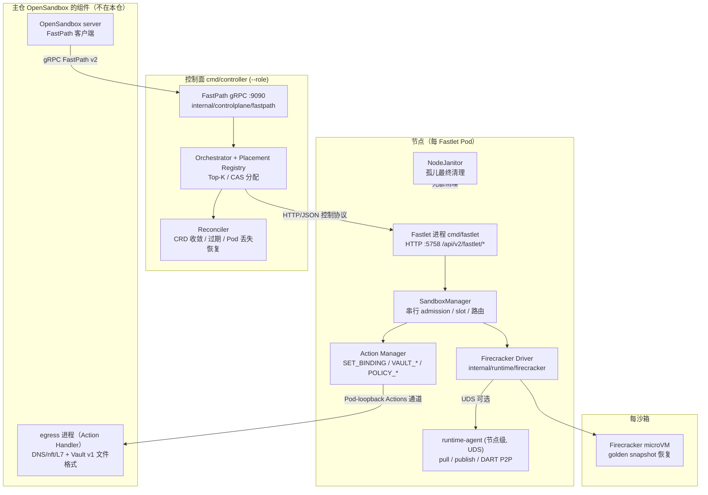

# 06 · Fast Sandbox 外仓源码深研（Round 3 线 A · 深研第 2 号，补 Round 2 断档）

> 检索日期：2026-10-27（Asia/Shanghai）｜ 源码：`opensandbox-group/fast-sandbox` 浅克隆 `--depth 50`
> **HEAD：`e0cd543`**（全哈希 `e0cd5437ae7abd686f890c32ad5370249842a7aa`，2026-10-27 16:48 +0800，当日提交）
> 版本口径：**无任何 release/tag**（gh API releases 与 tags 均为空）；主仓 OpenSandbox 以 commit pin 引用本仓（Round 2 主仓 HEAD 的提交即 "bump fast-sandbox pin to 0e20b90"）。仓库 created_at=2026-01-27、stars 54、Apache-2.0 [A]
> 对照主仓：`opensandbox-group/OpenSandbox` HEAD `dbcc6d7`（见 04 报告）。本报告所有 Fast 内部结论锚定上述两个 HEAD。
> 证据等级：A=本仓/主仓源码或官方文档直接支持；B=可靠独立来源；C=推断待验证；U=未知。性能数字一律标「官方公布，未实测」。本轮纯静态分析，未部署未运行。

---

## 0. 结论先行

1. **断档补完：Fast 运行时是一个独立的 K8s 原生平台，不是主仓的一个库。** [A] 本仓自带 FastPath 控制面（gRPC :9090）、K8s controller（CRD reconciler）、Fastlet 节点代理、Firecracker 驱动、运行时 agent（制品拉取/发布/P2P）、Janitor 与模板构建器；主仓只是它的一个客户端。660 个文件、502 个 Go 文件、217 个测试文件——规模与主仓同级。
2. **Fastlet = 跑在预热 Pod 里的节点代理进程，一 Pod 多沙箱。** [A] 它从 Pod 环境变量与挂载的 runtime plan/settings 装配（`cmd/fastlet/main.go`），对外是 HTTP/JSON 控制协议（:5758，`/api/v2/fastlet/*`，**不是 gRPC**）；真正的多沙箱隔离靠它串行化的 admission 边界 + 预备网络 slot + 每沙箱一个运行时实例。
3. **Firecracker 集成是「恢复唯一路径」**：每沙箱一个 microVM、从 golden snapshot 恢复是唯一启动方式（无冷启动直启路径），jailer 是**可选**的（配置了 `JailerPath` 才进 jailer-chroot 模式）；guest 内核烤进快照本身，不由驱动外挂。[A]
4. **快照内容寻址在本仓得到完整实现证据**：`internal/artifacts/manifest.go:WriteSHA256SUMS` 生成 SHA256SUMS、manifest 以摘要寻址、checkpoint 以 `checkpoint:sha256:<digest>` 为合成引用；恢复同节点走本地缓存（代码注释：~ms 级）否则走 agent 拉取（注释口径 ~16s/3.5GiB）——**62s 之谜在代码层只解开一半**（见 §4）。[A]
5. **Egress 的策略执行不在本仓，Vault 的文件格式也不在本仓。** [A] 本仓只做两件事：经 Sandbox Actions 通道发 `SET_BINDING`（per-subject 绑定），以及在 checkpoint 时以 StateMover 接口把 vault/policy **文件路径**交给 egress Handler 搬运（"no state bytes ever cross this process"）。执行（DNS/nft/L7）与文件格式（v1 明文）都在主仓 `components/egress`。这意味着 Fast 路径的网络/凭证安全审计对象仍然是主仓 egress，本仓是编排者。
6. **发现一处注释与代码的张力（新问题）**：本仓 `snapshot_driver.go` 注释断言模板导出的 vault 记录 "rides encrypted at rest"，但双仓 grep 不到任何加密实现——主仓 egress 侧只有 `TODO(encryption-at-rest): stored as-is` 与 "v1 is plaintext"。该断言在本轮证据下**未证实**，已列入 §9 裁定表与后续问题。[A：grep 事实；断言本身标 U]
7. **元数据/内网 deny 在本仓同样不是默认**：全仓无 169.254 硬编码；本仓文档明文把 metadata-service 限制列为部署方责任；默认命名空间策略甚至是「允许私有 CIDR 之外的路由出口」。Round 2 对主仓的结论在外仓**再次证实**。[A]

---

## 1. 仓库结构与组件

| 目录 | 职责 |
|---|---|
| `cmd/controller` | 控制面单二进制，`--role fastpath|controller|all`：FastPath gRPC (:9090) + CRD reconciler + Fastlet 心跳/放置 |
| `cmd/fastlet` | Fastlet 代理（Pod 内进程，控制口 :5758） |
| `cmd/fastlet-proxy` / `cmd/sandbox-proxy` | 数据面代理（Fastlet Proxy 作为平台 sidecar 注入；按 UID+port 解析访问描述符） |
| `cmd/firecracker-runtime` | 节点级 Firecracker runtime-agent（UDS 服务：制品 pull/publish、设备租约、DART P2P） |
| `cmd/janitor` | NodeJanitor：节点级孤儿资源最终清理 |
| `cmd/sandboxtemplate-builder` | SandboxTemplate golden image 构建（含 mitm/egress 模板处理） |
| `cmd/fsb-vm` | 宿主机侧 OverlayBD+ublk 按需加载路径（独立形态，K8s 集成不用，见 README） |
| `cmd/fastctl` | 运维 CLI |
| `api/proto/v2` | 全仓唯一 proto：FastPathService |
| `api/v1alpha2` | CRD 类型：Sandbox / SandboxPool / SandboxSnapshot / SandboxTemplate（API 版本 v1alpha2，仍 alpha） |
| `internal/controlplane/` | fastpath（server.go 1362 行：意图持久化、幂等、快照/暂停/恢复 RPC）、orchestrator（放置→Fastlet 调用、checkpoint 接线）、placement（Registry + Top-K）、reconciler（CRD 收敛、过期、恢复）、fastletcontrol、assignment |
| `internal/fastlet/` | sandbox（SandboxManager：admission、快照任务、路由生命周期）、network（slot 管理、Linux/GuestVM 驱动、DNAT/SNAT 链）、action（Action Handler 管理：binding/vault/policy 转移）、cache（镜像清单跟踪 + GC 保护索引）、infra（Infra Components 实例）、podcgroup、server（HTTP 控制面） |
| `internal/runtime/firecracker/` | 直连 Firecracker 驱动 + agent 子包（hostready 资产校验、dart P2P、publish/pull、host 状态） |
| `internal/runtime/containerd/` | container/gVisor/Kata 系列运行时驱动（经 containerd） |
| `internal/artifacts` / `internal/artifactstore` | 内容寻址 manifest/SHA256SUMS/校验 + S3 兼容制品存储 |
| `internal/janitor` / `internal/nodecleanup` | 孤儿扫描清理（containerd/OCI/网络后端）+ 残留进程清理契约（UDS） |
| `internal/guestnetwork` | guest 网关身份（MAC/网关常量） |
| `fseps/` | 本仓自己的增强提案（FSEP）目录 |



成熟度口径：无 release、以 commit pin 集成、CRD 仍是 v1alpha2 alpha、stars 54——**它是一个活跃但非常年轻的运行时**（2026-01 建仓），与主仓 1.1.x 的发布面貌不可类比。引用其能力时应带此口径。[A]

---

## 2. 协议面：两层协议，不要混

### 2.1 对外：FastPath gRPC v2（`api/proto/v2/fastpath.proto`，520 行）

`FastPathService` 共 15 个 RPC [A]：

| 组 | 方法 |
|---|---|
| 沙箱 | CreateSandbox / DeleteSandbox / UpdateSandbox / ListSandboxes / GetSandbox / GetSandboxDiagnostics / ResolveEndpoint / InvokeHandlerAction |
| 池 | GetPool / ListPools |
| 快照 | CreateSandboxSnapshot / GetSandboxSnapshot / DeleteSandboxSnapshot |
| 暂停恢复 | PauseSandbox / ResumeSandbox |

主仓 `FastSandboxService` 调用的正是这一面。关键语义（proto 注释与本仓文档互证）：Create 默认完成口径为聚合 `Ready`，可显式要 `RuntimeReady`（更早返回，未含组件/路由就绪）——**性能数字必须注明完成口径**，这与 Round 2 的口径警告同源。Pause/Resume 带 request_id 与 generation/checkpoint CAS 栅栏（`expected_checkpoint_id` 不符返回 Aborted）。[A]

### 2.2 对内：Fastlet HTTP/JSON 控制协议（`internal/fastlet/server/rpc_server.go:FastletServer.Handler`，:5758）

端点：`/create`、`/inspect`、`/delete`、`/bindings/reconcile`、`/handlers/invoke`、`/snapshots/{create,inspect,delete}`、`/heartbeat`、`/runtime-diagnostics`、`/diagnostics/sandbox`、`/draining`（前缀 `/api/v2/fastlet`），类型定义在 `internal/protocol/fastlet/types.go`（CreateSandboxRequest / CreateSnapshotRequest / Heartbeat 等）。**主仓视角的 "FastPath gRPC 客户端" 只对了一半**：控制面→Fastlet 这一跳是 HTTP/JSON，不是 gRPC。[A]

### 2.3 第三面：Sandbox Actions（`internal/protocol/action/types.go`）

Fastlet↔Pod 内 Handler 进程的 Pod-loopback HTTP 通道，操作含 `SET_BINDING` 与状态转移四件套 `VAULT_EXPORT / VAULT_IMPORT / POLICY_EXPORT / POLICY_IMPORT`。Handler 由 Pool 声明（约定名 `egress`），同一 Handler 同时服务 binding 与 vault/policy 两面。[A]

**与主仓接口对照表**

| 面 | 主仓（04 报告时所知） | 本仓实证 |
|---|---|---|
| server → Fast 平台 | gRPC FastPath v2 :9090 客户端（`fastpath_client.py`） | 服务端在本仓 `internal/controlplane/fastpath/server.go`；proto 单一源头在本仓 `api/proto/v2` |
| 平台内调度 | 文档转述（内存放置、429） | Orchestrator 本地 Registry + Top-K + 分配 CAS；Fastlet 原子 admission 兜底（§5） |
| 平台 → Fastlet | 未知 | HTTP/JSON :5758（上表） |
| 状态真相 | CR `sandbox.fast.io` LIST/WATCH 观察收敛 | CRD 类型在本仓 `api/v1alpha2`；reconciler 在本仓；主仓读的是本仓写的 CR |
| egress subject 注册 | server 经 FastPath Actions 下发 SET_BINDING | Fastlet `internal/fastlet/action/manager.go:setBinding` 执行，Handler 为 Pool 声明的 egress 进程 |
| checkpoint 发布 | S3 兼容 artifact store（文档） | 驱动 dump → 本仓 artifacts manifest/SHA256SUMS → runtime-agent `PublishImage`；存储根为 S3（`internal/artifactstore`） |

---

## 3. Fastlet 是什么

- **形态**：单个 Go 进程（`cmd/fastlet/main.go`），跑在 SandboxPool 声明的 Fastlet Pod 里，Pod 身份经环境变量注入（POD_NAME/POD_UID/POD_IP/NODE_NAME/NAMESPACE）；启动时加载挂载的 runtime plan 并校验 profile 名与哈希，**不一致直接退出**（`ErrSandboxProfileMismatch`）——配置漂移在启动期就被拒绝，不是运行时才发现。[A]
- **装配**：runtime driver（经 `runtimefactory` 按 profile 创建，默认 `container`，可为 firecracker/gvisor/kata-*）、网络管理器、Action Manager（并 `SetVaultHandler(VaultHandlerFromEnv())`，默认 handler 名 `egress`）、镜像 cache tracker、Infra Component 管理器；Firecracker 驱动可再接节点 runtime-agent UDS（无 socket 则本地模式：不做远程 pull）。[A]
- **一 Pod 多沙箱的正确性来源**：`internal/fastlet/sandbox` 的 SandboxManager 把容量与身份迁移串行化为单一 admission 边界——slot 在 creating/running/deleting/失败清理期间都保持占用，只有 runtime、网络、Infra、路由四者皆证明消失才释放。陈旧的控制面 Registry 因此不可能突破 `maxSandboxesPerPod`（`docs/concepts/scheduling-and-capacity.md` + 代码结构互证）。[A]
- **每沙箱身份**：不可变实例身份 = sandbox UID + instance generation + route generation；恢复/重建推进 generation，旧凭证与旧回调对新 generation 无效（`docs/concepts/sandbox-lifecycle.md`）。[A]

---

## 4. Firecracker 集成层与快照恢复

### 4.1 启 VM（`internal/runtime/firecracker/driver.go`，包自述 `doc.go`）

- **每沙箱一 VM、恢复唯一路径**：`doc.go` 原文——"one microVM restored from a golden snapshot per Sandbox create request (restore is the only startup path; an instance checkpoint resume shares the same machinery)"。Create 与 Resume 在驱动层是同一条恢复机器。[A]
- **jailer：可选**。`launchVM`（driver.go:1066）：仅当 `config.JailerPath != ""` 才设置 `plan.JailerPath/ChrootBase/NetNSPath`，以 jailer（`--netns <slot netns> --chroot-base-dir`）拉起 Firecracker 并 chroot；未配置则直接以子进程启动。资产侧 `agent/hostready/assets.go` 负责把 {firecracker, jailer} 二进制按版本（如 v1.16.1）下载校验到节点资产目录，但"资产存在"不等于"每次启动必经 jailer"。**引用时禁止写"OpenSandbox Fast 路径必经 jailer"**。[A]
- **guest kernel/rootfs 来源**：内核烤进快照（`internal/catalog/runtime/builtin.go:83` 注释 "snapshots bake their own kernel"，`KernelPath` 留空；仅 direct-boot 运维场景可钉死外挂内核路径并被能力探测校验）；rootfs 来自内容寻址缓存、按实例 reflink 克隆（XFS 前提与主仓文档一致）。[A]
- **网络零命令热路径**：slot 预备好 Pod 侧 IP 与 guest tap（GuestVMNetNSDriver），create 时不执行任何 ip/iptables 命令；恢复时仅以一次 `iptables-restore --noflush` 批量替换该 slot 的 `FSB_GUEST_DNAT/SNAT` 链（`docs/concepts/networking.md`）。被恢复克隆共享快照里烤死的静态 guest 地址，靠 per-slot DNAT 区分。[A]
- **机器规格**：`resolveMachineConfig`（driver.go:1294）把 SandboxSpec 的 cpu/memory 换算为 vCPU 数（向上取整）/内存 MiB，缺省取 profile 默认（内存缺省回退 512MiB）；规格源头是 Pool 的不可变 `SandboxResourceProfile`（见 §6）。[A]
- **幂等锚点**：`StateRoot/sandboxes/<id>/meta.json` 锚定幂等 create/delete 与 Fastlet 重启恢复；残留进程身份契约 = 二进制名 `firecracker` + `--id`，供 NodeJanitor 对账（driver.go 的 `ensureResidualProcessAbsent` / nodecleanup 客户端）。[A]

### 4.2 快照的组成、生成与校验

- **生成**（`snapshot_driver.go`，`Driver` 的快照路径）：容量门先行（dump 落不下先触发镜像 cache GC 自愈）→ dump 运行中沙箱（pause API → dump API → resume API，失败路径上 VM 被恢复运行）→ 按 kind 分流暂存 egress 状态文件（checkpoint：subject 封存态导出，失败即 checkpoint 失败；模板：seal-free 逐字复制，见 §5）→ `assembleSnapshotManifest` 组装清单 → 经 runtime-agent `PublishImage` 发布（OCI 快照走 `publishOCISnapshot`）。快照类型在 Firecracker API 层只有 `Full`（`client.go:61`），**无 Diff/UFFD 懒加载配置命中**。[A]
- **组成与寻址**（`internal/artifacts/manifest.go`）：artifact set = rootfs + vmstate + memory + `SHA256SUMS` + manifest（每文件一条 sparse-aware sha256 与逻辑大小）；`WriteSHA256SUMS`（manifest.go:242）以清单计算时已 memoize 的校验和写出 `"<sha256>  <相对路径>"` 行；集合摘要即内容地址，checkpoint 合成引用为 `checkpoint:sha256:<digest>`（manifest.go:291），实例私有、不可被当作 CreateSandbox 镜像寻址。[A]
- **恢复路径**（driver `EnsureSandbox` 状态机 + `agent/pull.go:PullImage/PullCheckpoint`）：同节点且 checkpoint 仍在本地镜像缓存 → 本地恢复；否则经 runtime-agent 从制品存储拉全集（DART P2P 减少回源，`agent/dart/`）。发布时 checkpoint 集合被 best-effort 提交进节点本地缓存正是为此（snapshot_driver.go 注释）。[A]

### 4.3 35ms vs 62s：代码能证明的程度

主仓官方实测：运行时恢复 ~35.49ms、SDK resume ~62.66s，官方自标未解。本仓代码给出的**构成线索**（均为 A 级代码/文档事实，但**没有任何一处能把 62s 逐项拆账**）：

| 环节 | 代码证据 | 量级口径 |
|---|---|---|
| VM 本体恢复（本地缓存命中） | snapshot_driver.go 注释：同节点 resume 本地恢复 "~ms"，对比全集拉取 "~16s per 3.5GiB" | ms–16s，取决于缓存命中与节点 |
| 跨节点首次恢复 | 指南原文："The first restore on a node pulls the artifact set from the store (seconds to minutes for multi-GiB sets)" | 秒–分钟 |
| 路由代际推进 | resume 推进 route generation，旧端点/凭证全部失效，客户端必须重新 `ResolveEndpoint`（lifecycle 文档 + 指南的 integration obligations） | 客户端轮询/重解析成本 |
| 数据面就绪前置 | 恢复时 vault/policy import 必须在 data-plane ready 之前完成（`cmd/fastlet/main.go` 装配注释）；binding 经 SET_BINDING replay 重建 | 串行前置步 |
| 状态投影 | 主仓 server 靠 CR LIST/WATCH 观察收敛、SDK 靠轮询 GetSandbox 至 READY | 轮询间隔级 |

**裁定：62s 的主因不在 VM 恢复本身，这一点代码层已可证（恢复机器与 create 共用且本地命中为 ms 级）；但 62s 的精确归因（哪一环吃了多少）在双仓代码里都找不到计量拆分，维持未证实。** 后续只能靠按 D 线口径（t_submit/t_ack/t_ready + 分段探针）在自建环境实测拆账。[A 构成 / U 归因]

---

## 5. Egress 与 Vault（跨仓最终形态）

### 5.1 Egress：本仓是编排者，主仓 egress 是执行者

- **subject 区分**：Fastlet 的 Action Manager（`internal/fastlet/action/manager.go:setBinding`）在沙箱准入时经 Sandbox Actions 通道向 Pool 声明的 Handler 发 `SET_BINDING`，绑定带 sandbox 身份与 fence/generation，陈旧绑定被栅栏拒绝；主仓 04 报告所述 "deny-first、data-plane-ready 才放行" 的执行点在 Handler（主仓 egress 进程）一侧。[A]
- **DNS/nft/L7 在哪一层**：全部在主仓 `components/egress`（Layer 1 DNS 代理 / Layer 2 dns+nft / mitmproxy 注入），本仓无 DNS 代理、无 nft 规则代码（本仓 network 包只做 slot/veth/tap/DNAT/SNAT 与 MASQUERADE 出口）。把 Fast 路径的 egress 能力记到本仓头上是错的。[A]
- **本仓自带的网络面**（不要与 egress 策略混淆）：每沙箱私有 netns + veth + 桥 + 私有 IP + per-slot 解析状态；节点出口一条幂等 MASQUERADE；默认命名空间策略 = 允许私有网关、拒绝直连兄弟沙箱私有地址、**允许向私有 CIDR 之外路由出口**（`docs/concepts/networking.md`）。即本仓层面的默认是"私网隔离 + 出口放行"，收紧出口是 egress Handler 与部署方的事。[A]

### 5.2 Vault：文件由 egress 持有，本仓只搬路径

- **契约**：`internal/runtime/contract/state.go` 定义 `StateMover` 与 `StateKindVault="vault"` / `StateKindPolicy`；驱动在 checkpoint 时调用 `ExportState/ImportState`，Fastlet Action Manager 转成 `VAULT_EXPORT/IMPORT`、`POLICY_EXPORT/IMPORT` 发给 Handler（`internal/fastlet/action/vault_transfer.go`）。信封只带 bundle 文件**路径**——"no state bytes ever cross this process"（原文），文件内容的读写由 Handler 用自己的提交协议完成；信封带当前 fence，过期调用被拒。[A]
- **格式与来源（跨仓确认）**：文件本体（每 subject 一个 `<uid>.json`，即 vault.json）在主仓 egress：`components/egress/fastsandbox_vault_persist.go`——v1 明文（注释原文 "v1 is plaintext"，目录 0700），密钥（真实凭证值）由可信控制面经主仓 server 的 vault API 写入 egress 内存 Store 后落该文件；生命周期 = 随 egress 进程/卷存续，pause 时导出进 checkpoint bundle、resume 时导入并按新 fence 重盖戳，导入失败则该 subject 的 vault 降级为 fail-closed 可观测状态（不是静默丢弃）。[A]
- **encryption-at-rest 现状（双仓定案）**：主仓 egress 两处 `TODO(encryption-at-rest)`（vault 与 policy persist）+ 本仓 0 处同名 TODO；双仓 grep `encrypt` 的实质命中只有本仓 snapshot_driver.go 一处**注释断言**（模板导出时 "The vault record rides encrypted at rest; key scoping is the clone-isolation boundary"）。**没有任何加密实现代码与之对应**；且主仓 TODO 的设计注记说得很清楚：将来加密也只防 store 侧读者，克隆隔离靠 key scoping。结论：截至双仓当前 HEAD，Fast 路径 vault 文件为明文 v1 + TODO 未落地；本仓那句注释应视为设计意图陈述，不得引用为已实现事实。[A：grep 与原文；断言标 U]

---

## 6. 池化、资源治理与回收

- **Warm Pool 模型**：`SandboxPool`（`api/v1alpha2/sandboxpool_types.go:189 SandboxPoolSpec`）固定五件事：Capacity（min/max/buffer）、`MaxSandboxesPerPod`、Runtime（不可变 profile）、`SandboxResources`（每沙箱 cpu/memory/**pids** 不可变 profile——顺带补上主仓 Q：Fast 路径的 PID 基线在 Pool profile 层，不是未定义）、WarmImages（异步预拉、GC 保护、Fastlet Ready 不等预拉完成）、Infra Components 编译修订。Pool controller 维持 Fastlet 数量与缓冲，缩容/换版走持久化 drain 而非随机删 Pod。[A]
- **放置**：每 FastPath/Controller 副本各自维护本地 Registry（K8s watch + 低频抖动心跳 + 本地尝试反馈），最终一致、无全局锁；Orchestrator 过滤（Pool/就绪/profile/Infra 修订/心跳新鲜度）→ 要求本地可见可用 slot > 0 → 按镜像 cache 亲和与负载 Top-K；候选非预留，单请求最多 32 次 Fastlet 尝试，换候选必须先证明上一候选零副作用且走分配 CAS。[A]
- **资源下发**：Pool profile → Fastlet 准入 → 驱动：Firecracker 走 `resolveMachineConfig`（§4.1）；containerd 系运行时在 Fastlet Pod cgroup 下建每沙箱 OCI cgroup；Pod 级父 cgroup 兜底聚合上限（超卖只能由运维显式调低 Pod limit 开启，`scheduling-and-capacity.md`）。execd 侧 cgroup 观测在主仓。[A]
- **超时/过期**：Sandbox CR 的 `expireTime` 由 reconciler 执行（`internal/controlplane/reconciler/sandbox_controller.go:402`：过期即终结，checkpoint 血统一并丢弃）；命令级超时仍是主仓 execd 的层级，与本仓无关。[A]
- **并发上限**：硬上限 = Pool 的 maxSandboxesPerPod × Fastlet 数，Fastlet admission 串行兜底；超容量在 FastPath 层回容量错误（主仓映射为 429 的源头在本仓 placement/admission）。[A]
- **回收**：删除要等 runtime/网络/Infra/路由四者皆无才释放 slot；Fastlet Pod 丢失 = 其上活实例全灭，自动重建是新 generation（README 明示，无 live migration）；节点级残留由 NodeJanitor（`internal/janitor` 多后端扫描 + `internal/nodecleanup` 进程契约）做最终清理。[A]

---

## 7. 元数据 / 内网 deny 复核（Q29 的静态部分）

- 全仓 grep `169.254`：业务代码 0 命中（仅 protobuf 生成的 Metadata 字段名）。[A]
- 本仓文档 `docs/concepts/networking.md` 的 Egress 节明文："Deployment owners remain responsible for cluster NetworkPolicy, DNS, registry, **metadata-service**, and tenant-specific egress restrictions."，且 Security boundary 节自述私有网络 "is not a complete tenant firewall by itself"。[A]
- 默认命名空间策略允许私有 CIDR 之外的路由出口（§5.1）——即在本仓层面，沙箱访问云元数据地址没有任何内建阻断，阻断只能来自主仓 egress 的 deny 策略/平台 overlay 或部署方 NetworkPolicy。[A]
- **裁定：Round 2 "元数据阻断不是产品默认" 的结论在外仓复核后维持，且证据从"主仓 grep 无命中"升级为"双仓 grep 无命中 + 外仓文档明文归责部署方"。** Q29 的剩余部分（配方在真实部署中是否完整生效、有无绕过面）仍需实验室实测，非静态分析可答。[A]

---

## 8. 与主仓的时序：Fast 创建 / 恢复

```mermaid
sequenceDiagram
    participant S as OpenSandbox server (主仓)
    participant FP as FastPath (本仓 controller)
    participant OR as Orchestrator/Registry
    participant FL as Fastlet (HTTP :5758)
    participant DR as Firecracker Driver
    participant AG as runtime-agent (UDS)
    participant EG as egress Handler (主仓组件)
    participant VM as microVM
    S->>FP: gRPC CreateSandbox (templateId, completion=Ready)
    FP->>FP: 持久化意图 (Sandbox CR) + 幂等登记
    FP->>OR: Top-K 放置 (cache 亲和/负载) + 分配 CAS
    OR->>FL: POST /api/v2/fastlet/create
    FL->>FL: admission 串行边界: 占 slot (预备 netns/tap)
    FL->>DR: EnsureSandbox (checkpoint/golden 引用)
    DR->>AG: PullImage (本地缓存命中则跳过)
    AG-->>DR: artifact set (rootfs/vmstate/memory, 摘要校验)
    DR->>DR: reflink 克隆 rootfs + jailer(可选) 拉起 FC + LoadSnapshot(Full)
    DR->>VM: Resume VM (烤入的 guest 身份 + per-slot DNAT)
    FL->>EG: SET_BINDING (subject+fence) → deny-first 待就绪
    FL-->>OR: RuntimeReady
    OR-->>FP: 聚合 Ready (含组件/路由)
    FP-->>S: CreateSandboxResponse
    Note over S,VM: Resume = 同路径: ResumeSandbox 翻 desired state → 选 recorded checkpoint → 同一恢复机器; 差别在 checkpoint 来源 (一次性消费) 与 route generation 推进后客户端必须重解析端点
```

---

## 9. Round 2 遗留 Fast 结论 · 最终裁定

统计口径：以 04 报告 §10 的 12 条复核表 + §3/§14 的 Fast 未清项为基数，涉及 Fast 内部实现的共 **8 项**。结果：**证实 5 / 修正 1 / 仍未证实 2 / 证伪 0**。

| # | Round 2 遗留结论（原文要点） | 最终裁定 | 本轮证据 |
|---|---|---|---|
| F1 | Fast = Firecracker microVM（当时仅证到集成层，运行时标 U） | **证实（升级为源码级）** | 本仓 driver 包自述 + EnsureSandbox/launchVM 实现：每沙箱一 VM、恢复唯一路径 [A] |
| F2 | egress 是每 Fastlet 一个共享进程、per-subject 策略（修正项） | **证实（带机制细化）** | 共享的是 Pool 声明的 **Action Handler 进程**（主仓 egress 二进制），Fastlet 经 Actions 通道发 SET_BINDING 区分 subject；进程本体不在本仓 [A] |
| F3 | Vault Fast 路径多一份明文 v1 文件、「只活内存」不成立（修正项） | **证实** | 本仓 StateMover/vault_transfer 只搬路径；主仓 persist 原文 v1 plaintext + TODO 未落地；本仓 0 处 encryption TODO [A] |
| F4 | 两套 checkpoint 互不共享（Fast 内容寻址 artifact） | **证实** | 本仓 manifest/SHA256SUMS/CheckpointReference 全实现；与主仓 operator 的 OCI commit 路径无代码共享 [A] |
| F5 | 元数据阻断不是默认（主仓 grep 无命中） | **证实（证据升级）** | 双仓 grep 无命中 + 本仓文档明文归责部署方 + 默认策略允许 CIDR 外出口 [A] |
| F6 | Fast Janitor 扫孤儿（当时本仓仅文档述及，标 A/B） | **证实** | 本仓 `cmd/janitor` + `internal/janitor`（containerd/OCI/网络多后端扫描清理）+ nodecleanup 残留进程契约 [A] |
| F7 | 64ms 创建 / 35ms 恢复的运行时数字 | **修正（口径再收紧）** | README 本仓口径：暖池串行 SDK create p50 77.9ms（2026-10-08 ACK，与主仓文档的 64.0ms 是不同样本集/口径，**两数并存且不可互换引用**）；35ms 级恢复只在本地缓存命中时成立，跨节点为秒–分钟 [A：官方公布，未实测] |
| F8 | SDK resume ≈62s 的差距归因（官方自标未解） | **仍未证实** | 代码只给出构成线索（§4.3 表）：缓存未命中拉取、route 重解析、状态投影与轮询、vault/policy import 前置；无任何分段计量能拆出 62s [U] |
| F9 | （新增）模板 vault 记录 "rides encrypted at rest"（本仓 snapshot_driver 注释） | **仍未证实（与代码现状冲突）** | 双仓无加密实现命中；主仓 TODO 明示 stored as-is。按设计意图处理，不得作事实引用 [U] |

（F9 为本轮新发现的待裁项，不计入上述 8 项基数时口径为：证实 5 / 修正 1 / 仍未证实 1（F8）/ 证伪 0；含 F9 则未证实为 2。回报口径以 8 项基数 + F9 单列为准。）

---

## 10. 定量与成熟度

- TODO/FIXME（排除测试/生成代码/pb）：全仓 **3 处**——`internal/runtime/containerd/driver.go` 2 处 FIXME（containerd 瞬时失败被吞为 terminated/stopped，可能误报终态，值得记名）、docs 指南 1 处。本仓 **没有** encryption-at-rest TODO（全在主仓 egress，3 处）。[A]
- 测试文件 217 个（Go `*_test.go`），含 driver/agent 的 e2e 命名测试文件（需真实 KVM 环境，本轮未跑）。[A]
- 已知形态限制（README 自述）：Fastlet Pod 丢失即其上实例全灭、无 live migration、持久化存储不在范围内；OverlayBD 按需加载只在宿主机侧 `fsb-vm` 路径，K8s 集成走全缓存原生制品。[A]

## 11. 源码阅读地图（本仓）

1. **先契约**：`api/proto/v2/fastpath.proto`（对外面）→ `api/v1alpha2/sandboxpool_types.go` / `sandbox_types.go`（池与沙箱的不可变面）→ `docs/concepts/architecture.md` / `sandbox-lifecycle.md`（generation 语义）。
2. **控制面**：`internal/controlplane/fastpath/server.go`（意图/幂等/CAS）→ `orchestrator/orchestrator.go` + `checkpoint.go`（checkpoint 如何复用快照传输）→ `placement/registry.go`（Registry 输入与 Top-K）→ `reconciler/sandbox_controller.go`（过期与收敛）。
3. **Fastlet 主干**：`cmd/fastlet/main.go`（装配与启动校验）→ `internal/fastlet/server/rpc_server.go`（协议面）→ `internal/fastlet/sandbox/`（SandboxManager admission、snapshot.go 任务机、route_lifecycle.go）。
4. **网络**：`internal/fastlet/network/`（manager / linux_driver / guest_vm_linux_driver：slot 三态与 DNAT/SNAT 批处理）→ `docs/concepts/networking.md`。
5. **Firecracker**：`internal/runtime/firecracker/doc.go`（包自述先读）→ `driver.go`（EnsureSandbox 状态机、launchVM、resolveMachineConfig）→ `snapshot_driver.go`（dump/暂存/发布全程）→ `agent/`（pull/publish/dart、hostready 资产）。
6. **制品**：`internal/artifacts/manifest.go`（FileEntry/WriteSHA256SUMS/CheckpointReference）→ `internal/artifactstore/`。
7. **状态转移与 Handler**：`internal/protocol/action/types.go` → `internal/fastlet/action/manager.go` / `vault_transfer.go` → 然后**换回主仓** `components/egress` 读执行面与 vault 格式（跨仓阅读点）。
8. **兜底**：`internal/janitor/` + `internal/nodecleanup/`（孤儿与残留进程契约）。

## 12. 未清项与下一步

- 62s resume 的分段归因（F8）：只能实测拆账，列入实验室阶段（自建 Kind/ACK 同构环境 + 分段探针）。
- vault 静态加密（F9/Q30）：跟踪上游是否落地 encryption-at-rest 或删除/修正该注释断言；本地部署缓解（Memory 卷等）在主仓 chart 侧核查（Q30 原项）。
- Q29 剩余：deny.always 配方在真实部署的生效与绕过面，需实测（与实验室 C8 矩阵合并）。
- fsb-vm/OverlayBD 按需加载路径未深读（独立形态，与 K8s 集成无关，优先级低）。
- 本仓无 release、主仓以 commit pin 集成：双仓 HEAD 漂移速率都很快（均为当日提交），引用本报告结论前应复核 pin 关系是否已变。

---
*产出：files/06-FAST-SANDBOX-DEEP-DIVE.md ｜ 过程日志：hidden_files/research/round3-A-fast-log.md ｜ 源码克隆：hidden_files/research/fast-sandbox-src（HEAD e0cd543）｜ products.csv 未改动*
