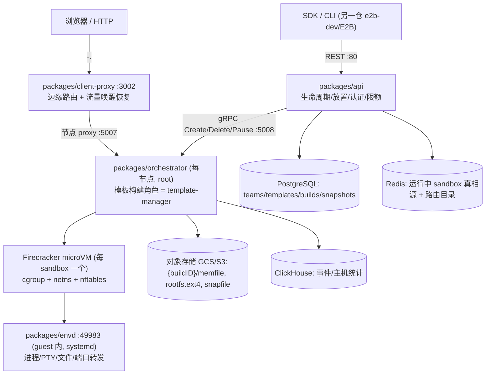
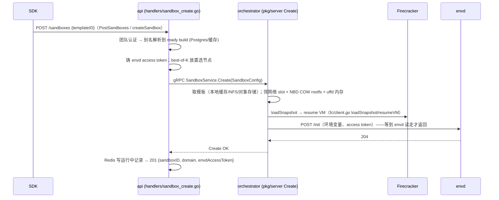

# 07 · E2B runtime 源码深研（Round 3 线 B · 深研第 2 号）

> 仓库：`github.com/e2b-dev/runtime`（原名 `e2b-dev/infra`，已更名）｜ 分析基线 HEAD：`92b83da`（2026-10-27 当日提交）
> 方法：**纯静态源码分析**。未调用 E2B 云 API、未创建/连接任何 sandbox、未部署、未实测。性能数字一律标「官方公布，未实测」。
> 证据等级：A 官方文档/源码直接 · B 可靠独立或官方自述但缺完整一手验证 · C 推断 · U 未知
> 核心问题：OPEN-QUESTIONS 第 1 问（Q1）——自托管（Embed/开源 runtime）与 E2B Cloud 的隔离实现与版本是否一致？结论在 §8。

## 0. 结论先行

1. **链路属实且比 Round 1 更完整**：`SDK/CLI ─REST→ API ─gRPC→ orchestrator ─▶ Firecracker microVM ─▶ envd` 在源码与官方架构文档中逐环对应；且控制面/数据面严格分离，沙箱流量永不经过 API（经 client-proxy→节点 proxy→envd）。[A]
2. **"创建 sandbox"本质是"恢复快照"**：模板 = 预启动 VM 的内存+磁盘+机器状态快照，存对象存储；创建 = 恢复（userfaultfd 懒加载内存页 + NBD COW 根文件系统），暂停/恢复/fork 走同一条路径，模板与暂停快照是同一种 artifact 形态（diff 链）。[A]
3. **隔离 = Firecracker + 每沙箱 cgroup + 独立 netns + nftables 出口防火墙**；但**不用 Firecracker jailer**（运行时代码 grep 无命中），FC 进程由以 root 运行的 orchestrator 直接拉起，收敛靠 cgroup/netns/插座文件路径而非 jailer 的 chroot+降权——这是与教科书 Firecracker 部署的实质差异，写隔离结论时必须带上。[A]
4. **Q1 的核心答案：同源同隔离、不同运营层**。官方明示同一套代码服务 Cloud / 企业专属部署 / Embed（README），隔离实现（FC 快照恢复、envd、出口防火墙、元数据默认拒绝）都在开源仓内可审计；但**计费与租户运营层不在本仓**：团队限额由"owning management service"经投影推入（本仓只读消费），secrets 的值解析在仓外的 secrets-store 后端与 `orchestrator-ee`，webhooks 后端亦为外部 gRPC 服务——这些后端未配置时对应路由在本仓实现里直接答 403/503。详见 §8。[A]
5. **版本节奏：本仓是内部 monorepo 的 copybara 只读镜像**（`docs/RELEASING.md` 明示源码真相在内部仓、发布也在内部仓切），Go module 路径至今仍是 `github.com/e2b-dev/infra`。组件按包 SemVer 协同发布、envd 独立版本（当前 0.10.2，模板内 envd 版本是 API/orchestrator 的特性门控依据）；**Embed 以平台版本发布、在平台 tag 之后跟进**（embed REFERENCE 原文），即自托管版本节奏 = 平台版本、带一个发布先后差。GitHub 侧另有日历版本 Release（最新 2026.30，2026-09-10），与 RELEASING 的说法存在张力，见 §8.3。[A/B]

## 1. 仓库结构地图

顶层：`packages/`（全部 Go 服务）、`spec/`（OpenAPI 四份：public/edge/dashboard/hyperloop，codegen 源头）、`embed/`（单机全栈分发：compose/terraform/{gcp,aws,azure}/kubernetes）、`firecracker/`（**自建** Firecracker 与 guest 内核：fc-versions 需 `FIRECRACKER_REPO_TOKEN` 克隆上游源码打补丁构建、fc-kernels 含 configs/patches）、`tests/integration/`（对真实部署的集成测试）、`docs/`（ARCHITECTURE.md 1296 行 + RELEASING.md）。

| 服务 | 包 | 位置 | 职责（一手） |
|---|---|---|---|
| API | `packages/api` | 控制面节点池 | 公开 REST：sandbox 生命周期、放置、认证、限额（ARCHITECTURE 表） |
| Orchestrator | `packages/orchestrator` | 每沙箱节点（root） | 跑 FC VM：create/pause/resume/kill/checkpoint；同二进制以 template-manager 角色跑构建节点 |
| Client proxy | `packages/client-proxy` | 控制面 | 边缘路由：sandbox URL→节点；暂停中则调 API `ResumeSandbox` 透明唤醒 |
| Envd | `packages/envd` | 每 VM 内 | SDK 实际调用的进程/文件/端口 API；可在线热升级 |
| Dashboard API | `packages/dashboard-api` | 控制面 | Web Dashboard 后端（模板/构建/管理） |
| 支撑 | `packages/{shared,auth,db,clickhouse,otel-collector,nomad-nodepool-apm,local-dev}` | — | proto/遥测/存储客户端/特性开关；认证库；PG 迁移+sqlc；CH 模式；Nomad 自动扩缩插件 |

## 2. 核心调用链（源码级）

### 2.1 创建（=恢复模板快照）

要点：API 同步阻塞到 envd `/init` 完成，客户端拿到响应即完全可用[A]。放置算法在 `packages/api/internal/orchestrator/placement/placement_best_of_K.go`（`BestOfKConfig`）：抽 K 个就绪节点、按 CPU 负载与 hugepage 池负载取高者打分、选最低；节点发现走 `packages/shared/pkg/servicediscovery`（K8s/DNS/静态列表/Nomad 遗留后端）[A]。创建带可选幂等（请求指纹+预留+响应重放，ARCHITECTURE 专节）[A]。

### 2.2 执行

SDK 不经 API，直接连 envd（经 client-proxy→orchestrator `pkg/proxy` :5007→slot IP）：envd 的 Process service（`packages/envd/spec/process/process.proto`：start/list/connect、stdout/stderr 流、stdin、信号、PTY）与 Filesystem service（`spec/filesystem/filesystem.proto`：stat/list/make/move/remove/watch），REST 面有 `/files` 上传下载、`/envs`、`/health`、`/metrics`[A]。envd 的控制路由（`/init`、`/upgrade`、freeze/thaw）标 `x-internal: true`，节点 proxy 对其一律 404，防经 sandbox URL 从公网触达[A]。

### 2.3 销毁与回收

API Delete → gRPC Delete → 节点拆除 VM、释放网络 slot、关路由记录；超时由 API 侧到期清扫（evictor）执行 auto-pause 或 kill；节点关机走 Draining→排空 sandbox 与未完成快照上传后才退出[A]。

## 3. 数据面深挖（orchestrator → Firecracker → envd）

- **FC 进程管理**：`packages/orchestrator/pkg/sandbox/fc/process.go`（`Process.Create/Resume/Pause/Stop`）+ `client.go`（`loadSnapshot`、`setMachineConfig`、`setRootfsDrive`、`setNetworkInterface`、`setEntropyDevice`、`createSnapshot` 等逐项调 FC HTTP API/Unix socket）[A]。FC 与内核均为 E2B 自建版本（`firecracker/` 目录），不是发行版二进制[A]。
- **不用 jailer**：全仓 `jailer` 仅出现在 `packages/orchestrator/cmd/resume-build/gdb.go` 调试语境；隔离收敛 = 每 sandbox 独立 cgroup（`pkg/sandbox/cgroup/manager.go`）+ 独立 netns + 对象文件按 sandbox 目录存放。orchestrator 本身以 root 运行——宿主侧信任边界因此比"jailer 降权"模型更依赖 orchestrator 自身代码质量，这是本深研最重要的边界修正。[A]
- **vCPU 超配收敛**：VM 可按 `max_vcpus` 建、guest 以 `maxcpus=<vcpu>` 启动，`fc_vcpu` 线程被 threaded 子 cgroup 的 `cpu.max` 配额限住，快照元数据记录 `vcpu_count` 供恢复时复算（`fc/process.go: limitVcpusBeforeResume`）[A]。
- **内存**：恢复时不加载内存，`pkg/sandbox/uffd/` 的 userfaultfd 处理器直接从模板 memfile 供页；可选 prefetcher 预热热页；balloon（含 free-page hinting/reporting）在 `fc/client.go: installBalloon` 一带[A]。
- **磁盘**：模板 rootfs 只读，每 sandbox 写层是进程内用户态 NBD 服务暴露的 COW cache（`pkg/sandbox/{rootfs,nbd,block}`）；暂停时导出脏块为 diff[A]。
- **envd**：systemd 早期启动，端口 49983，chi+Connect RPC；认证 `X-Access-Token` 与 MMDS 下发的 token 哈希比对，文件端点另有签名 URL[A]。**在线热升级**：orchestrator 在 resume 时经 `POST /upgrade` 流入新二进制，envd 以同一 PID `syscall.Exec` 自替换，进程表/PTY fd/文件 watcher 经 tmpfs handover blob 交接（`packages/envd/internal/services/process/upgrade.go`、`spec/upgrade/handover.proto`）[A]。

## 4. 模板系统

- 构建：SDK/API 注册 build（`POST /v3/templates` + `/v2/templates/{id}/builds/{buildID}` 提交配方）→ API gRPC `TemplateCreate` 到 template-manager → 拉镜像 → 注入 envd/provisioning → 抽 ext4 rootfs → 在真实 FC VM 中分阶段执行（provision→用户 steps）→ finalize→optimize[A]。
- 分层：`packages/orchestrator/pkg/template/build/phases/`（base/user/steps/resize/finalize/optimize），每层哈希缓存，只重跑变更步；optimize 阶段记录一次恢复实际触达的内存页，生成 prefetch 提示[A]。
- 存储与版本：产物按 buildID 存对象存储 `{buildID}/{memfile, rootfs.ext4, snapfile, metadata.json}` + `.header` 索引；构建行（vcpu/ram/状态/版本）落 Postgres `env_builds`；模板可为 filesystem-only（无 memfile，冷启动）[A]。V1 模板构建端点已移除（官方 changelog，SDK/CLI 2.x）[A]。

## 5. 暂停 / 恢复 / 快照

- **Pause**：API 先落 Postgres 快照行，再 gRPC Pause；节点暂停 VM，用脏页跟踪 diff 内存、COW cache diff rootfs，本地缓存并异步上传对象存储（带重试预算）；暂停有单 sandbox 速率限制（Redis GCRA）与磁盘准入检查（后者在 Embed 由环境变量打开）[A]。
- **Resume**：与创建同路，放置优先原节点（命中本地缓存则零对象存储读）；流量唤醒由 client-proxy 的 resume flight 合并并发请求（单进程上限、90s 上限，细节在 ARCHITECTURE）[A]。`Checkpoint` = 原地 pause+resume 持久化且保持运行；**Fork** = 对运行中 sandbox 做 checkpoint 后以新 sandbox 启动，单请求上限 100（`packages/api/internal/handlers/sandbox_fork.go: maxForkCount = 100`）[A]。
- **快照中的密钥/熵**：envd access token 经 MMDS 注入（`fc/mmds.go: MmdsMetadata` 只含 sandbox ID 与 token 哈希类元数据）；FC 侧配置了 entropy device（virtio-rng，`fc/client.go: setEntropyDevice`，1KB/100ms 补充）供 guest 取宿主熵。**但全仓 grep不到 VMGenID/快照克隆通知处理**：从同一快照恢复的多个 guest，其启动时随机状态如何彼此区分，本仓代码未见专门机制——标 **U（未找到）**，是 MicroVM 路线在本实现上的一个待实验问题（与 Round 1 线 C 的快照熵缺口同源）。[A（entropy device）/ U（克隆区分）]
- 官方口径警告：仓库内未出现"150ms"类启动数字；README 只说 "boots from a snapshot / almost instantly"。任何具体毫秒数均为官方营销口径（官方公布，未实测），不在源码证据内。[A]

## 6. 网络

- **槽模型**：`pkg/sandbox/network/` 每 sandbox 一个 slot = netns + veth + tap + /16 内唯一宿主侧 IP + NAT + 每 slot nftables 出口防火墙；slot 池化复用，启动时回收残留 netns[A]。
- **出口策略**：流量经 `pkg/tcpfirewall`（orchestrator `main.go: defaultEgressFactory` 装配）：按目标端口分流——80 看 Host、443 看 SNI、其他只查 CIDR；`handlers.go: isEgressAllowed` 按 sandbox 的 `SandboxNetworkEgressConfig`（allowedDomains/allowedCidrs）判定。入站经共享 ingress 策略校验每 sandbox 的 traffic access token[A]。
- **元数据与内网：默认拒绝（这次是默认，不是配方）**：`packages/shared/pkg/sandbox-network/firewall.go: DeniedSandboxCIDRs` 硬编码拒绝全部 RFC1918、CGNAT、loopback 与 **169.254.0.0/16（注释明写 incl. cloud metadata 169.254.169.254）** 及 IPv6 本地段，排在放行规则之前。运维可用 `ALLOW_SANDBOX_INTERNAL_CIDRS` 显式豁免（节点级、对所有 sandbox 生效，代码注释警告宽前缀会连带打开云元数据端点）[A]。——与 OpenSandbox "元数据阻断靠运维 deny overlay 配方"形成对照，见 §12。
- **guest 内 MMDS 防伪造**：envd 在 guest 内 pin 住 169.254.169.254:80 的路由 RETURN 规则（`packages/envd/internal/host/mmds_route_linux.go: PinMMDSRoute`），防沙箱内进程在同 netns 冒充 MMDS 地址抢 envd 的元数据通道[A]。
- **DNS**：共享防火墙文件含 DNS 解析逻辑（miekg/dns），默认 nameserver 8.8.8.8（`firewall.go: DefaultNameserver`）；域名放行以解析结果落规则，DNS rebinding 的完整防护口径未做专项追踪，标 C 待实验。

## 7. 资源治理与凭证

- **配额下发**：CPU/内存来自模板 build 行与 `SandboxConfig`（vcpu/ram_mb 落 Postgres `env_builds`）；节点侧 `InfoService.max_sandboxes` 为节点并发上限（节点级 flag 每 30s 刷新，准入/指标/节点信息共用）[A]。
- **团队限额**：并发数、最大时长（`MaxLengthHours`，`packages/api/internal/handlers/team_limits.go` 与 sandbox_connect 的 `validateAndParseTimeoutWithDefault(..., teamInfo.Limits.MaxLengthHours, ...)`）、API 分组速率（Redis 令牌桶，list/delete 分组，429+Retry-After）都在 API 层执行；限额值来自 Postgres `project_limits`（**由 owning management service 推入的投影**）或部署级 `default_limits`——即"限额的数值与档位定义不在本仓产生"，见 §8[A]。
- **超时**：创建/连接带 timeout 语义（V2 默认值 `SandboxTimeoutDefaultV2`），到期由 evictor 走 auto-pause（超时自动暂停不计入暂停速率限制）或 kill[A]。
- **凭证三层**：① 控制面：团队 API key（`e2b_` 前缀，`packages/auth/pkg/auth/consts.go: PrefixAPIKey`，X-API-Key）、OIDC JWT、admin token/服务 JWT（JWKS）；② 沙箱面：每 sandbox 的 envd access token 由 API 铸造、经 MMDS 进 guest、哈希比对，另有 sandbox URL 的 traffic access token；③ 工作负载身份：create 可带 `iam.tokens` 定义（audience+tokenType），身份由 orchestrator 从团队/sandbox/执行/模板 ID 派生，**API 不铸任何凭证、不投递任何东西进 sandbox**，fork 不继承[A]。
- **Secrets**：控制面 `/secrets` 只做元数据 CRUD 并 gRPC 转发到 `SECRETS_STORE_BACKEND_GRPC_ADDRESS` 指向的后端，值不经过 API/日志/span；值的解析发生在出口处、由仓外 `orchestrator-ee` 完成（ARCHITECTURE 原文 "orchestrator-ee resolves a marker to a value at sandbox egress"）。后端未配置或开关未开时路由答 403。**结论：sandbox 内默认拿不到平台 secrets 的值；secrets 的完整实现不在开源仓。**[A]

## 8. Q1 专项：自托管 vs Cloud，一致到什么程度？

### 8.1 旧结论裁定

| 旧结论 | 裁定 | 依据 |
|---|---|---|
| (a) Embed 是 Apache-2.0 单机自托管完整栈 | **证实** | embed/README："runs the whole E2B stack, every feature included, on a single machine"；LICENSE Apache-2.0；单节点持有控制面/数据面/模板与快照存储/日志指标/Dashboard（embed README "What runs on the node"逐项对应旧笔记）[A] |
| (a) 与 Cloud 相同 SDK/API，迁移主要是改 endpoint | **证实（官方自述级）** | embed/README："Same SDK, same API as E2B Cloud"、"Moving your application over from E2B Cloud is a configuration change"；同一 OpenAPI spec（`spec/openapi.yml`）即本仓 API 的生成源头 [A] |
| (a) 部署形态（2026-10-01 笔记语境为单机手动装） | **修正/扩展** | 现行 Embed 官方分发 = Docker Compose / Terraform（GCP/AWS/Azure）/ Kubernetes 四种，镜像全部 pin 版本、匿名拉取（embed/docs/REFERENCE "Images and pins"）；且明示单机是设计上限，多节点要走 BYOC/私有云/Cloud [A] |
| (b) 运行时仓 infra→runtime 更名 | **证实** | gh API 现名 e2b-dev/runtime；2026.30 release notes 的 commit 链接仍指向 e2b-dev/infra；Go module 路径仍是 `github.com/e2b-dev/infra` [A] |
| (b) 链路 SDK/CLI→API→orchestrator→Firecracker→envd | **证实并补全** | §2 源码逐环对应；补：流量路径 client-proxy→节点 proxy→envd 不经 API；构建是同二进制的 template-manager 角色 [A] |

### 8.2 一致性结论（能证的程度）

- **同源（A）**：README 原文 "The same code serves the public cloud, dedicated enterprise deployments, and the single-machine Embed package"；ARCHITECTURE 部署拓扑亦称 Embed 跑"same containers"。隔离实现因此是同一份：FC 快照恢复、envd、cgroup/netns、tcpfirewall 出口策略、`DeniedSandboxCIDRs` 默认拒绝——自托管与 Cloud 在**隔离机制层无代码分叉证据**。
- **只在云端/仓外（A，以代码中的外部接缝为据）**：① 计费与套餐档位——本仓只有 `default_limits` 一行默认值与 `project_limits` 投影消费端，`tiers`/`addons` 仅被 legacy 视图读取，档位与计费由 owning management service 拥有；② secrets 值存储与出口解析（secrets-store 后端 + orchestrator-ee）；③ webhooks 事件后端（外部 gRPC，未配置答 503）；④ 项目设置投影的产生方（management service，API 只做 revisioned 接收端）；⑤ 多集群运营面在本仓只有 rig 透传（API 不持云凭证、不做扩缩决策，直连集群 edge 服务）。**Embed 单机部署里这些面要么不存在、要么用部署级默认值**（如 Embed 以环境变量代替 LaunchDarkly 打开发关，多处代码注释明示）。
- **版本节奏（A/B）**：源码真相在内部 monorepo、本仓 copybara 镜像（RELEASING 原文）；平台组件协同 SemVer、envd 独立版本；**Embed "is released at the platform version once that release is tagged"**（embed REFERENCE），即 Embed 版本 = 平台版本但在其后发布；部署时 pin 的是镜像版本而非本仓 commit。Cloud 当前线上版本与最新 Embed 版本是否同号，**官方无公开对照表，标 U**。

### 8.3 一处文档/现实张力（如实并列）

RELEASING.md 称 "No release tags or GitHub Releases appear in this repository"，但 gh API 显示本仓存在日历版本 GitHub Releases（2026.03–2026.30，最新 2026-09-10，notes 为按组件整理的变更log）。可能解释是 RELEASING 描述的是 e2b-artifacts 制品发布通道、与 GitHub Release 展示层不是一回事——**未见官方澄清，标 B/待澄清**，引用版本时以 gh API 实测为准。

**Q1 一句诚实结论**：隔离实现与 API/SDK 一致性已由源码+官方文档证到 A 级（同一代码库、同一隔离栈）；但"Cloud 与自托管运行的是同一版本"无法证——Cloud 的真相源是内部 monorepo，公开仓是其导出镜像且 Cloud 线上版本未公开，只能证"同源同线、Embed 按平台版本跟进发布"，不能证"此刻同版本"。

## 9. 测试、成熟度与未完成标记

- 测试文件 989 个：packages 927（orchestrator 370、api 188、shared 182、envd 70、db 41、dashboard-api 39、auth 18、client-proxy 9、clickhouse 7、其他 3）+ tests/integration 62（需对真实部署运行，本轮未跑、未部署）[A]。
- TODO/FIXME（非测试、非生成代码）32 处，多数带 Linear 工单号（如 ENG-3352、ENG-3544 的 GetLastSnapshot 按 team 作用域的重复 TODO 出现 4 次）——量级小且可追踪，属活跃维护信号[A]。
- 活跃度：HEAD 为 2026-10-27 当日提交、仓库当日推送；特性开关（LaunchDarkly）密度极高，大量行为（放置参数、暂停准入、envd 升级目标、日志路由）由 flag 门控——读码时"代码里有"≠"线上开"，本报告凡涉及 flag 门控行为均只述实现存在，不述线上启用状态[A]。

## 10. Spec §7 十七问（E2B Cloud + runtime 合并视角；云端不可见处标未知）

1. **解决什么问题？** 给 AI Agent 提供"每会话一台隔离 Linux 机器"的云执行环境：从快照秒级恢复、跑任意代码、可暂停/恢复/fork，并有可编程 API 与沙箱 URL。[A]
2. **目标用户是谁？** 构建 Agent 产品的开发者与平台团队；受监管行业（政府/金融/医疗）是 Embed 的明示对象；企业专属部署由 E2B 运营（BYOC）。[A]
3. **核心架构是什么？** 控制面（api/dashboard-api/client-proxy，无状态）+ 数据面（每节点 orchestrator 驱动 Firecracker）+ guest 内 envd；状态三分：Postgres 持久实体、Redis 运行态真相源、对象存储放模板/快照 artifact。[A]
4. **使用什么隔离技术？** Firecracker microVM（E2B 自建 FC 与 guest 内核）+ 每沙箱 cgroup + 独立 netns/nftables；快照恢复即创建。[A]
5. **安全边界在哪里？** 最强：hypervisor 边界 + 出口默认拒绝私网/元数据 + 域名/CIDR 策略。最弱：orchestrator 以 root 运行且不用 jailer，宿主侧收敛依赖其自身代码与 cgroup/netns 配置；secrets 解析在仓外 EE 组件，开源侧不可审计。[A]
6. **创建和销毁如何实现？** 创建 = API 铸 token+best-of-K 放置 → 节点恢复模板快照 → envd /init 就绪才返回（§2.1）；销毁 = Delete gRPC 拆除 VM/slot/路由，到期由 evictor auto-pause 或 kill。[A]
7. **如何执行代码？** SDK 直连 envd 的 Process/Filesystem Connect RPC（进程、PTY、流式输出、信号）与 REST 文件面；控制路由对公网 404。[A]
8. **如何处理文件和网络？** 文件：只读模板 rootfs + NBD COW 写层，暂停导出 diff；持久卷独立于 sandbox 生命周期（卷内容经 API 的 token 化通道）。网络：见 §6，入站靠 traffic token、出站靠 tcpfirewall 策略 + 默认拒绝表。[A]
9. **如何管理密钥？** 三层见 §7：API key/OIDC 管控制面、envd token 管沙箱面、工作负载身份零投递派生；secrets 只存元数据、值在出口由仓外组件解析。[A]
10. **如何控制资源消耗？** build 行定 vcpu/ram、cgroup 落地（vCPU 线程配额）、节点 max_sandboxes 准入、团队限额（时长/并发/API 速率）由 API 执行；数值来源在仓外管理服务。[A]
11. **如何支持并发？** 多节点放置（best-of-K）+ 节点自治运行 + client-proxy 无状态扩展；fork 单请求 100 个新沙箱跨节点散布。云端实际节点规模与区域布局未公开，标 U。[A/U]
12. **如何处理故障？** 创建幂等与预留重放、放置对 ResourceExhausted 的抖动退避重试、暂停/快照的分离式预算与关机排空、envd 热升级失败回退旧版（exec 后不可恢复失败则整次 resume 失败，不留不可用沙箱）。[A]
13. **计费和成本结构如何？** SaaS 按 vCPU·秒计（Round 1 已核 pricing 页 A 级）；本仓不含计费实现。Embed 免费开源，自担单机成本；BYOC/企业版为商务定价，未公开。[A/U]
14. **与其他路线相比的优势？** （有据的）快照即创建使 create/resume/fork 同路、延迟结构性低（官方口径，未实测）；控制面/数据面分离干净；同一代码自托管形态完整（Embed 四种分发）；envd 热升级使 guest 代理可不中断演进。[B]
15. **有哪些不足？** 运营层关键件在仓外（计费/secrets 解析/webhooks 后端/管理服务），"开源全栈"在 secrets 与套餐面上不完整；不用 jailer 使宿主收敛面更宽；flag 门控密度高、自托管与 Cloud 的线上行为差异只能逐项对 env 开关，无法整体断言；快照克隆的 guest 熵区分在本仓未见机制（U）。[A/B]
16. **适合哪些生产场景？** Agent 代码执行的托管 SaaS（不想自建）；数据不出域的受监管场景（Embed 单机/BYOC）；需要暂停/恢复/fork 语义的长会话 Agent。[B]
17. **从零实现应借鉴什么？** 见 §11 阅读地图后的对照启示：快照即创建、控制/数据面分离、envd 式 guest 代理+热升级、出口默认拒绝表硬编码、放置与运行分工。

## 11. 源码阅读地图（建议顺序）

1. `README.md` → `docs/ARCHITECTURE.md`（全文，官方维护口径）——先建全局图，再下钻。
2. 创建链：`packages/api/internal/handlers/sandbox_create.go`（`createSandbox`）→ `packages/api/internal/orchestrator/placement/placement_best_of_K.go` → `packages/orchestrator/pkg/server/sandboxes.go`（`Server.Create`）→ `packages/orchestrator/pkg/sandbox/sandbox.go`（`Sandbox` 类型与生命周期）。
3. FC 层：`packages/orchestrator/pkg/sandbox/fc/{process.go,client.go,config.go,mmds.go}`；内存/盘：`pkg/sandbox/{uffd,rootfs,nbd,block}/`；收敛：`pkg/sandbox/cgroup/manager.go`。
4. 网络：`pkg/sandbox/network/{slot.go,pool.go,firewall.go}` → `pkg/tcpfirewall/handlers.go`（`isEgressAllowed`）→ `packages/shared/pkg/sandbox-network/firewall.go`（默认拒绝表）。
5. envd：`packages/envd/main.go` → `spec/{process,filesystem,upgrade}` → `internal/services/process/upgrade.go`（热升级）→ `internal/host/mmds_route_linux.go`。
6. 暂停/恢复：`docs/ARCHITECTURE.md` Pause and resume 节对照 `pkg/sandbox/snapshot.go` 与 API `handlers/sandbox_pause.go` / `sandbox_resume.go`。
7. 模板：`packages/orchestrator/pkg/template/build/phases/`（phase.go + 各阶段目录）。
8. 自托管对照：`embed/README.md` → `embed/docs/REFERENCE.md`（Images and pins / releases）→ `docs/RELEASING.md`（镜像与版本节奏）。

## 12. 与 OpenSandbox 对照（同为源码级，HEAD：OpenSandbox dbcc6d7 / E2B 92b83da）

| 维度 | E2B runtime | OpenSandbox（04 号深研） |
|---|---|---|
| 产品形态 | SaaS 为主 + 同源自托管（Embed 单机 / BYOC） | 开源自托管为全部产品，无托管计费面 |
| 隔离默认档 | Firecracker microVM（无更弱默认档） | 容器默认（runc），gVisor/Kata 为服务器级可选档，Fast 为 microVM 档 |
| 创建模型 | 快照恢复即创建，模板与暂停快照同 artifact | 后端分发创建；快照机制按后端分化、两套 checkpoint |
| 控制面真相源 | Postgres（持久）+ Redis（运行态） | K8s CR / 服务端状态（以 04 为准） |
| 出口与元数据 | **默认拒绝**私网/链路本地/元数据（硬编码表），tcpfirewall 做 SNI/Host 检视 | egress 策略体系完整，但元数据/内网隔离靠运维 overlay 配方，非默认 |
| 凭证 | 三层（API key / envd token / 工作负载身份）；secrets 值解析在**仓外 EE** | Credential Vault 在仓内实现（sidecar 注入），但 Fast 路径有明文 v1 文件修正项 |
| guest 代理 | envd：Connect RPC，可**热升级**（同 PID exec 交接） | execd：注入方式三选，能力面含 Jupyter code 通道 |
| 宿主收敛 | orchestrator root 运行、**不用 jailer**，cgroup+netns 收敛 | 容器路径靠运行时与 cap 配置，Fast 路径靠 Fastlet |
| 可审计完整度 | 隔离/运行面完整；运营面（计费/secrets/webhooks 后端）不在仓 | 本仓即全部产品，但 Fast 运行时在外仓 |

## 13. 未清项与下一步

- Cloud 线上版本与 Embed 最新版的同号性：官方无公开对照（U）——只能靠 Embed 发布节奏文档间接判断。
- RELEASING "无 GitHub Releases" 与实际 2026.x Releases 的张力：待官方澄清（B）。
- 快照克隆 guest 熵区分机制未找到（U）：建议入实验室议题——同模板恢复两个 sandbox 对比 `/proc/sys/kernel/random/boot_id` 与熵池行为（待执行，需自建节点，不在本轮静态范围）。
- tcpfirewall 的 DNS 解析→规则落地的 rebinding 防护未专项追踪（C）。
- `orchestrator-ee` 与 secrets-store/webhooks 后端的实现不在公开仓：secrets 的出口注入细节（header 改写/域名绑定粒度）只能以 API 侧元数据契约推断，标 C，待官方文档或企业版材料。
- 本轮未跑任何测试、未部署 Embed：Embed "单机可跑通"为官方自述（B），不在已验证之列。
