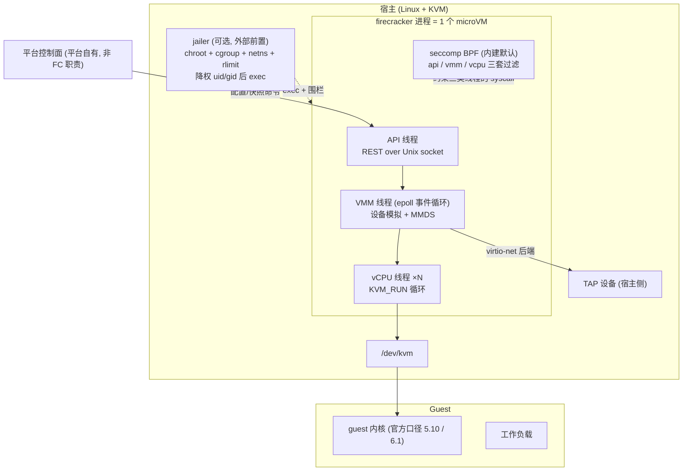
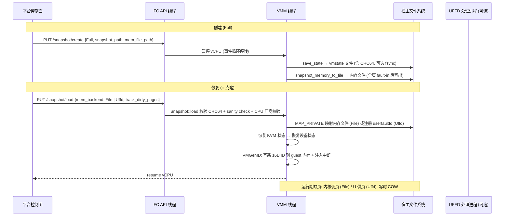

# 12 · Firecracker 源码深研（深研第 3 号）+ Q13 结案

> 项目：Agent Sandbox 全领域技术研究（goal_a756da9ace9a）· Round 5 线 B
> 对象：firecracker-microvm/firecracker（MicroVM VMM，基础设施组件）
> 日期：2026-10-27（Asia/Shanghai）｜ 方法：纯静态源码 + 官方 docs 原文（未编译、未运行；本机无 /dev/kvm）
> 源码口径：克隆 HEAD `f0f48ff`（2026-10-27 当日提交）；最新 release **v1.17.0**（2026-09-10，gh API 实测，与 Round 1 一致、无更新）；License **Apache-2.0**
> 证据等级：A 官方文档/源码直接 · B 可靠独立/官方自述未源码核 · C 推断 · U 未知。性能数字一律 [OFFICIAL 官方公布未实测]

## 0. 结论先行

1. **「5 个设备」是历史口径，不是现行代码口径。** NSDI'20/FAQ 的最小设备集（virtio-net/block/vsock + serial + i8042）在代码中仍是核心，但现行 vmm 已包含 virtio-balloon、virtio-rng、virtio-mem、virtio-pmem、PCI 传输（可选 `--enable-pci`，默认仍是 MMIO）与设备热插拔（Developer Preview），另有 ACPI 侧 VMGenID/VMClock 与 pseudo BootTimer。攻击面结论必须改写为：**核心数据面极小、但设备面在持续受控扩张**，引用「只有 5 个设备所以安全」自本轮起视为过期表述。[A]
2. **Q13 可以结案**：快照组成/Full 与 Diff/CRC64/双后端懒加载（File mmap 与 UFFD）均有官方原文 + 代码双证；恢复后熵处理有明确官方口径——**Firecracker 实现了 VMGenID 且总是启用**，恢复时写新 16 字节随机 ID 并注入中断，guest 内核（≥5.18）据此强制重播种 CSPRNG；但官方明说存在「vCPU 恢复到内核处理通知之间」的竞态窗口，且 userspace 自有熵池不在其保证内。Round 1 底稿中「VMGenID 具体机制标未验证」的 C 级线索就此升 A 并关闭。[A]
3. **快照的完整性保护是弱项且官方不掩饰**：只有 vmstate 文件带 CRC64（防意外损坏，非防篡改），内存文件与磁盘文件无内建校验/加密，威胁模型直接把快照文件列为**可信对象**，认证与加密是集成方（平台）的责任。任何把 Firecracker 快照当不可信输入的设计都是错的。[A]
4. **jailer 与 seccomp 是两层独立机制，分工不可混**：seccomp 是 VMM **内建默认开启**（按 api/vmm/vcpu 三类线程的 BPF 过滤，构建时嵌入）；jailer 是**外部可选前置程序**（chroot+cgroup+netns+rlimit+降权后 exec FC）。E2B 不用 jailer 丢的是外层围栏，不丢 seccomp；OpenSandbox Fast 的「jailer 可选」与上游语义一致。[A]
5. **快照可移植性比营销叙事窄得多**：官方口径是恢复环境须与生成环境软硬件**相同**（同 CPU 厂商校验在代码里强制 warn/校验、同 GIC 版本、快照格式独立版本线）；跨宿主恢复靠 CPU template 把异构机群「装扮」成同构，但官方明说 CPU template **不是安全边界**。[A]

## 1. 仓库结构地图

```
firecracker/ (Rust workspace, src/**/*.rs 共 128,706 行 [SELF 实测])
├─ src/firecracker/ 二进制入口：main.rs、api_server/（HTTP over UDS 的 REST API）、seccomp.rs（SeccompConfig）
├─ src/vmm/ 核心 VMM（263 个.rs）：builder.rs（VM 构建/恢复装配）、persist.rs（快照创建/恢复）、
│ device_manager/、devices/{virtio,legacy,acpi,pci,pseudo}/、vstate/（KVM/vCPU/内存）、
│ snapshot/（格式+CRC）、cpu_config/（CPU 模板）、mmds/、dumbo/（极简 TCP 栈）、rate_limiter/
├─ src/jailer/ 外层围栏程序：env.rs（Env::run）、chroot.rs、cgroup.rs、resource_limits.rs
├─ src/seccompiler/ 把 JSON 过滤规则编译为 BPF 二进制的工具链
├─ src/snapshot-editor/ 离线编辑/查看快照文件（内存重映射、vmstate 修改）
├─ src/rebase-snap/ 把 diff 快照层合并进 base 生成 full 快照
├─ resources/seccomp/ 默认 seccomp 过滤 JSON（x86_64/aarch64 musl）
├─ docs/ design.md、jailer.md、seccomp.md、entropy.md、snapshotting/（6 篇）、
│ cpu_templates/、prod-host-setup.md、kernel-policy.md …
└─ tests/ Python pytest 集成测试框架（95 个 test_*.py：build/functional/performance/security/style）
+ Kani 形式化验证（docs/formal-verification.md）
```

进程模型（design.md 原文）：**一个 Firecracker 进程恰好封装一个 microVM**，线程分 API / VMM / vCPU(s) 三类；API 线程不在数据面快路径上；全部设备模拟由 VMM 线程的单个 epoll 事件循环驱动；Paused 时 VMM 线程停转事件循环、只服务 API。[A]

## 2. 架构图



## 3. 设备模型：逐个在代码落实

### 3.1 现行设备清单（以 HEAD 代码为准）

| 类 | 设备 | 代码位置 | 备注 |
|---|---|---|---|
| virtio 数据面 | net（TAP 后端、双向限速器） | `devices/virtio/net/` | 限速在宿主侧强制（guest 不可信）[A] |
| virtio 数据面 | block（文件后端；含 vhost-user 变体） | `devices/virtio/block/` | 同上 |
| virtio 数据面 | vsock（UDS 后端） | `devices/virtio/vsock/` | 快照时已连接的 vsock 连接被关闭、监听 socket 保留（snapshot-support.md 原文）[A] |
| virtio 扩展 | balloon（内存气球） | `devices/virtio/balloon/` | docs/ballooning.md |
| virtio 扩展 | rng（熵设备，随机源 = aws-lc-rs） | `devices/virtio/rng/device.rs`（`use aws_lc_rs::rand`） | `/entropy` API 配置、可限速；docs/entropy.md |
| virtio 扩展 | mem（内存热插拔 virtio-mem） | `devices/virtio/mem/` | docs/memory-hotplug.md |
| virtio 扩展 | pmem（持久内存） | `devices/virtio/pmem/` | docs/pmem.md |
| legacy | serial console（8250） | `devices/legacy/serial.rs` | prod-host-setup 建议生产环境处理其输出 |
| legacy | i8042（极简键盘控制器） | `devices/legacy/i8042.rs` | 唯一用途：向 guest 信号 reboot 请求（design.md 原文）[A] |
| legacy（ARM） | RTC PL031、GPIO PL061 | `devices/legacy/` | aarch64 平台设备 |
| ACPI 侧 | VMGenID | `devices/acpi/vmgenid.rs` | 见 §6.5，**总是启用** |
| ACPI 侧 | VMClock | `devices/acpi/vmclock.rs` | 向 guest 通报宿主时钟关系与快照/迁移类扰动事件；快照恢复的 userspace 通知机制即经此（snapshot-support.md）[A] |
| pseudo | BootTimer | `devices/pseudo/boot_timer.rs` | 度量 guest 启动的伪设备，非 guest 功能设备 |
| 平台件（非设备） | PIC/IOAPIC/PIT、MMDS | KVM in-kernel / `src/vmm/src/mmds/` | MMDS 是 VMM 线程提供的元数据服务，不是 guest 设备 |

传输层：默认 **MMIO**；PCI 传输为可选（`--enable-pci`），设备热插拔（block/pmem/net 的 PCI 热插，Developer Preview）依赖 PCI 且需 machine config 预配 `pcie_hotplug_ports`（docs/device-hotplug.md）。[A]

### 3.2 明确不存在的设备与攻击面含义

代码与 docs 中不存在：USB、GPU/显卡、声卡、完整 BIOS/UEFI 固件链（走 kernel 直接加载 + 可选 PVH/initrd）、传统整机芯片组模拟。[A：devices/ 目录全集 + design.md]
含义（机制层，承 Round 1 底稿 §2.2）：每个虚拟设备 = 一段处理 guest 可控输入的宿主解析/状态机代码，砍设备即删解析器——此论证仍成立；但**现行清单已比 NSDI 时代长**（balloon/rng/mem/pmem/PCI/hotplug 都是新增的宿主代码面），评估 Firecracker 攻击面应引用现行清单，不得停留在「5 个设备」。剩余攻击面不变：KVM ioctl 面、virtio 实现缺陷、API socket 的宿主侧访问控制、快照文件被当作可信输入（§6.3）。[A]

## 4. VMM 架构、API 与 seccomp

- **API**：HTTP REST over Unix domain socket（`src/firecracker/src/api_server/`，按资源分 request/*.rs：boot-source、drives、snapshot、entropy、hotplug 等）；也支持以配置文件不用 API socket 直接启动。API socket 的文件权限即访问控制——宿主侧谁能写这个 socket 谁就能控制 VM，平台必须自管。[A]
- **seccomp（内建层）**：`src/firecracker/src/seccomp.rs` 的 `SeccompConfig` 三态——`Advanced`（默认，构建时由 seccompiler 把 `resources/seccomp/<target>.json` 编译并嵌入二进制）、`Custom`（`--seccomp-filter` 用户自备，官方警告配错可直接拆掉这道边界）、`None`（`--no-seccomp`，且参数互斥校验在 main.rs）。过滤**按线程类别**施加：api / vmm / vcpu 三套 BPF（`src/vmm/src/seccomp.rs` 的 `BpfThreadMap`），加载时点分别为 API 起 HTTP server 前、VMM/vCPU 执行 guest 代码前（docs/seccomp.md 原文）。debug/GNU 实验构建**无默认过滤**，生产口径不适用。[A]
- **与 jailer 的分工**：seccomp 管「FC 进程能发哪些 syscall」，jailer 管「FC 进程活在什么文件系统/网络/资源/身份里」。两者独立：不用 jailer 不影响 seccomp 默认生效；用了 jailer 也不替代 seccomp。[A]

## 5. jailer

独立二进制（`src/jailer/`），官方定位：只为加固 Firecracker 本身、须与同版本静态链接（musl）FC 配套（docs/jailer.md）。`Env::run`（`src/jailer/src/env.rs`）的执行顺序即其机制清单：

```
解析参数 → 把 FC 二进制拷入 chroot 目录 → join 预建 netns（--netns，可选）
→ 安装 resource limits（--resource-limit: nofile/fsize 等 rlimit）
→ 建并加入 cgroup（v1/v2 可选，--cgroup <file>=<value> 多次、--parent-cgroup）
→ chroot 进 jail 目录 → 在 jail 内 mknod 必需 /dev 节点（kvm/tun 等，含 userfaultfd 设备号处理）
→ （可选 --new-pid-ns 时 fork 进新 PID ns）→ 降权到 --uid/--gid → exec FC
```

何时可选：上游语义里 jailer **从来都是可选的加固层**，FC 本体不依赖它启动。对照既有深研结论——E2B「不用 jailer」（07 报告：orchestrator 以 root 直接拉起 FC，宿主收敛靠 cgroup/netns 自行实现）丢的是这一整层现成围栏，需自证其替代实现；OpenSandbox Fast「配了 JailerPath 才进 jailer 模式」（06 报告）与上游语义完全一致。[A]

## 6. Snapshot：官方口径 + 代码证据逐项结案

问题原文：Firecracker 官方 snapshot 文档原文（快照组成/懒加载/校验）与恢复后熵、机器身份处理（VMGenID 类机制）的官方口径。
主证据：`docs/snapshotting/snapshot-support.md`、`handling-page-faults-on-snapshot-resume.md`、`random-for-clones.md`、`network-for-clones.md`、`versioning.md`；代码 `src/vmm/src/persist.rs`、`src/vmm/src/snapshot/{mod.rs,crc.rs}`、`src/vmm/src/devices/acpi/vmgenid.rs`、`src/vmm/src/builder.rs`。

### 6.1 组成 —— 裁定：已证 [A]

快照 = 三类文件：**guest 内存文件 + microVM 状态文件（vmstate：vCPU/KVM/设备模拟状态，例外是 serial 模拟与 vsock 后端不入）+ 磁盘文件（0..n，由用户自管，不由 FC 生成）**。创建入口 `persist.rs: create_snapshot()`：先 `save_state()` 序列化 MicrovmState 写状态文件（可选 fsync，`sync_snapshot_files`），再 `snapshot_memory_to_file()` 落内存；设备脏页经 `device_manager.commit_dirty()` 汇总。恢复微 VM 共享只读磁盘/内存页是设计允许的用法（多克隆共享 base）。

### 6.2 Full vs Diff —— 裁定：已证 [A]，且 Diff 仍是 Developer Preview

- Full：完整内存 + 状态，独立可恢复；默认类型。
- Diff：只存上次快照以来被写脏的页（稀疏文件，靠 KVM dirty bitmap + `track_dirty_pages`），**一般不可直接恢复**，须用 `rebase-snap` 工具按创建顺序逐层合并回 base 生成 Full（例外：恢复后未放行 vCPU 就打的 diff）。docs 顶部明示 Diff 仍在 Developer Preview（与 guest_memfd 的结合未定）。
- 创建快照会把 guest 全部内存 fault-in 并同步写出——「打快照慢、恢复快」是官方自述的不对称性，引用恢复数字时禁止把创建成本藏掉。

### 6.3 校验与信任模型 —— 裁定：已证 [A]，结论是「弱校验 + 快照即可信输入」

- 状态文件格式（versioning.md）：`magic_id(64) | version | state(bitcode blob) | crc(64, CRC64)`；`Snapshot::load`（snapshot/mod.rs）切出末 8 字节校验 CRC64，失败即终止进程；另有 `load_without_crc_check` 内部路径与 `snapshot_state_sanity_check()`（内存 region 结构检查、CPU 厂商/制造商校验）。
- 官方原文定性：CRC「只是防意外损坏的部分措施」，内存与磁盘文件**需要集成方自己做认证与加密**；design.md 的威胁模型把「宿主、宿主/API 通信、快照文件」列为可信对象。
- 结论：快照文件 = 完整内存转储 + 机器状态，其密级与处理要求见 Round 1 底稿 §2.5（加密存储、租户分桶、销毁联动）——本轮由「分析判断」升级为「官方口径直接支持」。[A]

### 6.4 懒加载：File mmap 与 UFFD 双后端 —— 裁定：已证 [A]（Round 1 的 C 级线索关闭）

恢复时内存**不全量载入**：`LoadSnapshot` 的 `mem_backend` 二选一（`src/vmm/src/vmm_config/snapshot.rs` 的后端类型 + `restore_from_snapshot()` 装配）：
- `File`：对内存文件建 MAP_PRIVATE 映射，缺页由内核按需从文件调入，写时 COW 到匿名内存；代价是内存文件须在该 VM 整个生命周期内保留。
- `Uffd`：经 Unix socket 把 userfaultfd 交给一个**专职用户态进程**处理缺页（`src/firecracker/examples/uffd/on_demand_handler.rs` 为官方示例处理器；2M hugetlbfs 必须用 UFFD）。E2B 的「userfaultfd 懒加载 + NBD COW 根盘」正是这一后端的产品化使用（07 报告回链）。
恢复后匿名内存 vs 快照内存的这一区别也决定了 B3 类「内存基线开销」口径：恢复型 VM 的宿主 RSS 随工作集 fault-in 增长，禁止用刚恢复的瞬时值报密度。

### 6.5 恢复后熵与机器身份：VMGenID —— 裁定：已证 [A]，附官方明示的竞态窗口

- **实现存在且总是启用**（random-for-clones.md 原文 "Firecracker will always enable VMGenID"）：设备在 `src/vmm/src/devices/acpi/vmgenid.rs`——`VmGenId::make_genid()` 用 `rand::fill` 生成 16 字节随机数；恢复装配时（`builder.rs: build_from_snapshot` 路径）DeviceManager 恢复后调用 `activate()` 把新 ID 写进 guest 内存，再由 `do_post_restore()` 触发中断通知 guest；builder.rs 源码注释明说恢复顺序就是为此安排的（须在 KVM 状态恢复之后，否则中断被覆盖）。x86 走 ACPI 表、ARM 走 DeviceTree `microsoft,vmgenid` 节点（`arch/aarch64/fdt.rs`）。
- **guest 侧效果**（官方引内核实现）：内核 ≥5.18 有 VMGenID 驱动，收到新 ID 即把其作为新随机性喂 CSPRNG 并强制立即重播种——同快照克隆的 `getrandom()/urandom` 输出在内核处理通知后彼此不同。
- **官方明示的三个缺口**（不得省略）：
1. **竞态窗口**：vCPU 已恢复运行、内核尚未处理 VMGenID 通知之间的窗口内，随机输出仍可能带快照状态；
2. **userspace 自有熵池不在保证内**：应用/库自维护的 RNG 状态、快照前生成的密钥材料，FC 与内核都救不了，官方建议不要在快照前逻辑里用这类库；
3. **boot_id 不变**：`/proc/sys/kernel/random/boot_id` 是开机时定的、只读，同快照克隆读到相同值，需要区分只能 bind mount 覆盖；systemd 的 `/var/lib/systemd/random-seed` 文件须在打快照前删除。
另有边角：快照若在 guest 内核启动极早期打，恢复时 VMGenID 中断可能因中断处理未就绪而使内核崩溃（snapshot-support.md 的 VMGenID limitation 节，官方建议内核启动完成后才打快照）。
- **补充熵源**：virtio-rng（§3.1）从宿主侧持续供给，随机字节由 aws-lc-rs 生成；官方对克隆的完整建议集（删 seed 文件、用 virtio-rng、老内核用 RNDADDENTROPY+RNDRESEEDCRNG 的 rerand 程序）在 random-for-clones.md 的 Recommendations 与 Annex 1。
- 对 Q32（E2B 克隆熵）的回链：机制层答案已由上游给出——区分靠 VMGenID+内核重播种，**前提是 guest 内核带驱动且平台真的在恢复路径启用**；E2B 仓内当年 grep 不到 VMGenID 处理，意味着其 guest 镜像/恢复路径是否吃到这个机制仍是 E2B 侧的实测问题，Q32 维持 LAB-REF 不变，但其「机制是否存在」子问题就此关闭。[A]

### 6.6 恢复后的网络与时间状态 —— 裁定：已证 [A]，结论是「不保证，靠平台与 guest 配合」

- 网络：恢复后网络/vsock 连接**预期会丢包、连接状态不保证存活**（snapshot-support.md 原文）；已打开的 vsock 连接被关闭、监听 socket 保留可再 accept。克隆的网络冲突（同一 TAP 名、同一 guest IP）官方给的配方是「每克隆独立 netns（jailer --netns）+ iptables NAT 改写」（network-for-clones.md，且官方自注「示例、 不保证性能与安全」）；`LoadSnapshot` 支持 `network_overrides` 在恢复时改写 net 设备的宿主 TAP 名、`vsock_override` 改写 UDS 路径（persist.rs 代码），这是给平台留的正式接线点（OpenSandbox/E2B 的克隆网络处理都应在此层对照）。
- 时间：VMClock 设备（§3.1）把宿主时钟关系与「发生过快照恢复/迁移类扰动」写进 guest 可读结构并中断通知，guest 侧应用/时间同步据此校正——这是「恢复后时钟跳变」的上游正式机制；快照本身冻结的是 vCPU 时钟状态，墙钟连续性不由快照保证。[A]

### 6.7 快照兼容约束 —— 裁定：已证 [A]

- 恢复环境须与生成环境**软硬件相同**（官方 Where-can-I-resume 节）；仅在同硬件 + 较新宿主内核的有限组合有兼容表且官方**不作保证、不建议生产**。
- 快照格式有独立版本线（MAJOR.MINOR.PATCH，写在文件头），与 FC 版本解耦；bitcode 编码不允许向后兼容的状态变更，状态结构一变即 bump MAJOR——旧快照跨大版本恢复先查格式版本。
- arm64 GICv2/GICv3 之间不可互相恢复；x86_64 未用 CPU template 时 `MSR_IA32_TSX_CTRL` 的覆写不跨恢复保留。

## 7. 快照创建/恢复流程图



## 8. Guest 兼容边界与 CPU 模板

- **测试矩阵**（README Tested platforms）：宿主为 AWS metal 实例（m5n/m6i/m7i 系列、AL2/AL2023 宿主内核 5.10/6.1/6.18），guest 内核官方口径 **5.10 与 6.1**（docs/kernel-policy.md 有微 VM 内核的维护/退役表）；VMGenID 在 ARM 上需要 6.10 的 DeviceTree 绑定回移到 6.1（官方 CI 即如此做，自备 ARM guest 内核须照办）。超出测试矩阵的 guest 不是「不支持」，是「未验证」——引用时分开写。[A]
- **CPU templates**（docs/cpu_templates/）：以 JSON 定制 guest 可见的 CPUID/MSR（x86_64）、ARM 寄存器与 vCPU 特性、KVM capability，另有 cpu-template-helper 工具；用途是把异构机群呈现为同构（快照跨机恢复的前提之一）与掩藏不需要的特性。**官方警告原文口径：CPU template 不是对恶意 guest 的安全防护**——关掉特性位不等于指令不可执行；且「把一个厂商装扮成另一个厂商」不支持。静态模板自 v1.5.0 起弃用、自定义模板为正路。[A]
- **生产宿主基线**（docs/prod-host-setup.md 要点）：用默认 seccomp、jailer 配置（cgroup 放置/磁盘与内存与 vCPU 的 jailer 侧约束）、宿主侧过滤 guest 出站流量（FC 本身**不做**流量过滤，design.md 明示全部出站视为不可信、由宿主过滤）、关 SMT/禁 KSM/安全 swap 等侧信道与 noisy-neighbour 缓解清单。平台若只引用 VMM 本体而不落这份宿主基线，等于只做了隔离的一半。[A]

## 9. 成熟度信号

- 代码体量与测试：src 共 128,706 行 Rust[SELF 实测]；vmm 内单元测试函数约 912 个；集成测试为独立 Python 框架（95 文件，含 security 与 performance 类）；另有 Kani 形式化验证与 fuzzing 文档——在 VMM 同类开源项目中属于高配。[A/SELF]
- TODO/FIXME：全 src 仅 43 处（vmm 42、seccompiler 1、jailer 与二进制 crate 为 0）[SELF 实测]——低存量与「窄功能面」定位互证。
- 版本节奏：release v1.17.0（2026-09-10），仓当日仍有提交，未归档；快照 Diff、设备热插拔两处 Developer Preview 是当前明确的未完成功能面，引用时带状态。[A]

## 10. Spec §7 十七问（基础设施组件适用子集）

1. **解决什么问题？** 在 KVM 上以最小设备模型 + 强进程围栏运行多租户 microVM 的 VMM 本体：让「一函数/一容器一 VM」的隔离粒度在启动速度（官方 <125ms 冷启、<5MiB VMM 开销，[OFFICIAL 未实测]）与密度上可行。[A]
2. **目标用户是谁？** 云平台与 Sandbox 平台构建者（不是终端用户）：AWS Lambda/Fargate 是其出处，下游含 E2B、Fly 类平台与自建者。[A]
3. **核心架构是什么？** 一进程一 VM；API/VMM/vCPU 三线程类；设备模拟全在 VMM 线程 epoll 循环；配置与生命周期走 REST-over-UDS API；快照为一等能力（§6）。[A]
4. **使用什么隔离技术？** KVM 硬件虚拟化（guest 独立内核）+ 内建 seccomp + 可选 jailer（chroot/cgroup/netns/降权）+ 宿主侧 TAP/NAT 与流量过滤（平台职责）。[A]
5. **安全边界在哪里？** 最强：VM-exit 边界 + 极小设备面。最弱（官方自认）：快照文件是可信输入、只有 CRC64 弱校验；FC 不做网络过滤；API socket 即控制权。[A]
6. **创建和销毁如何实现？** 创建：API 配置 boot source/驱动/网络 → 从内核+rootfs 冷启，或从快照恢复（§7 图）；销毁：进程退出即 VM 消失，无独立回收状态机（平台负责进程与文件清理）。[A]
7. **如何执行代码？** N/A——VMM 不执行用户代码，只运行 guest；「执行」语义在 guest 内核之上，与 envd/execd 类 guest 代理是不同层（这是与 E2B/OpenSandbox 对比时最容易混的一点）。[A]
8. **如何处理文件和网络？** 文件：virtio-block 文件后端（平台预格式化、快照磁盘文件平台自管）；网络：virtio-net→宿主 TAP，限速在 VMM 宿主侧，过滤在宿主网络层（FC 不过滤）。[A]
9. **如何管理密钥？** N/A（组件层）——FC 不管租户凭证；但快照文件含 guest 全部明文秘密，其加密/访问控制是平台的密钥管理职责（§6.3）。[A]
10. **如何控制资源消耗？** net/block 双向限速器（宿主侧）、balloon、jailer 的 cgroup/rlimit、machine-config 的 vCPU/内存定额；CPU 时间片级配额不是 FC 的事（宿主 cgroup）。[A]
11. **如何支持并发？** 一进程一 VM 的水平扩展：密度由 VMM 常驻开销 + guest 页表决定，调度/放置/池化全是平台层（FC 无调度器）。[A]
12. **如何处理故障？** 进程级故障域 = 单 VM；快照 CRC 校验失败即终止进程不带病恢复；平台负责重试/迁移/重建。[A]
13. **计费和成本结构如何？** N/A——开源组件无定价；成本 = 宿主资源 + 平台自建控制面的 TCO（见 Round 1 成本口径）。[A]
14. **与其他路线相比的优势？** （有据）设备面最小且有源码可查、快照/VMGenID/UFFD 等克隆机制是上游一等公民、Rust + 形式化验证带来的实现质量信号。[B]
15. **有哪些不足？** Diff 快照与设备热插拔仍 Developer Preview；快照弱校验把安全责任上推平台；恢复兼容约束窄（同构环境）；网络/凭证/调度全不在内——「用了 Firecracker」离「有 Sandbox 平台」还差整个控制面。[A]
16. **适合哪些生产场景？** 多租户函数/容器底座、Agent Sandbox 的 MicroVM 数据面（E2B/OpenSandbox Fast 的共同选择已证）、批量短命隔离执行。[A/B]
17. **从零实现应借鉴什么？** 见 §11 阅读地图与 §12 对照：极小设备面的取舍纪律、一进程一 VM 的故障域、快照格式独立版本线、VMGenID 式恢复后身份分化、把「不做的事」（过滤/加密/调度）写进威胁模型而不是留白。[B]

## 11. 源码阅读地图（建议顺序）

1. `docs/design.md` — 线程模型、威胁遏制模型、机器模型（半小时建立全局观）。
2. `docs/getting-started.md` + `src/firecracker/src/api_server/request/` — API 面长什么样、配置顺序。
3. `src/vmm/src/builder.rs` — 冷启装配与 `build_from_snapshot` 恢复装配（VMGenID 顺序注释在此）。
4. `src/vmm/src/devices/` — 按 virtio/mod.rs 索引读 net/block/vsock 三件，再读 acpi/vmgenid.rs（全文件最短的安全关键代码）。
5. `src/vmm/src/persist.rs` + `src/vmm/src/snapshot/` — 快照创建/恢复/CRC/格式版本，配合 docs/snapshotting/ 四篇原文。
6. `src/firecracker/src/seccomp.rs` + `resources/seccomp/x86_64-unknown-linux-musl.json` — 默认过滤到底放行什么。
7. `src/jailer/src/env.rs` 的 `Env::run` — 一条函数读完 jailer 全部机制。
8. `docs/prod-host-setup.md` + `docs/snapshotting/random-for-clones.md` — 从「组件」到「生产系统」与「克隆安全」的官方完整口径。

## 12. 回链对照：E2B / OpenSandbox 如何使用 Firecracker

| 维度 | 上游 Firecracker（本报告） | E2B runtime（07 报告） | OpenSandbox Fast（06 报告） |
|---|---|---|---|
| 启动路径 | 冷启与快照恢复双路 | **只用快照恢复**（模板快照即创建） | **只用快照恢复**（唯一启动路径） |
| 内存懒加载 | File mmap / UFFD 双后端可选 | UFFD + NBD COW 根盘 | 本地缓存命中走恢复机器（外仓实现） |
| jailer | 可选加固层（§5） | **不用**（orchestrator root 直拉，cgroup/netns 自理） | 可选（配 JailerPath 才启用） |
| 快照校验/加密 | CRC64 弱校验、加密归平台（§6.3） | artifact 存对象存储，平台侧管理 | 内容寻址 artifact + SHA256SUMS（平台自加的完整性层，正补上游缺口） |
| 克隆身份分化 | VMGenID 总是启用（§6.5） | 仓内未见 VMGenID 处理（Q32 待实测） | checkpoint 跨 Fastlet 恢复，身份分化未见专门处理（未证实） |
| 网络过滤 | FC 不做，宿主职责 | 自建 tcpfirewall + 默认拒绝表（硬编码私网/元数据） | 自建 egress sidecar/共享进程（默认不含元数据 deny） |

读法：两家平台在上游留白处（校验、过滤、凭证）的差异，正是 Round 1 以来「同底座、不同安全完成度」结论的源码级注脚。[A]

## 13. 未清项与下一步

- 本轮未编译/未运行：device 行为、快照恢复的实际时延与 VMGenID 在自备 guest 内核上的生效情况均为静态结论，实测归 LAB-REF（Q36 前置不变）。
- 未逐个核对 virtio 扩展设备（balloon/rng/mem/pmem）的引入版本，报告只陈述现行清单，不做版本史断言。
- gVisor 深研（原 Round 5 排序第 3）与 Q12（兼容清单/Systrap 数字）仍挂账，与本报告 §3 的设备面结论无依赖，可独立推进。
- Q13 结案建议（交主线整合）：状态改「已清（Round 5，12 报告 §6）」，Q32 保留但注明机制子问题已关闭、剩余为 E2B 侧实测。
