# 14 · 参考架构 A–E（Phase 6 线 A：第 1–3 步）

> 项目：Agent Sandbox 全领域技术研究（goal_a756da9ace9a）· Phase 6 产出顺序第 1–3 步
> （第 1 步跨架构决策矩阵 · 第 2 步五份架构文档 · 第 3 步全局图组，图组按任务书置于文首）
> 日期：2026-10-28（Asia/Shanghai）
> 事实依据（仅限已验证材料）：01 分类体系、04/06/07/12 四份源码深研、Round 1 线 C 原理五专题、
> Round 1 线 D 威胁与评测底稿（T01–T25）、Round 5 线 C gVisor 选读、09 评测阈值冻结 v1.0、10 实验室第一批报告。
> 标注规则：事实结论带证据等级 [A/B/C/U]；厂商或官方公布数字带 [OFFICIAL]、本项目自测数字带 [SELF] 并给出处；
> 凡属本文的设计取舍一律标「设计判断」并给出依据，不与事实混写。全文禁止无定义打分，架构间只做机制对照。

---

## 1. 全局图组（第 3 步）

### 1.1 技术分类图（按隔离对象与威胁模型分，不按营销名词分 [A · 01 分类体系]）

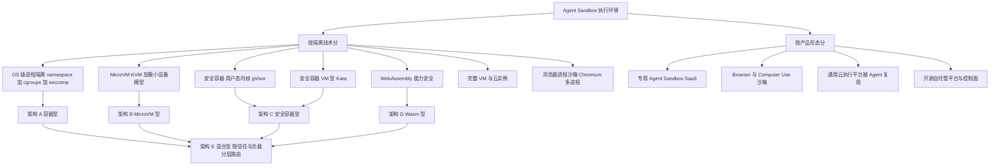

### 1.2 Sandbox 总体架构图（五种架构共用的骨架，差异在数据面的隔离单元）

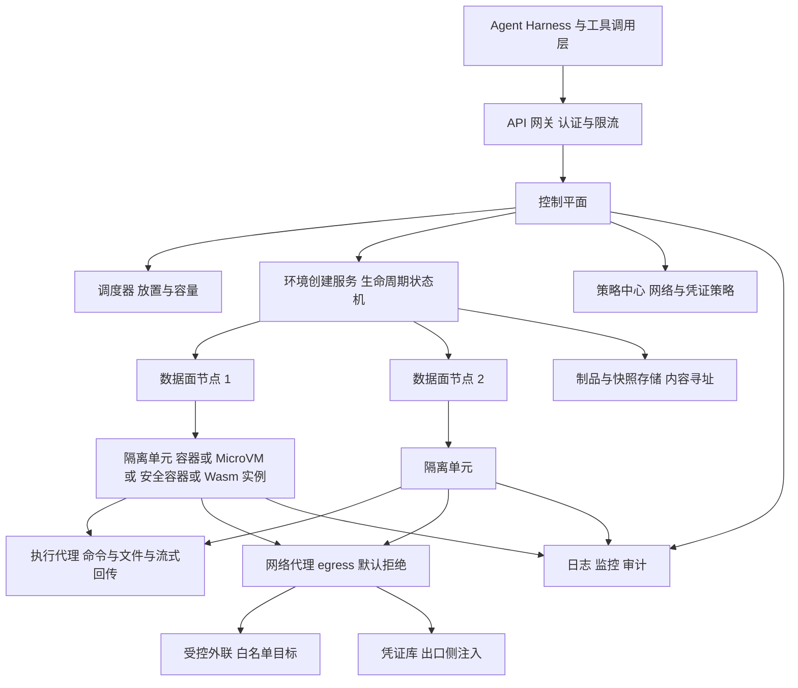

### 1.3 控制平面与数据平面图（分离原则借鉴 E2B：沙箱流量永不经过 API [A · 07 深研]）

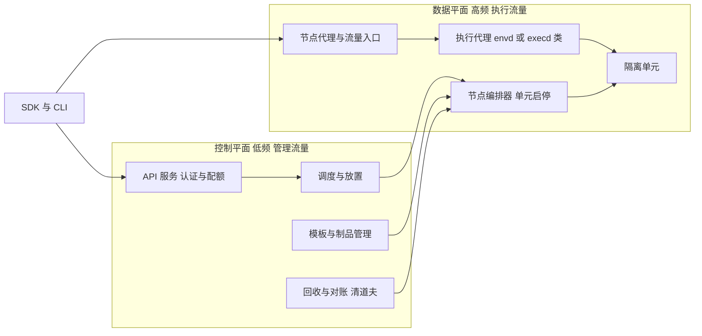

### 1.4 Sandbox 生命周期状态图（暂停与快照为一等状态，借鉴 OpenSandbox 与 E2B 的同构生命周期词汇 [A · 04/07 深研]）

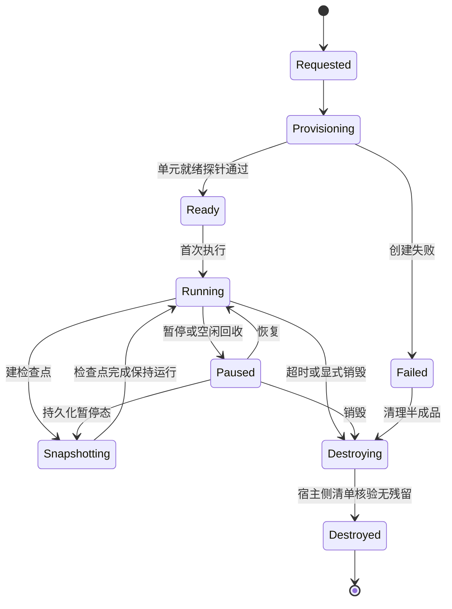

### 1.5 网络安全边界图（默认拒绝为所有架构的共同底线，依据 D 线 T09–T12 与 C8 冻结线）

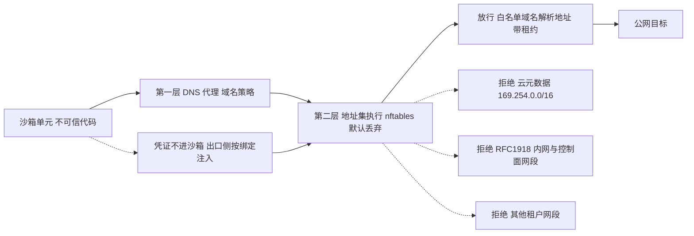

### 1.6 多租户执行图（共享的是硬化服务面，永不共享隔离单元与凭证域）

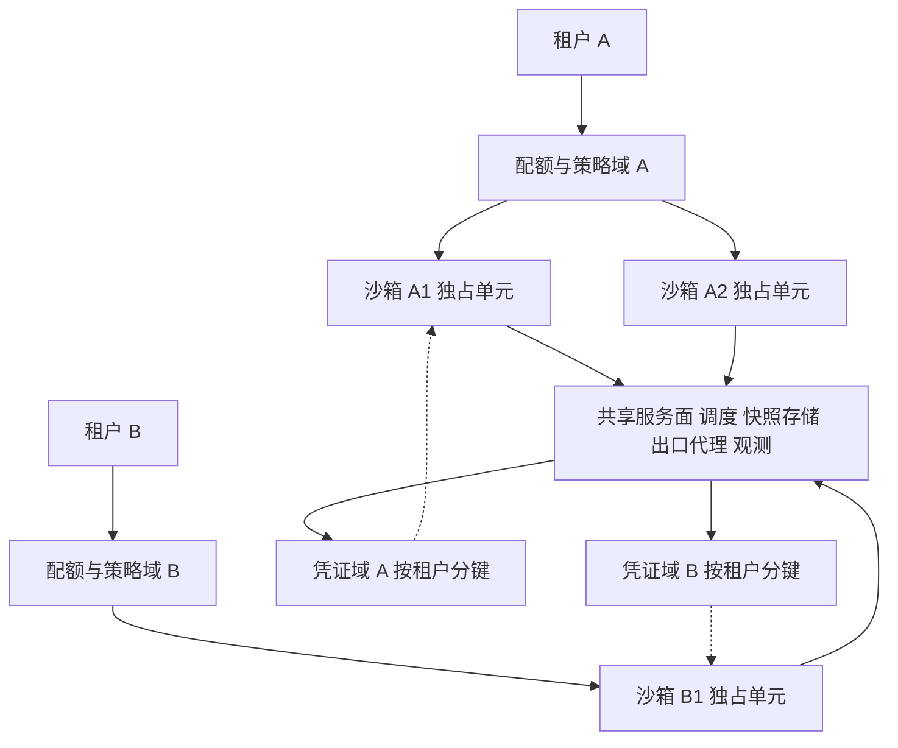

---

## 2. 跨架构决策矩阵（第 1 步）

读法：每格 = 机制词 + 一句依据。C 安全容器型含 gVisor 与 Kata 两个变体，机制差异足够大，分行写。
本矩阵只回答「用什么机制、边界在哪里」，不回答「谁更好」——优劣取决于威胁模型与负载，见各架构文档的适用/不适用节。

| 设计轴 | A 容器型 | B MicroVM 型 | C1 安全容器型 gVisor | C2 安全容器型 Kata | D Wasm 型 | E 混合型 |
|---|---|---|---|---|---|---|
| 隔离原语 | namespace + cgroups v2 + seccomp + capability 削减；决定「看见什么/用多少/能做什么」三件套，同宿主内核 [A · 线 C 专题 1] | KVM 硬件虚拟化 + 极小设备模型的 VMM；边界从 syscall 接口移到 VM-exit 接口 [A · 线 C 专题 2 / 12 深研] | 用户态应用内核 Sentry 重写 Linux 并拦截全部 syscall、零透传 [A · 线 C 专题 3] | 每容器一个轻量 VM 与独立 guest 内核，OCI/K8s 运行时类接口不变 [A · 04 深研 runtimeClass 映射] | 线性内存 + 边界检查 + imports 能力授权，无环境权威 [A · 线 C 专题 4] | 以上原语并存，由路由层按任务信任级与负载形态选档 [设计判断 · 依据 04 三路径共用一套生命周期 API 的实证] |
| 每任务边界 | 一个容器 = 一任务边界；边界内进程共享同一宿主内核，距宿主沦陷「一个 syscall」[A · gVisor 官方论述转引于线 C] | 一个 microVM = 一任务边界；攻破 guest 内核后还须再破虚拟化边界 [A · 线 C 专题 3 三分法] | 一个 runsc 沙箱 = 一任务边界；Sentry 与宿主内核不共享代码，须双重利用 [A · 线 C 专题 3] | 一个 VM 化的容器/Pod = 一任务边界；边界强度接近 B、多一层容器编排语义 [设计判断 · 依据 T4 定义与 04 映射] | 一个 Wasm 实例/组件 = 一任务边界；同宿主进程内多实例共享运行时，运行时缺陷影响同进程全部实例 [A · 线 C 专题 4] | 边界随档位变化，路由错误 = 边界降级，故路由策略本身进入信任基 [设计判断 · 依据 D 线 T20 合法工具组合越界] |
| 启动路径 | 拉起进程组 + 装配隔离配置，无 guest 启动；冷启动开销主要是镜像/挂载与策略装配 [设计判断 · 依据线 C 专题 1 机制] | 快照恢复为唯一/主路径：模板快照恢复 + UFFD 或 mmap 懒加载 + COW 根盘 [A · 06/07 深研] | 拉起 Sentry + Gofer 进程对，无 guest 内核启动；开销在拦截层初始化 [设计判断 · 依据线 C 专题 3 机制] | 启动轻量 VM 再走容器语义，路径长于 C1、短于完整 VM 冷启 [设计判断 · 依据 T4 取舍] | 模块实例化，无 OS 启动；冷启动敏感场景的结构性优势（定性，数字未验证）[A · 线 C 专题 4] | 各档用各档路径；预热池按档分别维护，池化策略不可跨档套用 [设计判断 · 依据 06 池模型与 04 的 62s 口径警告] |
| 快照能力 | 进程级 checkpoint 非内建；靠镜像分层与工作区制品做「逻辑快照」，无内存态恢复 [设计判断 · 容器模型本身无 VM 快照语义] | 内建强项：内存文件 + VM 状态文件 + 磁盘，Full/Diff 两类，内容寻址制品可跨节点恢复 [A · 12 深研 §6 / 06 深研] | 非内建主路径；runsc checkpoint 属实验外围，本架构以「销毁重建 + 工作区制品」代替内存快照 [设计判断 · 依据线 C 专题 3 未列快照为其机制] | 随底层 hypervisor 而定，可复用 VM 快照但编排层支持度按实现核 [C · 本项目未深研 Kata 快照路径] | 实例状态可序列化但生态做法是「无状态函数 + 外部状态」，不做 OS 级快照 [设计判断 · 依据线 C 专题 4 适用形态] | 快照语义按档不统一是最大税：统一生命周期 API 必须显式标注每档的快照保真度 [设计判断 · 依据 04 两套 checkpoint 互不共享的实证] |
| 网络执行点 | netns + 节点 egress 代理/nft；netns 只给独立栈不给策略，策略必须另配 [A · 线 C 专题 1/5] | guest 外侧 tap/veth + 宿主 nft 出口防火墙按槽位执行 [A · 07 深研槽模型] | Sentry 内建虚拟网卡 + 宿主侧代理；或直接 host networking（启用即削弱收敛，属安全参数）[A · Round 5 线 C Sentry 交互面] | guest 网络经 VM 边界出节点，执行点回到节点 egress，与 B 同构 [设计判断] | 默认无网络；网络能力以 import 形式按需授予，粒度到单个 HTTP 能力 [A · 线 C 专题 4] | 统一策略中心下发、各档本地执行；策略语义必须先对齐再谈统一 [设计判断 · 依据 04 平台 overlay 优先级模型] |
| 凭证执行点 | 环境变量/文件注入为常见做法，凭证实际进沙箱；要做到不进沙箱必须引入出口注入层（非容器内建）[设计判断 · 对照 04 Vault 实证] | 同 A：VM 本身不解决凭证问题，执行点应在出口代理按绑定注入 [设计判断 · 依据 04 Vault 与 07 secrets 仓外解析] | 同 A；Sentry 被攻破时其可达面不含宿主文件，凭证仍须外置 [A · Round 5 线 C Sentry 最小交互面 + 设计判断] | 同 B [设计判断] | imports 即凭证面：宿主函数按能力逐项授予，未授予不可获得；已授予的实现安全自担 [A · 线 C 专题 4] | 凭证平面必须全档统一外置，任何一档把凭证放回沙箱内都会成为全平台短板 [设计判断 · 依据 D 线 T17] |
| 密度模型 | 最高：进程级开销，无 VMM 与 guest 内核常驻 [设计判断 · 依据线 C 三分法的资源模型对照] | 每 VM 一个 VMM 进程，常驻开销随密度线性增长；Firecracker 官方口径 VMM 开销小于 5 MiB 且设计目标含资源超卖 [A · OFFICIAL · 线 C 专题 2] | 接近容器：资源运行时动态分配/释放，无预分配 guest 资源 [A · 线 C 专题 3 三分法] | 每单元多一份 guest 内核与 agent 常驻，密度低于 C1、高于完整 VM [设计判断 · 依据 T4 取舍] | 最高且最细：同进程多实例，密度受运行时内存与实例上限约束 [设计判断 · 依据线 C 专题 4] | 密度按档混合核算，容量规划须分档建模，禁止用单一「每宿主沙箱数」概括 [设计判断 · 依据 09 冻结 B3 口径要求] |
| 宿主形态要求 | 任意 Linux 宿主（含云 VM 内）；user ns 可用性按发行版策略核 [A · 线 C 专题 1] | 必须 /dev/kvm 可见（裸金属或嵌套虚拟化已开）；本项目 LAB-MINI 实测无 KVM 即整条路线不可用 [SELF · 09/10 号文件] | Systrap 无虚拟化依赖、适合 VM 内；KVM 平台仅裸金属占优 [A · Round 5 线 C 平台线] | 必须 KVM，与 B 同 [设计判断 · 依据 T4 实现族] | 任意宿主，运行时为普通用户态进程 [A · 线 C 专题 4] | 宿主池须异构分区：KVM 区与非 KVM 区分别承接不同档位 [设计判断] |

---

## 3. 架构 A · 容器型（namespace + cgroups + seccomp）

定位：以 Linux 原语直接组装的最小执行环境。成本与密度最优，边界 = 宿主内核的正确性本身。
主要参照实现：OpenSandbox 容器路径（默认 runc 档 + 容器硬化 + execd + egress sidecar）[A · 04 深研]；
本项目 Lab 第一批的 namespace 单元载体实测 [SELF · 10 号报告]。

### 3.1 组件图

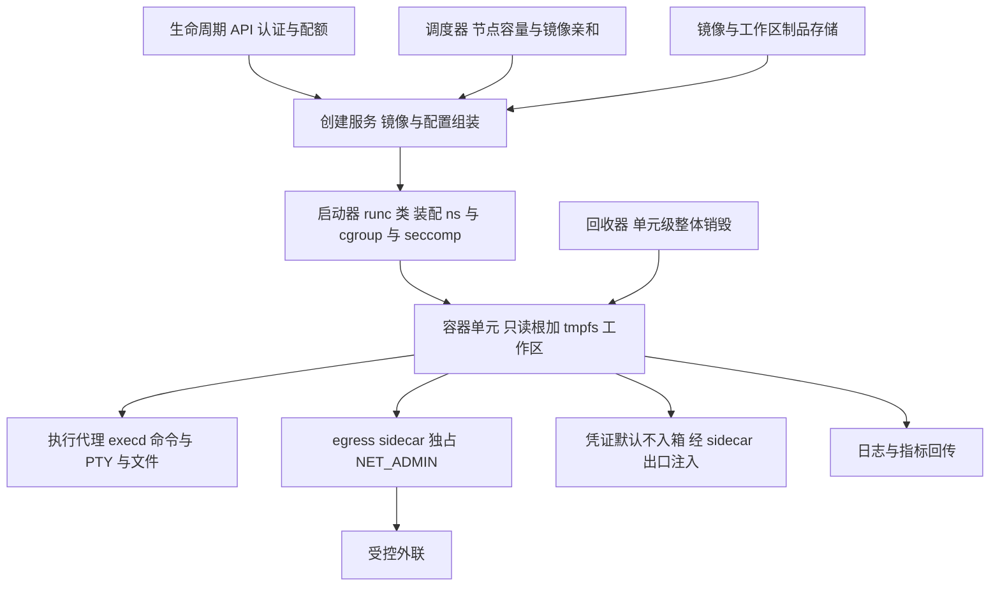

### 3.2 十七项设计

| # | 项 | 本架构设计 | 依据 / 借鉴 |
|---|---|---|---|
| 1 | 系统组件 | 生命周期 API、创建服务、runc 类启动器、execd 类执行代理、egress sidecar、镜像/制品存储、回收器 | OpenSandbox 本仓组件划分 [A · 04 §1/§2] |
| 2 | 控制平面 | 单一生命周期 API 统管 create/run/pause/destroy；隔离档位是部署级配置而非每请求可选，多档需求靠多实例部署分流 | OpenSandbox secure_runtime 服务器级配置与启动校验 [A · 04 §0/§4.1] |
| 3 | 数据平面 | 容器进程组 + execd 通道；执行流量不经 API | 04 调用链 [A]；控制/数据分离与 07 同构 [A] |
| 4 | 调度器 | 按节点容量、镜像缓存亲和放置；准入超限回容量错误而非排队 degradation | 04 的 429 容量语义与 Fast 放置回链 [A · 04 §7] |
| 5 | 环境创建服务 | 组装 host_config：只读根、tmpfs 工作区、cap_drop、no-new-privileges、seccomp/AppArmor profile、pids_limit | OpenSandbox docker 后端硬化项逐项对应 [A · 04 §4.1]；profile 须做成产品内建基线而非运维模板自选——这是对 04「profile 来自模板」现状的修正 [设计判断] |
| 6 | 执行代理 | execd 提供命令执行、流式输出、文件操作；会话级再隔离可用 bwrap 在同一沙箱内切分单个执行会话的文件视图与 syscall 面 | execd 与其 bwrap 隔离会话 [A · 04 §4.2]；定位必须写清：会话隔离不是租户边界 [A · 同上] |
| 7 | 文件系统服务 | 只读根 + 每沙箱独立 tmpfs/overlay 工作区；工作区制品化导出供恢复与审计，销毁连同工作区清除 | 线 C 专题 1 的最小权限组合 [A]；C7 回收清单 [A · 09 冻结] |
| 8 | 网络代理 | 每沙箱 netns + egress sidecar 独占 NET_ADMIN，主容器 drop NET_ADMIN；两层执行：DNS 代理 + nft 默认丢弃、学习地址集带租约；平台 deny overlay 优先级最高且热重载 | 全部借鉴 OpenSandbox egress [A · 04 §5]；并补其缺口：元数据/RFC1918 段做成产品硬编码默认拒绝而非运维配方 [设计判断 · 反面依据 04 §5 与 06 §7，正面依据 07 硬编码默认] |
| 9 | 权限与凭证管理 | cap drop ALL 后按需回加、user ns 映射到非特权 UID 区间、no_new_privs；凭证走 Vault 模型：真值只在 sidecar 内存，沙箱内只见假值，出口 HTTPS 按绑定注入 | 权限组合 [A · 线 C 专题 1 Q5]；Vault [A · 04 §6]，且须带 Fast 路径明文文件的前车之鉴：本架构不落盘凭证 [设计判断] |
| 10 | 日志、监控与审计 | execd 侧读 cgroup v2 实际配额做指标与 OOM 遥测；API 审计每次策略变更与 overlay 合并结果 | 04 的 execd 遥测定位：限额执行在编排层、execd 只观测 [A · 04 §7] |
| 11 | 快照与恢复 | 无内存快照：pause = 冻结进程组或销毁容器保留工作区制品；resume = 按制品重建 + 重注入凭证与策略 | 04 容器路径 pause 后 vault 随 Pod 消失须重注入的实证 [A · 04 §6]；冻结线 C6 对容器档记「逻辑快照」口径 [设计判断 · 依据 09] |
| 12 | 资源回收 | 单元级整体销毁为唯一终止语义：销毁命名空间单元/cgroup 并宿主侧枚举核验进程、端口、文件残留为零 | [SELF · 10 号 EXP-02：单元销毁 30/30 零残留，只杀主进程 30/30 留全套脱缰残留]；对应冻结线 C4/C7 [A · 09] |
| 13 | 故障处理 | 创建失败清理半成品并回滚 sidecar 与 netns；egress 初始策略加载失败即退出、永不以无策略状态运行 | OpenSandbox egress fail-closed 实证 [A · 04 §5]；本项目实验的半成品清理教训 [SELF · 10 号 EXP-02 无效批登记] |
| 14 | 高可用 | 控制面无状态多副本 + 节点故障时其上沙箱全灭、按制品在新节点重建（无 live migration 假设） | 06 对 Fastlet Pod 丢失语义的同构借鉴 [A · 06 §6]；[设计判断] |
| 15 | 安全边界 | 宿主内核 syscall 面：namespace 管视图、cgroups 管量、seccomp 管可达 syscall 子集、LSM/Landlock 管对象；边界三线 = 内核检查点、特权 setup 代码、逃生口配置 | [A · 线 C 专题 1 Q5/Q8] |
| 16 | 性能瓶颈 | syscall 本身零中介（原生执行）；瓶颈在镜像拉取、overlay 写放大、egress 代理穿越与高密度下内核锁竞争（定性，无本项目实测数字） | 机制推论 [设计判断]；LAB-MINI 的 ST 冒烟数字只属该载体、禁止外推 [SELF · 10 号 EXP-04 声明] |
| 17 | 主要成本来源 | 宿主算力（密度最高、单位成本最低）、镜像/制品存储、egress sidecar 每沙箱一份的常驻开销、运维侧 profile 与策略维护人力 | [设计判断 · 成本口径按 09 的 D 组定义] |

### 3.3 关键决策的借鉴出处

- egress 用 per-sandbox sidecar 而非节点共享代理：借鉴 OpenSandbox 容器路径 [A]。理由：NET_ADMIN 归属与策略域都随沙箱走，销毁即回收；代价是每沙箱一份常驻。Fast 路径的共享进程形态证明共享也可做，但策略区分与审计复杂度上升 [A · 06 §5]。
- 元数据拒绝做成硬编码默认：借鉴 E2B `DeniedSandboxCIDRs` [A · 07 §6]，明确反对 OpenSandbox 的配方制默认 [A · 04 §5]。[设计判断]
- 终止语义用单元整体销毁：本项目实验直接证据 [SELF · 10 号 EXP-02]，与冻结线 C4「残留 = 0 唯一通过线」互锁 [A · 09]。

### 3.4 最先被打穿的三条路径

1. **T04 容器逃逸 / T08 宿主内核漏洞**：不可信代码的 syscall 由宿主内核亲手执行，保留面内一个内核缺陷即直达宿主 [A · 线 C 专题 1 Q4/Q7]。本架构对此无结构性防御，只有 seccomp 收敛与内核及时升级两件运营事。
2. **T21 恶意子进程与后台任务**：双 fork + setsid 脱缰后，若终止实现是「杀主进程」，残留恒定存在且不自愈 [SELF · 10 号 EXP-02 对照组 30/30]。打穿点不在攻击者多强，在回收实现偷懒。
3. **T15 文件越权 + 配置逃生口**：挂载宿主目录、docker.sock、`--privileged`、过宽 seccomp（留 ioctl/io_uring/bpf）任一出现，前面所有原语都被配置送回 [A · 线 C 专题 1 Q6]。

### 3.5 不适用场景

- 面向公众的强多租户不可信代码执行，且威胁模型包含内核 0day 利用（须转 B/C）。
- 合规或合同明确要求 VM 级隔离边界的场景。
- 负载需要自带内核模块、真实 /proc 语义或特权设备操作的场景。
- 宿主无法保证 user ns 与 seccomp 基线（如发行版策略禁用）的环境——此时不是降级用 A，而是换宿主 [设计判断 · 依据线 C 专题 5 对 `--no-sandbox` 的同构警告]。

---

## 4. 架构 B · MicroVM 型（KVM / Firecracker）

定位：每任务一个带独立 guest 内核的 microVM，以快照恢复为创建路径。
参照实现三件套：Firecracker 上游（设备模型、jailer、seccomp、快照与 VMGenID）[A · 12 深研]、
E2B runtime（快照即创建、槽位网络、硬编码元数据拒绝）[A · 07 深研]、
OpenSandbox Fast（warm pool、内容寻址制品、共享 egress 编排）[A · 06 深研]。

### 4.1 组件图

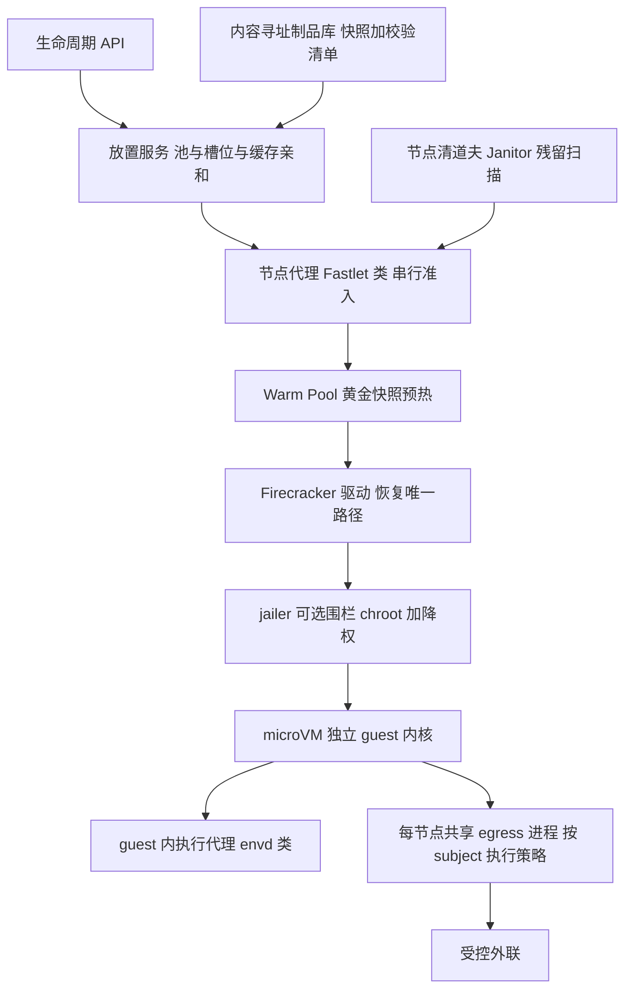

### 4.2 十七项设计

| # | 项 | 本架构设计 | 依据 / 借鉴 |
|---|---|---|---|
| 1 | 系统组件 | 生命周期 API、放置服务、节点代理、FC 驱动、warm pool、内容寻址制品库、共享 egress、节点清道夫 | Fast 外仓组件全集 [A · 06 §1/§6] |
| 2 | 控制平面 | 控制面维护池与槽位视图（最终一致、无全局锁、按缓存亲和与负载 Top-K 选候选、分配走 CAS） | Fast 放置模型 [A · 06 §6] |
| 3 | 数据平面 | 节点代理经内层控制协议管 VM；对外协议与对内协议分层，执行流量不经 API | Fast 两层协议实证 [A · 06 §2]；07 控制/数据分离 [A] |
| 4 | 调度器 | 池化调度：min/max/buffer 容量模型 + 每节点最大沙箱数硬上限；超容量在放置层回容量错误 | Fast PoolSpec 与准入语义 [A · 06 §6]；04 的 429 回链 [A] |
| 5 | 环境创建服务 | 创建 = 从黄金快照恢复（唯一路径，不设冷启直启分支）；guest 内核烤进快照；恢复同节点优先命中本地缓存 | Fast 恢复唯一路径 [A · 06 §0/§4]；E2B 创建即恢复 [A · 07 §0] |
| 6 | 执行代理 | guest 内 envd 类代理提供进程/PTY/文件 RPC；身份令牌经 MMDS 类通道注入并哈希比对 | E2B envd 与 MMDS 注入 [A · 07 §5/§7] |
| 7 | 文件系统服务 | 根盘 = 快照磁盘 + NBD COW 增量；工作区走独立卷/制品导出，与模板通道分离 | E2B UFFD 懒加载 + NBD COW [A · 07 §0]；模板与租户数据分通道 [A · 线 C 专题 2 §2.5] |
| 8 | 网络代理 | 每 VM 独立 netns 槽位（veth + tap + NAT）+ 宿主出口防火墙；策略执行可下沉为每节点共享 egress 进程按 subject 区分 | E2B 槽模型与 tcpfirewall [A · 07 §6]；Fast 共享 egress 编排 [A · 06 §5] |
| 9 | 权限与凭证管理 | 平台 secrets 的值不进 API 与沙箱：出口处由专用后端把标记解析为值；每沙箱令牌与租户/沙箱/模板 ID 派生绑定 | E2B secrets 仓外解析与凭证三层 [A · 07 §7]；禁止 Fast 式明文 vault 文件落盘的做法在本架构定为反模式 [设计判断 · 反面依据 04 §6/06 §5] |
| 10 | 日志、监控与审计 | 节点代理上报池水位、缓存命中、恢复分段耗时；快照制品的生成/分发/恢复全程审计 | [设计判断]；分段计时的必要性来自 62s 拆账教训：端到端 resume 与运行时恢复必须分开计量 [A · 04 §0/06 §4.3] |
| 11 | 快照与恢复 | Full 快照为默认且独立可恢复；Diff 只作增量优化（上游仍 Developer Preview，不作生产主路径）；懒加载双后端 File mmap / UFFD 按场景选；恢复启用 VMGenID 使 guest 内核重播种；快照文件按最高密级对待：平台侧加密 + 认证 + 审计 | 快照组成/Full-Diff/双后端/VMGenID [A · 12 §6]；弱校验修正：CRC64 仅覆盖 vmstate 且非防篡改，认证加密是平台责任 [A · 12 §6.3]；同构约束：恢复环境须软硬件相同、CPU template 不是安全边界 [A · 12 §6.7] |
| 12 | 资源回收 | 删除须等运行时/网络/制品引用/路由四者皆无才释放槽位；节点清道夫做最终残留扫描 | Fast 回收模型与 Janitor [A · 06 §6] |
| 13 | 故障处理 | 节点丢失 = 其上 VM 全灭、无 live migration，按制品在新一代节点重建；恢复失败回滚槽位并标记快照坏件隔离 | Fast 节点丢失语义 [A · 06 §6]；[设计判断] |
| 14 | 高可用 | 池跨故障域分布；黄金快照多副本（含跨节点制品分发）；控制面多副本最终一致 | [设计判断 · 依据 06 制品拉取与放置模型] |
| 15 | 安全边界 | KVM 虚拟化边界 + 极小设备面；VMM 自身再套内建 seccomp（默认）与可选 jailer 外层围栏，两层独立不可混谈 | [A · 12 §4/§5]；本架构定 jailer 为公有多租户默认开、自托管可关（见 4.3）[设计判断] |
| 16 | 性能瓶颈 | 懒加载缺页风暴拉长恢复后尾延迟；62s 级端到端 resume 的大头在端点/网关就绪而非 VM 恢复本身；并发准入与池补充速率决定突发能力 | [A · 线 C 专题 2 §2.4 分解]；[A · 04 官方实测口径] |
| 17 | 主要成本来源 | 每 VM 的 VMM 与 guest 内核常驻、warm pool 待机占用、快照存储与分发带宽、KVM 宿主池（不可与普通容器宿主混池） | [设计判断 · 依据 06 池成本结构与 09 的 D1/D6 口径] |

### 4.3 关键决策的借鉴出处

- 「恢复唯一路径」：借鉴 Fast [A] 与 E2B [A] 的共同选择。好处是创建语义单一、池化与缓存可围绕一个路径优化；代价是模板/快照管线成为关键路径，坏快照 = 全面不可用，故制品校验与坏件隔离必须内建。
- jailer 默认开：上游语义为可选 [A · 12 §5]；两个参照实现分别给出反例与正例——E2B 不用 jailer、以 root 编排器 + cgroup/netns 收敛 [A · 07 §0]，Fast 为可选启用 [A · 06]。本架构的设计判断：面向公众多租户时默认开（多一层不依赖编排器正确性的围栏），内部可信场景可关并记录理由；但任何情况下不得把「没开 jailer」写成「没有 seccomp」——VMM 内建 seccomp 与 jailer 无关 [A · 12 §0]。
- 元数据拒绝硬编码：借鉴 E2B [A · 07 §6]；同时把其节点级豁免开关的注释警告（宽前缀会连带打开元数据端点）写入运维红线 [A · 同上]。
- 性能口径纪律：引用创建/恢复数字必须带口径与来源——OpenSandbox 官方实测创建 64.0ms P50 与 Fast 仓 README 的 77.9ms P50 是两套样本 [OFFICIAL · A · 04 §0/06 §9]；运行时恢复约 35ms 与 SDK 端到端 resume 约 62s 不可混用 [OFFICIAL · A · 04 §0]；Firecracker 官方冷启小于 125ms 指到 microVM 运行、不含业务就绪 [OFFICIAL · A · 线 C 专题 2]。E2B 源码内无毫秒级数字，营销数字不在源码证据内 [A · 07 §5]。

### 4.4 最先被打穿的三条路径

1. **T23 快照/模板污染与克隆状态重复**：同快照多克隆内存逐字节相同；VMGenID 覆盖内核 CSPRNG 重播种，但留竞态窗口、boot_id 不变、userspace 自有熵池不在保证内 [A · 12 §6.5]。guest 侧不做恢复后身份轮换，密钥重复事故只是时间问题。
2. **T05 MicroVM 逃逸**：设备面在受控扩张（balloon/rng/virtio-mem/pmem/PCI 可选与热插拔 Preview），新设备代码就是新攻击面 [A · 12 §0]；快照文件若被当普通文件管理（无认证加密），等于把内存明文拱手让人 [A · 12 §6.3]。
3. **T10 元数据访问（平台实现缺口型）**：MicroVM 本身不防元数据——OpenSandbox Fast 默认策略甚至允许私有 CIDR 之外出口且无硬编码阻断 [A · 06 §7]；平台不把硬编码默认拒绝做进防火墙，这条路第一天就开着。

### 4.5 不适用场景

- 宿主无 KVM（云上普通 VM 未开嵌套虚拟化、LAB-MINI 类环境）：整条路线不可用，先解决宿主形态 [SELF · 09/10 号文件]。
- 需要 GPU/设备直通或异构硬件混部的负载：快照同构约束与极小设备模型正面冲突 [A · 12 §6.7]。
- 非 Linux guest 或强依赖完整桌面/外设的 Computer Use 场景：应走完整 VM 或 E 的浏览器/桌面档，而非硬套 microVM [设计判断]。
- 任务以毫秒级短函数为主且密度要求极高：VM 常驻与恢复路径的固定成本占比过大，优先 D 或 A [设计判断 · 依据线 C 专题 4 的分层结论]。

---

## 5. 架构 C · 安全容器型（gVisor 变体 C1 / Kata 变体 C2）

定位：在不改变容器使用体验的前提下，把「不可信代码 ↔ 宿主内核」之间插入一层。
C1 用用户态第二内核换掉共享内核；C2 用轻量 VM 换掉共享内核。两者共用 OCI/K8s 入口，分野在边界实现与宿主需求。
参照：gVisor 官方机制与 Round 5 选读三线 [A]、OpenSandbox 的 secure_runtime 换档模型 [A · 04 §4.1]。

### 5.1 组件图（两变体共用骨架，分野点已标注）

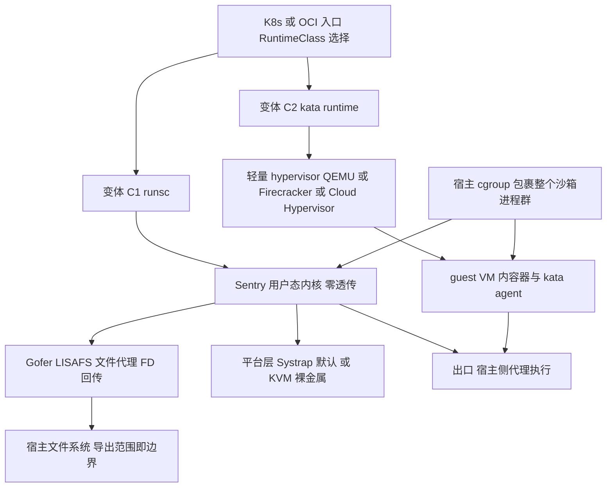

### 5.2 十七项设计（共用项合并，差异项分变体写）

| # | 项 | 本架构设计 | 依据 / 借鉴 |
|---|---|---|---|
| 1 | 系统组件 | 共用：OCI/K8s 运行时类入口、节点运行时、出口代理、制品存储。C1 特有：Sentry + Gofer 进程对。C2 特有：轻量 hypervisor + guest agent | [A · 线 C 专题 3 / 04 §4.1] |
| 2 | 控制平面 | 隔离档位以 RuntimeClass/服务器配置声明，启动时实测运行时可用性、不可用拒绝启动；多档共存靠多部署分流且须明示「选择粒度不是租户边界」 | OpenSandbox secure_runtime 模型与其官方指南原文警告 [A · 04 §0/§4.1] |
| 3 | 数据平面 | C1：应用 syscall 先进 Sentry、文件经 Gofer。C2：先进 guest 内核、再经 VM 边界 | [A · 线 C 专题 3 三分法] |
| 4 | 调度器 | 与 A 共用容量/亲和模型；C1 额外按 syscall 密集度给负载打标分流（见 5.3 兼容门），C2 按 KVM 节点池调度 | [设计判断] |
| 5 | 环境创建服务 | 创建前兼容门：C1 以目标负载的 syscall 面对照 gVisor 官方兼容表先验核对，未实现即 ENOSYS 的负载改路由；C2 校验 guest 镜像与 hypervisor 组合 | C1 兼容表为源码自动生成的派生视图，抓取时点（2026-10-27）352 条中 292 条 full-or-partial、引用必须带日期 [A · Round 5 线 C Q12] |
| 6 | 执行代理 | 沿用容器语义的 exec 通道；C1 的 /proc、dmesg 等为 Sentry 合成视图，观测类工具的行为差异要在执行代理层显式声明 | [A · 线 C 专题 3 §3.3] |
| 7 | 文件系统服务 | C1：Gofer 挂载导出范围 = 文件信任边界全集，Sentry 不能凭空越出；directfs 默认关，开启须走安全评审。C2：guest 内文件系统 + 宿主共享目录通道，边界在 VM | [A · Round 5 线 C 线 2]；directfs 是以隔离收敛换性能的旁路 [A · 同上] |
| 8 | 网络代理 | C1：默认走 Sentry 虚拟网卡出宿主代理；host networking 与沙箱内自建网络栈都属削弱收敛的开关，按安全参数管。两变体最终执行点都收敛到节点 egress（与 A/B 同一策略面） | Sentry 对外交互面仅三类（Gofer socket、最小宿主 syscall 集、虚拟网卡收发）[A · Round 5 线 C 线 1]；[设计判断] |
| 9 | 权限与凭证管理 | 与 A/B 相同原则：凭证外置、出口注入。C1 附加面：Sentry 自身被空 mount ns + 最小宿主 syscall 集反向关住，此配置不可为性能调优放宽 | [A · Round 5 线 C 线 1]；[设计判断] |
| 10 | 日志、监控与审计 | C1 须把 Sentry CPU 开销单独计量（拦截层的成本在 Sentry 进程上，不在应用进程上）；C2 计量 guest 与 hypervisor 开销 | [设计判断 · 依据线 C 专题 3 性能定性] |
| 11 | 快照与恢复 | 两变体都不以内存快照为内建主路径：以工作区制品 + 销毁重建实现逻辑恢复。C2 若用 hypervisor 快照，继承 B 的全部快照纪律（认证加密、克隆分化） | [设计判断]；C2 快照路径本项目未深研，标 C（见矩阵） |
| 12 | 资源回收 | 单元销毁对象：C1 为 Sentry/Gofer 进程对 + 宿主 cgroup；C2 为 VM + agent。回收核验同 A 的 C7 清单 | [A · 09 冻结 C7]；[设计判断] |
| 13 | 故障处理 | 运行时可用性启动校验失败即拒绝接单；C1 负载运行中触发未实现 syscall 的失败要在执行代理层归因为「兼容门漏检」并回流创建服务 | [A · 04 启动校验]；[设计判断] |
| 14 | 高可用 | 与 A 同构：控制面多副本、节点故障按制品重建。C2 的节点池须与 B 共用 KVM 宿主池治理 | [设计判断] |
| 15 | 安全边界 | C1：Sentry 第二内核 + 宿主内核双层，攻破需双重利用且两内核不共享代码；官方明示不防范围——运行时之上组件漏洞、Spectre 类侧信道、被授权范围内的应用层作恶。C2：VM 边界（强度近 B），但 hypervisor 设备模型大于 Firecracker 极小模型者（QEMU 变体）攻击面随之放大 | [A · 线 C 专题 3 §3.2]；[设计判断] |
| 16 | 性能瓶颈 | C1：syscall 与小 I/O 密集负载开销显著、单次操作做的功越少相对开销越大；纯 CPU 与内存访问基本无开销；文件经 Gofer 有固定穿越成本。现行 Systrap 无官方可引用数字，禁止引用 ptrace 时代倍数，数字只能自测。C2：guest 启动与常驻、I/O 穿越 VM 边界 | [A · 线 C 专题 3 §3.4 定性结论]；[A · Round 5 线 C Q12 性能缺位结论] |
| 17 | 主要成本来源 | C1：Sentry 的 CPU 税（按负载 syscall 密度浮动）、兼容治理人力。C2：每单元 guest 常驻 + KVM 宿主池，与 B 部分重叠 | [设计判断 · 按 09 的 D 组口径] |

### 5.3 关键决策的借鉴出处

- 平台选择按宿主形态而非偏好：Systrap 于 2023 年中成默认（无虚拟化依赖、低拦截开销，ptrace 已停止支持）；KVM 平台只在裸金属占优，VM 内官方指引就是 Systrap [A · Round 5 线 C 线 3]。本架构把这一条写成部署门：云 VM 池默认 Systrap，裸金属池才评估 KVM 平台。[设计判断]
- 限额不指望沙箱内 cgroup：gVisor 沙箱内 cgroups 只记账不限额，限额靠宿主 cgroup 包裹整个 gVisor 进程群 [A · Round 5 线 C Q12 官方自列缺口]——资源治理的执行点因此钉在宿主侧，与 A 的 cgroup 执行点对齐。
- Gofer 协议口径更新：现行 Sentry↔Gofer 协议是 LISAFS，9P 为前代遗留 [A · Round 5 线 C 线 2]；架构文档与审计清单按 LISAFS 写，写 9P 须注明历史沿革。

### 5.4 最先被打穿的三条路径

1. **T06 安全容器逃逸（C1）**：Sentry 本身是重写内核，缺陷面在 Sentry 实现与平台层 stub；被攻破 Sentry 后仍需再破其最小宿主 syscall 面与 Gofer 收敛，但「双重利用」是概率优势不是不可逾越 [A · 线 C 专题 3 三分法]。
2. **T15 文件越权（C1 配置型）**：Gofer 导出范围给宽、或为性能打开 directfs，文件边界在部署日就已经被自己放宽——打穿发生在配置评审缺位时，不在运行时 [A · Round 5 线 C 线 2]。
3. **T05 VM 逃逸（C2 QEMU 变体）**：设备模型越丰富、VM 逃逸面越大；选 QEMU 变体图生态兼容时，等于主动接受比 Firecracker 更宽的设备攻击面，须以宿主侧 jailer/seccomp 与及时升级补偿 [设计判断 · 依据 12 §3 设备面分析方法]。另共用一条：**T03 语义逃逸**——C1 兼容子集导致的程序行为差异可能被误判为「跑通了」，把不兼容伪装成可用（对应创建服务的兼容门）[设计判断 · 依据线 C 专题 3 §3.3]。

### 5.5 不适用场景

- C1 不适用：syscall/小 I/O 极密集负载（小包网络、元数据密集文件服务）、要求真实内核行为保真（驱动、底层网络、依赖真实 /proc 与内核日志的观测栈）、依赖 io_uring 完整语义或沙箱内挂载块设备文件系统的负载 [A · Round 5 线 C Q12 官方缺口清单]。
- C1/C2 共同不适用：把「安全容器」当作同沙箱混跑互不信任客户的理由——官方明确要求不同客户分沙箱 [A · 线 C 专题 3 §3.5]。
- C2 不适用：无 KVM 宿主；密度与冷启同时苛刻且负载 syscall 面简单（此时 C1 或 A 更合算）[设计判断]。

---

## 6. 架构 D · WebAssembly 型（Wasmtime / WASI 能力模型）

定位：不是 OS 执行环境，而是「细粒度能力授权的函数/插件层」。
结论先行（本项目既有定论）：Wasm 与容器/VM 是分层关系不是替代关系 [A · 线 C 专题 4 §4.4]；
本架构只承接能被编译为 Wasm 组件、且能力面可枚举的负载子集，其余负载必须路由到 A/B/C（即落入架构 E 的组合）。

### 6.0 负载子集边界（硬边界，先于一切设计）

**能跑**：可编译到 WASI 的单体计算（数据变换、解析、校验、推理前后处理）、
无状态/短生命周期函数、以 import 形式可完全表达其 I/O 需求的工具与插件、
语言运行时有成熟 WASI 目标的子集（以目标运行时实际支持为准，不承诺任意语言原生生态）。

**不能跑（结构性，不是调优问题）**：任意 shell 与工具链（包管理器、编译器、解释器原生二进制）、
需要 fork/exec 任意原生程序的 Agent 工作区、浏览器/GUI、守护进程与后台任务、
依赖真实 /proc 语义、挂载、设备、网络命名空间操作的负载、调用未移植原生扩展的语言生态部分。
把通用 Agent 工作区硬塞进 Wasm，等于先把整个工具链逐个移植/模拟一遍 [A · 线 C 专题 4 §4.4]。

### 6.1 组件图

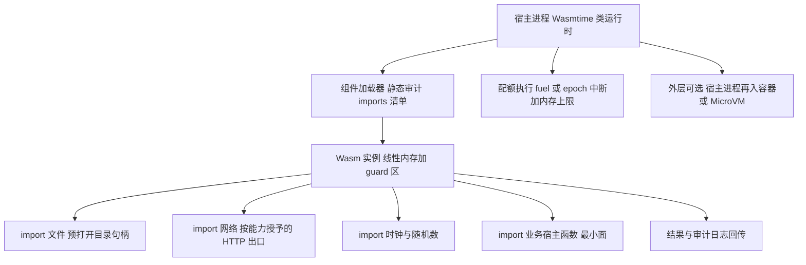

### 6.2 十七项设计

| # | 项 | 本架构设计 | 依据 / 借鉴 |
|---|---|---|---|
| 1 | 系统组件 | 运行时宿主进程、组件注册表、加载器（静态审计）、能力授予配置、配额执行器、结果通道 | [设计判断 · 依据线 C 专题 4 的能力模型] |
| 2 | 控制平面 | 组件注册与版本、每组件的能力清单（imports 即权限清单）审批与变更审计；清单可在二进制中静态检查，审查在加载前完成 | WASI 0.2 组件以 WIT 接口表达能力、宿主只以被授予 import 实例化 [A · 线 C 专题 4 §4.2]；审查前置为其直接推论 [A · 同上] |
| 3 | 数据平面 | 宿主进程内实例调用；无 OS 进程、无 guest；数据经 imports/exports 进出 | [A · 线 C 专题 4 §4.1] |
| 4 | 调度器 | 按实例并发与内存上限调度；高保障场景按租户分宿主进程（见第 15 项分层） | [设计判断] |
| 5 | 环境创建服务 | 创建 = 实例化已审计组件 + 绑定被授予的句柄集；未授予的能力在实例化期即不存在，不是运行时拒绝 | WASI 0.1 预打开 FD 无新 FD 申请、0.2 宿主按 import 实例化 [A · 线 C 专题 4 §4.2] |
| 6 | 执行代理 | 宿主函数集即执行面：每加一个宿主函数等于加一条 syscall，按新增 syscall 的标准评审（参数校验、路径规范化、配额） | 「宿主函数即新的 syscall 面」[A · 线 C 专题 4 §4.3] |
| 7 | 文件系统服务 | 仅预打开目录句柄内的访问；禁止把「读文件」import 实现成任意路径读取 | Wasmtime WASI 文件实现遵循能力模型、只能访问被授予目录 [A · 线 C 专题 4 §4.3] |
| 8 | 网络代理 | 默认无网络 import = 无网络；授予时优先「单个 HTTP 能力到指定目标」的窄接口，而非通用 socket | 能力粒度 [A · 线 C 专题 4 §4.4]；[设计判断] |
| 9 | 权限与凭证管理 | 凭证不进组件内存：需要带凭证的调用由宿主函数在宿主侧完成，组件只见结果 | [设计判断 · 与 04 Vault 的「真值不进沙箱」原则同构] |
| 10 | 日志、监控与审计 | 宿主侧记录每次 import 调用的能力使用审计；实例结束清零线性内存防同进程后续实例读到残留 | 实例清零为 Wasmtime 官方纵深项 [A · 线 C 专题 4 §4.1] |
| 11 | 快照与恢复 | 不适用 OS 级快照：以「无状态 + 状态外置」为设计前提；需要状态的负载不属于本架构子集 | [设计判断 · 依据 §6.0 子集边界] |
| 12 | 资源回收 | 实例销毁即回收；同进程多实例时回收须含内存清零与句柄表清理核验 | [A · 线 C 专题 4 §4.1 清零]；[设计判断] |
| 13 | 故障处理 | 实例 trap/超配额只终止该实例；宿主进程级故障影响同进程全部实例——这是分进程部署的决策输入 | [A · 线 C 专题 4 §4.4 同进程影响面] |
| 14 | 高可用 | 无状态实例天然可重放：任意宿主节点实例化同一组件即恢复服务，不做状态迁移 | [设计判断] |
| 15 | 安全边界 | 线性内存边界检查 + 类型化控制流 + 无环境权威三件套，外加运行时纵深（guard region、栈保护、Spectre 缓解为持续课题）；能力安全只保证未授予不可获得，不保证已授予被安全实现 | [A · 线 C 专题 4 §4.1/§4.3]。高保障定版：宿主进程再入容器/MicroVM 分层部署 [A · 线 C 专题 4 §4.4] |
| 16 | 性能瓶颈 | 实例化与计算本身为结构性优势（无 OS 启动）；瓶颈在宿主函数穿越频次、数据在大对象进出线性内存的拷贝、以及语言生态移植完整度（兼容性先于性能成为瓶颈） | 定性 [A · 线 C 专题 4 §4.4]；具体数字未验证、须按 D 线 B 组自测 [A · 同上] |
| 17 | 主要成本来源 | 宿主进程池常驻、组件移植与维护的人力（真实大头）、审计与能力清单治理 | [设计判断] |

### 6.3 关键决策的借鉴出处

- 运行时选 Wasmtime 为参照：官方安全文档最完整、WASI 文件实现遵循能力模型 [A · 线 C 专题 4 §4.3]。WasmEdge 的官方安全文档本项目未取得（Q14 未结案），其扩展面差异标未验证，架构 D 不以 WasmEdge 为据 [A · 线 C 专题 4 §4.3 缺口登记]。
- 配额用 fuel/内存上限：D 线威胁矩阵把 Wasm 档的 T22 对策记为 fuel/内存上限 [A · 线 D 路线速查表]。
- 分层而非替代的定版：直接采用线 C 专题 4 结论——Agent 主体在 MicroVM/容器，单个工具/插件以 Wasm 组件运行并按 imports 最小授权 [A · 同上]，这也是架构 E 中 D 档的接法。

### 6.4 最先被打穿的三条路径

1. **T06 Wasm 沙箱逃逸（运行时实现缺陷）**：同宿主进程内一处运行时缺陷可能影响全部共居实例 [A · 线 C 专题 4 §4.4]——不分进程部署时，这是第一路径。
2. **T20 合法能力滥用 / T15 路径越权（宿主函数面）**：能力已授予但实现不安全（任意路径读取、过宽目录、无校验的参数拼接），能力模型对此明确不兜底 [A · 线 C 专题 4 §4.3]。
3. **T19 Prompt Injection 经工具层放大**：组件能力清单若按「工具可能需要」从宽授予，被注入操纵的 Agent 可在授权内完成越权组合——防御在授予评审与调用审计，不在 Wasm 本身 [设计判断 · 回链 D 线 T19/T20 的 Harness 授权层结论]。

### 6.5 不适用场景

- 通用 Agent 工作区、AI Coding Agent 的完整工具链执行（§6.0 硬边界）。
- 长驻服务、后台任务、需要状态快照的负载。
- 需要浏览器/GUI/桌面的一切场景（走 E 的浏览器档）。
- 团队没有能力承担工具链移植与宿主函数安全评审时——此时 D 的人力成本高于其隔离收益 [设计判断]。

---

## 7. 架构 E · 混合型（分层路由：B 主干 + A/C 降档 + D 工具层 + 浏览器档）

定位：不是第六种隔离技术，而是把 A–D 组织成一个平台的路由与治理架构。
存在理由：单一路线无法同时覆盖「不可信代码全工具链执行、细粒度工具授权、浏览器会话」
三类形态差异极大的负载——这正是参照系统们已经在做的事：
OpenSandbox 三条执行路径共用一套生命周期 API [A · 04 §0]、E2B 在 MicroVM 内再跑完整工具链 [A · 07]、
线 C 的分层结论（主体 MicroVM/容器 + 工具 Wasm）[A · 专题 4]、Browserbase 的浏览器 per-VM 形态 [A · 13 号报告 §1.1]。

### 7.1 路由定版（设计判断，依据逐项给出）

| 负载 | 默认档 | 依据 |
|---|---|---|
| 不可信代码 + 完整工具链（公众多租户） | B MicroVM | 边界不依赖宿主内核正确性 [A · 线 C 三分法]；快照恢复支撑会话语义 [A · 07] |
| 内部可信度较高、syscall 面简单的批任务 | C1 gVisor | 密度近容器、边界强于 A；兼容门先行 [A · 专题 3] |
| 高频短任务、内部工具执行 | A 容器（全硬化档） | 密度与启动最优；威胁模型不含内核 0day 时成立 [设计判断] |
| 单个工具/插件/UDF | D Wasm（跑在任务所在沙箱内或独立宿主池） | imports 最小授权、审查前置 [A · 专题 4] |
| 浏览器会话 | 浏览器档：Chromium 跑在 B 或 A 单元内、一会话一实例一 profile、CDP 只经带认证网关 | Chromium 自身沙箱是内层、外层须再套沙箱 [A · 线 C 专题 5 清单]；Browserbase 的 per-VM + 销毁不复用为 SaaS 实证 [A · 13 号报告] |
| Computer Use/桌面 | B 单元内完整桌面会话，同生命周期同租户绑定 | 桌面残留终端/文件管理器同为执行面，须整机销毁 [A · 线 C 专题 5 清单第 7 条（该条原文标建议待补证据，此处沿用其定性）] |

### 7.2 组件图

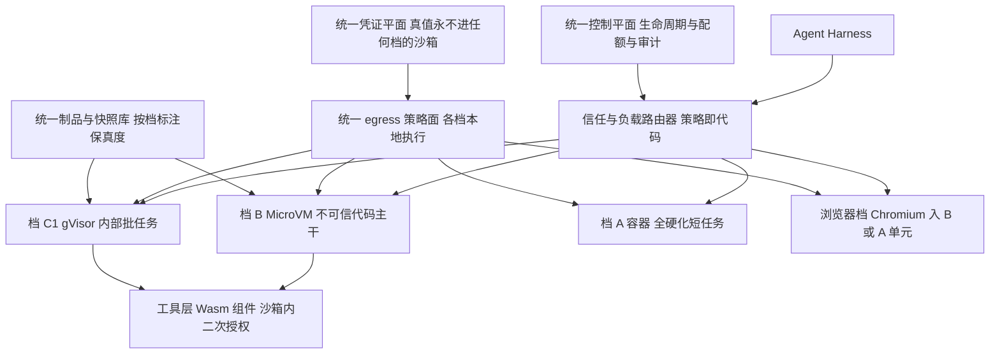

### 7.3 十七项设计

| # | 项 | 本架构设计 | 依据 / 借鉴 |
|---|---|---|---|
| 1 | 系统组件 | 统一控制平面 + 路由器 + 四个执行档 + 三个统一平面（egress/凭证/制品）+ 浏览器档 | [设计判断 · 组织方式借鉴 04 的多路径单 API] |
| 2 | 控制平面 | 一套生命周期 API 覆盖全档；API 层显式暴露每档的能力差异（快照保真度、兼容子集），禁止用统一词汇掩盖差异 | 04 的 spec 与实现差距教训：读 spec 低估、读 README 高估，须按后端逐项核 [A · 04 §8] |
| 3 | 数据平面 | 各档保持各自数据面（§3–§6），平台不做跨档统一执行通道 | [设计判断] |
| 4 | 调度器 | 两级调度：先由路由器定档（信任级 × 负载形态 × 兼容门结果），再在档内按各档模型放置；定档结果与理由写入审计 | [设计判断 · 回链 T20：定档即授权决策] |
| 5 | 环境创建服务 | 按档调用各自创建服务；跨档一致的只有创建契约（配额、网络策略引用、凭证绑定引用、工作区制品引用） | [设计判断 · 借鉴 04 的统一创建请求字段] |
| 6 | 执行代理 | 每档各自代理（execd/envd/宿主函数/CDP 网关），对上暴露统一的流式与文件接口子集；CDP 只经带认证网关、永不直达租户网络 | CDP 无内建认证与会话接管风险 [A · 线 C 专题 5 §5.4] |
| 7 | 文件系统服务 | 工作区制品为跨档唯一通用货币：任务在档间迁移只能经制品导出/导入，不存在活迁移 | [设计判断 · 依据 04 两套 checkpoint 互不共享的同构教训] |
| 8 | 网络代理 | 策略一份（默认拒绝 + 平台 deny 最高优先 + 元数据硬编码拒绝）、执行多点（sidecar/共享 egress/宿主防火墙/Wasm 窄接口/浏览器档 egress），每点须通过同一 C8 矩阵验收 | 策略模型 [A · 04 §5]；硬编码元数据拒绝 [A · 07 §6]；验收线 [A · 09 C8] |
| 9 | 权限与凭证管理 | 统一 Vault 平面：真值只在出口执行点、按租户分键、全档一致；任何档的本地凭证落盘实现（如明文文件）一律定为平台级缺陷 | [A · 04 §6 正面与反面证据]；[设计判断] |
| 10 | 日志、监控与审计 | 统一审计模式：定档、策略合并、凭证绑定、快照制品流转四类事件必入审计；性能指标按档分开报，禁止跨档平均 | 口径纪律 [A · 09 §2 统计口径与 04 的 62s 教训] |
| 11 | 快照与恢复 | 按档保真度分级并在 API 明示：B 为内存级、A/C 为制品级、D 不适用；「暂停/恢复」在不同档语义不同，客户端不得假设一致 | [A · 04 §3 三套机制不要混]；[设计判断] |
| 12 | 资源回收 | 每档执行各自回收 + 平台级对账清道夫跨档巡检 C7 清单 | [A · 09 C7]；[设计判断] |
| 13 | 故障处理 | 单档故障不扩散：路由器可把新任务改道他档（须同信任级或更高档，禁止故障时自动降档到更弱边界） | [设计判断 · 安全侧fail-closed 原则回链 04 §5] |
| 14 | 高可用 | 控制平面与三个统一平面多副本；执行档按故障域分布；档间无状态共享（制品库除外） | [设计判断] |
| 15 | 安全边界 | 平台边界 = 最弱档边界的并集风险：路由器与统一平面进入信任基；任一档被打穿不得横向进入统一平面（凭证/策略/制品库按租户分键且执行点只持本档所需） | [设计判断 · 回链 T16 跨租户与 T14 供应链] |
| 16 | 性能瓶颈 | 路由与策略合并的控制面开销、制品跨档搬运、浏览器档的 per-VM 成本；各档自身的瓶颈见 §3–§6，不重复 | [设计判断] |
| 17 | 主要成本来源 | 多档并存的固定成本（KVM 池 + 暖池待机 + 浏览器 VM 池 + 治理人力）——E 的成本本质是「为覆盖面交的税」，小规模部署不回本 | [设计判断 · 按 09 的 D6/D8 口径] |

### 7.4 关键决策的借鉴出处

- 「多路径单 API」组织方式：借鉴 OpenSandbox（Docker/K8s/Fast 三路径共用生命周期 API、按 templateId 与 ID 前缀分发）[A · 04 §0]。同时继承其教训：能力按后端高度不齐，选型与文档必须按「后端 × 能力」矩阵逐项验 [A · 04 §9]。
- 浏览器档的 per-VM 与销毁不复用：借鉴 Browserbase 企业安全页口径（一浏览器一 VM、独立 subnet、session 后销毁重建）[A · 13 号报告 §1.1]；Chromium 内层纪律（禁 `--no-sandbox`、保持站点隔离、profile 一会话一毁）来自线 C 专题 5 清单 [A]。
- 故障不降档：把 egress 的 fail-closed 原则从网络面推广到路由面 [设计判断 · 依据 04 §5 的 "policy may be late, never open"]。

### 7.5 最先被打穿的三条路径

1. **T20 路由降级与合法工具组合越界**：攻击者（或被注入的 Agent）诱导路由器把不可信负载定到弱档，或在低档内用合法工具组合拼出高档能力。防御全在定档策略的保守性（默认最高档、降档需显式依据）与审计 [回链 D 线 T20]。
2. **T16 经统一平面的跨租户泄露**：egress/凭证/制品库是全档共享面，一处租户分键失效即全档失守；Fast 路径明文 vault 文件即此类教训的单点版本 [A · 04 §6]。
3. **T24 预热池状态污染（跨档版）**：暖池与制品复用在任一档未做 canary 校验与彻底清理，污染会随池复用横向传播到后续租户 [回链 D 线 T24 与冻结线 C5（污染率 = 0）]。

### 7.6 不适用场景

- 单人/小团队的个人 Agent 项目：固定成本与治理复杂度远超收益，直接选 B 的 SaaS 或自托管单档。
- 负载形态单一（如纯代码判题、纯函数插件）：单档 A 或 D 即可，E 是过度工程。
- 没有专职平台运维的团队：多档并存的升级、兼容门与策略治理是持续人力承诺，不是买带宽能解决的 [设计判断]。

---

## 8. 收口：借鉴索引与证据纪律复述

五份架构的真实系统借鉴汇总（详细出处见各节）：

| 架构 | 借鉴的真实系统（证据等级） |
|---|---|
| A 容器型 | OpenSandbox 容器路径与 egress/Vault [A]、E2B 元数据硬编码默认（单点借鉴）[A]、本项目 Lab 单元销毁实测 [SELF] |
| B MicroVM 型 | Firecracker 上游 [A]、E2B runtime [A]、OpenSandbox Fast 外仓 [A] |
| C 安全容器型 | gVisor 官方机制与 Round 5 选读 [A]、OpenSandbox secure_runtime 换档模型 [A]、Kata 运行时类映射（经 04）[A]、Kata 快照路径 [C 未深研] |
| D Wasm 型 | Wasmtime/WASI 官方安全模型（经线 C 专题 4）[A]；WasmEdge 未取得官方安全文档，不为据 [U 登记] |
| E 混合型 | OpenSandbox 多路径单 API [A]、E2B 的 MicroVM 内工具链形态 [A]、Browserbase 浏览器档口径 [A]、线 C 分层结论 [A] |

纪律复述：本文全部性能表述只用三类已验证口径——官方公布数字（带 [OFFICIAL] 与样本口径）、
本项目 LAB-MINI 自测（带 [SELF] 且禁止外推）、机制定性（无数字）。
凡标「设计判断」者均为本项目在已验证事实之上的取舍决定，可被后续实验与深研推翻，推翻时按 09 冻结文件的变更控制留痕。

---

## 9. Phase 6/7 整合修正记录（2026-10-28，主线整合自检）

- §5.2 第 5 项：gVisor 兼容数字「352 条中 292 条 full-or-partial」原引未带抓取日期，与该格自立的「引用必须带日期」规则不符；已补「（2026-10-27）」。属标注补全，不改变任何结论。详见 16-PHASE67-REPORT.md §2(c)。
