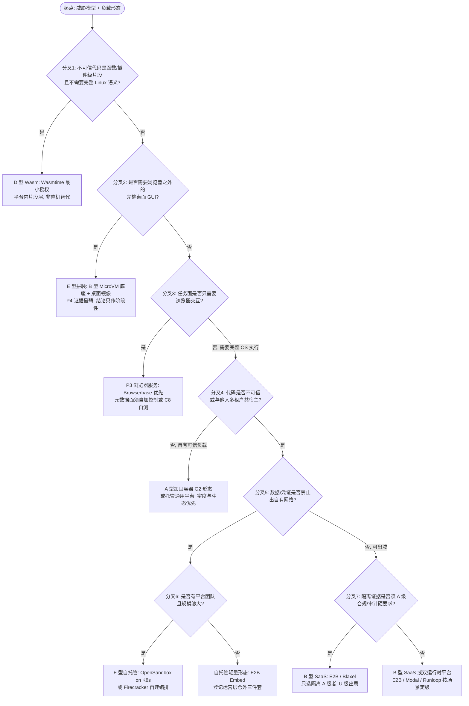

# 15 · 选型框架：17 维度定义、路线对照与 9 场景选型

> 项目：Agent Sandbox 全领域技术研究（goal_a756da9ace9a）｜ Phase 7 线 B
> 日期：2026-10-28（Asia/Shanghai）｜ 证据等级：A 官方/源码/论文 · B 可靠独立 · C 推断待验证 · U 未知；自测数据标 [SELF]
> 素材边界：本文件所有产品事实回指 `products.csv`（53 行，A22/B13/C17/U1）与 02/05/08/11/13 各轮报告及深研 04/06/07/12；不新增未核实事实。架构命名与线 A 对齐：**A 容器型 / B MicroVM 型 / C 安全容器型 / D Wasm 型 / E 混合型**（详见 14-REFERENCE-ARCHITECTURES.md）。
> 价格口径声明（全文件适用）：各家计费单位至少 7 种且互不一致（vCPU·秒、GB RAM·秒、core·秒且 1 core=2 vCPU、browser hour、30 秒 Unit、credit、实际用量 CPU·h，见 02 报告 §1.5），**任何价格对照必须先声明换算假设**；本文件只引 CSV 已核口径并注明单位，不做跨家价格排名。

## 0. 本框架的判定方式（先读）

1. **不设综合评分、不算总分、不排名次。** 没有任何一个数字能同时表达「隔离证据强度」和「计费口径可比性」这类不可通约的东西；综合分只会把 U 级证据洗成看起来精确的结论。
2. **只做维度级定性判定**：每维用 强 / 中 / 弱 / 未知（U）/ 不适用 五档，判定后必须跟证据指针（CSV 字段、报告章节或实验编号）。「未知」是合法判定，且在高安全场景里等于「不得入选」（见 §3 的硬门槛规则）。
3. **权重不在框架层预设，由场景决定**：同一维度在不同场景权重完全不同（启动速度对判题平台是二阶量、对交互式 Coding Agent 是一阶量）。每个场景在 §3 公开自己的加权说明——哪几维是一票否决、哪几维是优化项。
4. **产品点名受 CSV confidence 约束**：隔离事实为 U 的产品（Hyperbrowser 隔离 U、Steel SaaS 隔离 U、Daytona 容器 runtime 名 U），不得作为高安全场景的隔离边界推荐；候选级（C）产品只能以「候选、未核实」身份出现，不得作主推荐。
5. 推测性判断逐条标 **[C-n]** 编号，全文件共 18 条，文末登记。

---

## 1. 17 个评价维度的严格定义

每维给四件事：测什么、证据从哪来（对应本项目已有资产）、该维度已知的不可比陷阱。

| # | 维度 | 测什么（判定对象） | 证据来源（本项目） | 不可比陷阱 / 判读注意 |
|---|---|---|---|---|
| 1 | 隔离强度 | 租户/任务之间的实际边界由什么构成：共享内核（T1）、用户态内核（T2）、独立 guest 内核（T3/T4）、线性内存（T5）；以及边界的**默认形态**而非可配置上限 | CSV `isolation_tech`；深研 04/06/07/12（源码级）；01 分类 T1–T8 | ①「支持 Kata」≠ 默认 Kata：OpenSandbox 的 secure_runtime 是服务器级配置、多档共存官方明说不是租户边界（04）。②开源版形态 ≠ SaaS 形态（Browserless/Steel 双写教训，13 §1.1）。③「用 MicroVM」已成营销词，只有给出 VMM 名、每会话边界与销毁语义的一手表述才算证据（02 §1.1） |
| 2 | 威胁模型适配度 | 产品/架构对**你的**威胁清单（D 线 T01–T25）逐条的覆盖方式：哪条靠隔离、哪条靠策略层、哪条根本不在其模型内 | D 线威胁矩阵（round1-D §1）；09 冻结 C 组判据；深研中的 egress/vault 章节 | 底稿级结论（C，待跨线验证）：隔离路线主要决定逃逸/内核类威胁（T04–T08）上限，网络类（T09–T12）与 Agent 类（T19/T20）取决于平台策略与 Harness 授权层——拿隔离强度代替威胁适配度是最常见的选型错误 |
| 3 | 启动速度 | 从请求到「可执行第一条命令」的时间，须注明完成口径：VM resume / 进程就绪 / 首次命令可执行 / 端点网关就绪 | CSV `startup_latency`；D 线 A 组指标定义（A1–A8）；深研实测口径注记 | **四种语义不可混引**：OpenSandbox Fast 创建 64.0ms（暖池串行、终点 guest /ping）与 SDK resume ≈62s（端点就绪口径）同出官方一份实测；外仓另有 77.9ms 第三口径。只报单个「启动 xx ms」而不带口径与暖/冷状态的数字一律不采信 |
| 4 | 运行性能 | 同负载相对原生基线（G0）的开销：CPU、syscall、I/O 路径的相对比值，而非绝对跑分 | D 线 B 组指标（相对 G0 口径）+ 对照组 G0–G6 设计；LAB-REF 待测 | ① gVisor 官方 Performance Guide 是已退役 ptrace 平台口径，数字禁止引用（13 §2 Q12 结案）。②本项目 [SELF] 性能数据仅有 LAB-MINI 冒烟级（ST-1/2/4），且明示禁止外推、禁止用于产品排名（11 §1）。③syscall 密集负载与计算密集负载的开销结构完全不同，只报一种负载的「性能」是误导 |
| 5 | 资源开销 | 每沙箱的固定占用（VMM/运行时进程、guest 内核、agent）与密度上限：单宿主可并置数、空载内存基线 | D 线 B3/D1；各深研的资源章节；CSV `resource_limits` | 快照恢复型架构的开销藏在快照存储与页缓存而非 RSS；只看进程内存会系统性低估 B 型路线的真实占用（口径须含存储，见 D7） |
| 6 | 语言与工具兼容性 | 目标负载实际需要的 syscall/工具链/原生二进制能否跑：fork/exec、shell 工具链、包管理器、浏览器、GPU | CSV 字段 + gVisor 官方兼容清单（源码自动生成，amd64 352 条中 292 full-or-partial，2026-10-27 快照，引用须带日期，13 §2）；C 线 Wasm 专题 | ①兼容清单是时点快照，且官方明示「未实现 ≠ 应用不可用、清单本身不是兼容性的好度量」。②Wasm 的兼容问题是语义级（无完整 Linux 语义）不是清单级。③GPU 可用性会反转运行时选择：Modal 的 GPU Sandbox 仅支持 gVisor 运行时（CSV） |
| 7 | 浏览器支持 | 是否提供浏览器/GUI 执行面、会话隔离粒度、Cookie/profile 资产如何处理、销毁是否复用 | CSV `browser_or_gui` + P3/P4 行；13 报告五家攻坚结果 | ①P3 浏览器服务与 P4 完整桌面是两个品类，不得互相替代（见 §2.6）。②浏览器 SaaS 的元数据/SSRF 默认策略五家全 U、官方渠道已穷尽（13 §2 Q6）——该维度的「网络安全」子项只能靠自测或自加控制，不能看文档判定 |
| 8 | 网络控制 | 出站策略的粒度与**默认值**：域名/IP 白名单、DNS 控制、内网与元数据阻断是默认还是配方、fail-open 还是 fail-closed | CSV `network_control`；深研 04/06（OpenSandbox egress）、07（E2B 防火墙）、12；LAB EXP-03 [SELF] | **机制强 ≠ 默认强**，本项目有双向实证：E2B 的 `DeniedSandboxCIDRs` 是硬编码默认拒绝（排在一切放行之前）；OpenSandbox 机制最硬（sidecar 独占 NET_ADMIN、fail-closed）但元数据/内网阻断非默认、须运维自写 deny.always 配方（08 §1.2/§1.1）。按产品名判网络控制必然出错，必须按实际部署配置测 |
| 9 | 数据持久化 | 状态的存续语义：临时/快照/卷/常驻工作区；暂停保留时长；快照的完整性与机密性由谁负责 | CSV `filesystem`/`persistence`/`lifecycle`；12 报告快照结案（Q13） | ①快照文件在 Firecracker 官方威胁模型里是**可信输入**：CRC64 仅覆盖 vmstate（防损坏非防篡改），内存/磁盘无内建校验与加密——「有快照」≠「快照安全」，认证加密是集成方责任。②「数据保留期」（retention）是删除政策，不是状态存续保证（Browserbase 口径教训） |
| 10 | 多租户支持 | 每租户边界粒度（VM/容器/进程）、调度公平性、状态污染防护、复用与销毁语义 | CSV `concurrency_limits` + 隔离/生命周期字段；D 线 C5（跨任务污染率）判据已冻结未执行 | 进程级分离（单容器多浏览器进程）是会话分离、不是租户边界——Browserless/Steel 开源版形态不得外推为多租户能力。复用型环境（池化/快照克隆）必须额外回答状态分化问题（见维度 9 与 Q32） |
| 11 | 可观测性 | 平台提供的日志/指标/审计/会话回放，以及自托管时这些面是否在开源面内完整 | CSV 字段 + 深研运营层章节（07 §1.2 运营层仓外三件套）；D 线核心资产含审计日志完整性 | 「开源全栈」可能在运营面不完整：E2B 的计费档位、secrets 值解析、webhooks 后端都在公开仓之外（07）。选自托管路线时，可观测性与审计面要按「仓内可审计部分 + 仓外黑盒部分」分开验收 |
| 12 | 开发运维复杂度 | 从零到生产可用的团队成本：控制面组件数、部署形态、对 K8s/KVM 等底座的要求、故障面 | 深研 04/06/07 的组件与部署章节；CSV `deployment` | ①复杂度不在运行时而在运营层（计费、密钥、审计、配额）——自建时这部分没有现成答案。②「单机可跑通」是官方自述级证据（E2B Embed），未经本项目部署验证，引用须带此限定 |
| 13 | 商业价格 | SaaS 轨的真实账单结构：计费单位、免费额度、附加项（代理/快照/存储/出站流量） | CSV `pricing`（官方 pricing 原文，A 为主）；D 线 D1–D8 成本模型 | **全框架最大的不可比维度**：计费单位 ≥7 种且 vCPU 定义互不一致（02 §1.5）；旧价污染已实证三处（Fly Sprites、Steel、CodeSandbox 均被现页覆盖，02 §3）——引用任何二手比价文必错。比价前必须按 D3 口径（标准任务集总成本）换算并声明假设，禁止按标价单位直接排序 |
| 14 | 自建成本 | 自托管轨的总拥有成本：宿主资源（D1 空闲/D2 创建/D7 存储/D8 平台固定开销分摊）+ 运维人力 + LAB-REF 类基础设施投入 | D 线成本模型 D 组；11 报告 LAB-REF 前置条件（Q36） | 自建成本最容易漏计三项：快照与持久化存储（D7）、平台固定开销分摊（D8：控制面/日志/egress 代理）、以及实验与验收环境本身（本项目的 LAB-REF 就是一笔真实前置成本） |
| 15 | 供应商锁定 | API/SDK 的专有程度、数据与模板的可迁移性、有无同代码自托管逃生口 | CSV `deployment`；深研的 API 关系章节（04 §1.2 与 E2B 无关的结论） | ①概念相似 ≠ 可迁移：OpenSandbox 与 E2B 无兼容层，迁移 = 按新 API 重写集成（04）。②有逃生口也要验成色：E2B Embed 与 Cloud 同源同线已证（A），但「此刻同版本」无法证（U 尾巴，08 §2.2）——锁定风险低 ≠ 零 |
| 16 | 社区活跃度 | 维护节奏（release/commit 时点）、治理形态（基金会/厂商/社区）、生态采纳信号 | CSV `status`/`latest_version`/`last_maintained`（gh 一手核实）；02 §2 | 「活跃」要拆口径：Judge0 是 release 停滞（v1.13.1, 2024-04）与 commit 活跃（2026-10-26）并存，只报一种口径都会得出错误结论（02 §3 #14） |
| 17 | 维护风险 | 项目/厂商层面的存续与漂移风险：归档、收购、核心转私有、版本机制不成熟、文档与代码冲突 | CSV `status`/`notes`；各轮纠错清单（02 §3、05 §3、08 §2、13 §1） | 已实证的风险形态各异：Daytona OSS 归档且核心转私有（SaaS 与 OSS 从此是两个事实）；Blaxel 被 Baseten 收购、CodeSandbox 并入 Together（主体变更，条款原文未取）；OpenSandbox Fast 无 release/tag、以 commit pin 集成、CRD 仍 v1alpha2 alpha；注释断言与代码冲突（F9 vault「encrypted at rest」无实现，标 U）。维护风险低的产品，其**文档**也可能漂移（旧价污染同源） |

### 1.1 权重的使用方式

- 框架层只给维度定义与判定，**不给跨场景通用权重**。
- §3 每个场景声明三类权重：**门槛维**（不达标即出局，如高安全场景的隔离强度证据等级）、**一阶维**（决定推荐排序）、**二阶维**（同档时参考）。
- 当两个候选在一阶维不可区分（差异小于证据精度）时，结论写「当前证据下不可区分」，不硬排——与 D 线统计口径（差异小于批间波动不排名次）同源。

---

## 2. 技术路线两两对照（9 组）

每组给：分水岭问题（什么条件决定胜负）、各自胜场、证据指针。胜场判定只在该组两方之间成立，不跨组外推。

### 2.1 容器（A 型）vs MicroVM（B 型）

- **分水岭问题**：沙箱里跑的代码是否「不可信且与他人共宿主」？是 → 边界必须是独立 guest 内核（B）；代码可信或单租户自担风险 → A 的密度与生态占优。
- **A 胜场**：启动与密度（无 guest 内核开销）、镜像生态与工具链原生兼容、运维心智成熟。加固形态（D 线 G2：cap drop、no-new-privileges、seccomp、只读根、user namespace）是容器路线的正确基线，裸 runc 默认配置（G1）只是对照基线、不是生产形态。
- **B 胜场**：逃逸需穿透 VMM 而非共享内核，内核类威胁（T04/T07/T08）的上限由架构决定；每会话独立内核使「邻居哨兵劣化」「内核参数互相污染」类问题结构性消失。
- **成本注记**：对中小规模、内部可信负载，加固容器的全生命周期运维成本大概率低于自建 MicroVM 池——B 型的成本大头在编排、快照存储与宿主加固，而不是 VMM 本身 **[C-1]**。
- 证据指针：01 分类 T1/T3；D 线对照组 G1/G2/G4；深研 07（E2B 的宿主侧收敛靠 cgroup+netns，orchestrator 以 root 拉起 FC——B 型也不是「装上就安全」，宿主面仍要审计）。

### 2.2 原生容器（A 型基线）vs gVisor（C 型）

- **分水岭问题**：负载的 syscall 面是否落在 gVisor 兼容清单的高覆盖区、且你是否愿意用性能换「不共享宿主内核的 syscall 路径」？
- **原生容器胜场**：兼容性满分（真内核）、性能无拦截层、生态零适配。
- **gVisor 胜场**：syscall 由用户态 Sentry 独立实现、零透传，未实现即 ENOSYS——宿主内核攻击面从「全部 syscall」收敛为 Sentry 与宿主的最小交互面；且平台选择有明确指引：Systrap 为默认（无虚拟化依赖、低开销），KVM 平台只在裸金属占优，VM/嵌套环境用 Systrap（13 §1.3）。
- **判读注意**：文件面边界 = Gofer 的挂载导出范围，且现行协议是 LISAFS 不是 9P；directfs 是以隔离换性能的旁路，开启后必须当安全参数重新审查（13 §1.3）。兼容数字引用必须带日期（352 条中 292 full-or-partial @2026-10-27）；性能数字官方现行材料未提供 Systrap 基准，旧 ptrace 口径禁止引用，只能自测（B7）。
- **成本注记**：以 shell 工具链为主的 Coding Agent 负载，其常用 syscall 大概率落在清单高覆盖区，实际踩到硬缺口（沙箱内 cgroup 只记账不限额、io_uring 默认禁用等官方自列项）之前，应先用目标负载做一轮兼容冒烟再下结论 **[C-2]**。
- 证据指针：CSV gVisor 行；13 §1.3/§2（Q12 结案）；D 线 G3。

### 2.3 Kata Containers vs 裸 Firecracker 类编排

- **分水岭问题**：你是否已经站在 Kubernetes 上？已在 K8s 且要给现成 Pod 提升隔离档 → Kata 是运行时替换；从零设计沙箱平台、要对生命周期/快照/池化全栈掌控 → 裸 Firecracker 编排。
- **Kata 胜场**：OCI/K8s 语义不变（RuntimeClass 切换）、多 VMM 后端可选（Cloud Hypervisor/QEMU/Firecracker 等，CSV 注明后端矩阵未逐项核实）、平台团队迁移成本低。GKE Agent Sandbox 支持 Kata 即此路线在云厂商侧的落点（CSV，A）。
- **Firecracker 胜场**：设备模型与快照语义完全自控（UFFD 懒加载、内容寻址 artifact 等机制可直接编排，见 06/12）；E2B 与 OpenSandbox Fast 两条产品线都证明这是「做平台」的选型。
- **成本注记**：把现成 K8s 工作负载直接提升隔离档时，Kata 的迁移与验证成本显著低于改走裸 Firecracker 编排——后者的账单主要在控制面重写而非运行时本身 **[C-3]**。
- 证据指针：CSV Kata 行（A，具体后端细节与启动/密度开销待实测）；12 报告（设备面「核心极小、受控扩张」、jailer 与内建 seccomp 是两层独立机制）；D 线 G4/G4b（Kata 须单独成组、配置不可与 Firecracker 混）。

### 2.4 Wasm（D 型）vs 容器（A 型）

- **分水岭问题**：不可信代码是「函数/插件级片段」还是「需要完整 Linux 语义的程序」？前者 D 型是更细的边界；后者 D 型根本不成立（无 shell 工具链、无 fork 原生二进制语义，C 线结论，CSV Wasmtime limitations）。
- **D 胜场**：能力安全是默认形态——无环境权威、一切经显式 imports；网络/文件都是可单独授予的 import（CSV Wasmtime，A）；实例级隔离粒度与极低的单位开销适合海量短片段。
- **A 胜场**：语义完整性。Agent 生成的代码默认假设完整 OS，这是 D 型当前无法承接的部分；WasmEdge 的插件扩展（socket 等）安全边界本项目未核（U，CSV），其结论在本框架中按「未知」处理。
- **成本注记**：把完整 Agent 工具链塞进 WASI 的改造与长期适配成本，通常高于它在隔离粒度上省下的收益；D 型的正确位置是平台内部的片段层，而不是整机替代 **[C-4]**。
- 证据指针：01 分类 T5；CSV Wasmtime（A）/WasmEdge 行；D 线 G5（只测可运行子集，禁止以子集成绩外推）。

### 2.5 自建 vs SaaS

- **分水岭问题**：数据/凭证是否禁止出自有网络，以及团队是否愿意长期持有运营层（计费、密钥、审计、配额、LAB-REF 类验收环境）？前者为是 → 自建或带逃生口的部署形态；后者为否 → SaaS 的机会成本更低。
- **SaaS 胜场**：time-to-value、弹性与峰值容量、宿主加固由厂商持有；且头部 SaaS 的隔离证据并不弱（E2B/Browserbase/Blaxel 均 A 级官方表述）。
- **自建胜场**：数据面不出域、默认值可审计可改（对照维度 8：默认拒绝还是配方制只有自建能完全掌控）、无供应商计费口径风险；OpenSandbox 是当前唯一「控制面+双运行时+egress/Vault」齐全的开源样本（02 §5）。
- **隐藏项**：自建的对照物不是「零」，是 D8 平台固定开销分摊 + 维度 14 的三项易漏成本。团队规模小、用量未稳定时，自建总成本大概率高于 SaaS 账单 **[C-5]**；反之用量稳定且规模化后结论可能反转，须按 D3/D5 画像逐场景算，不给通用阈值。
- 证据指针：CSV `deployment` 全列；07（自托管成色：同源已证、同版本 U）；D 线 D 组。

### 2.6 浏览器服务（P3）vs 完整桌面（P4）

- **分水岭问题**：任务是否真的需要浏览器之外的桌面应用与 OS 级交互？只需要网页交互 → P3；需要桌面软件、文件系统级 GUI 操作 → P4/完整 VM。
- **P3 胜场**：会话粒度、并发与成本结构都是为浏览器任务设计的；隔离证据已有 A 级样本（Browserbase 每浏览器一台 VM、独立 subnet、销毁不复用）。
- **P4 胜场**：能力边界完整——但本项目 P4 是**全表最薄弱类**：仅 E2B Desktop 一个 C 级候选入表，云桌面厂商与参考实现均未核实（02 §4）。在这一组里，P4 的胜场是能力逻辑，不是证据优势。
- **成本注记**：大多数网页任务用完整桌面承接，是在为用不上的能力面支付攻击面与成本 **[C-6]**；反过来，把 P3 当桌面替代会在第一个非浏览器应用处翻车——两类不得互替（01 判定规则）。
- 证据指针：CSV P3 四行 + P4 候选行；13 §1.1；02 §4。

### 2.7 单任务 Sandbox（按请求/按任务）vs 持久工作空间（按用户常驻）

- **分水岭问题**：状态是任务的产物还是用户的资产？判题/一次性执行 → 单任务（销毁即清零，C5 污染问题结构性消失）；长程协作/代码库常驻 → 持久工作空间。
- **单任务胜场**：安全语义最干净——终止即全量回收，本项目 [SELF] 已证「单元级整体拆除 30/30 轮零残留」，而只杀主进程 30/30 轮恒留脱缰残留（11 §1，EXP-02）；计费与审计以任务为单位最易闭合。
- **持久胜场**：上下文连续性（登录态、代码库、历史产物）；但必须正面回答快照/复用的状态分化（Q32）与凭证驻留问题。
- **成本注记**：持久工作空间的真实成本主要不在计算，而在状态治理：快照存储（D7）、污染检测（C5）、凭证轮换与审计 **[C-7]**。
- 证据指针：01 §3 执行模型标签；09 冻结 C4/C5/C7；11 §1；CSV `lifecycle`/`persistence`。

### 2.8 按需创建 vs 常驻/预热池

- **分水岭问题**：延迟目标是否硬到愿意为待机付费？预热与快照恢复把「创建」换成「恢复/分配」，但池水位本身是持续成本（D6 预热池待机成本占比）。
- **按需胜场**：成本结构诚实（idle 接近零）、无池污染面；冷路径的真实数字常被低估——各家「启动」口径四种语义（维度 3），按需路线选型时必须索取与自己完成口径一致的那个数字。
- **常驻/预热胜场**：交互体验与尾延迟。机制样本：OpenSandbox Fast 暖池（64.0/77.9ms 双口径并存，均为暖池串行口径）、Blaxel standby resume 约 25ms（官方口径、非冷启动，CSV）、GKE Agent Sandbox Warm Pool 预热 <1s 分配（CSV，A）、Fly Sprites 三态（running/warm/cold）按实际用量计费。
- **成本注记**：用量呈潮汐形态时，预热池的经济性对池水位远比对单价敏感——先定水位策略（按峰值比例/按预测），再谈选哪家 **[C-8]**。
- 证据指针：D 线 A2/D6 联动口径；CSV `startup_latency` 各行口径注记。

### 2.9 单一隔离技术 vs 混合架构（E 型）

- **分水岭问题**：平台是否同时承接信任等级显著不同的负载（如内部可信批处理 + 公众不可信执行 + 浏览器会话）？是 → 按负载分档的 E 型；负载同质 → 单一技术栈的运维简单性胜出。
- **单一胜场**：审计面单一、故障模式可枚举、团队心智便宜。
- **E 胜场**：每档负载用与其威胁模型匹配的边界，不为低危负载付高危成本。现成样本：OpenSandbox 的容器/gVisor/Kata/Fast 分档（但注意：其分档是服务器级粒度、多档共存需多 Server 部署且官方明说不是租户边界，04/CSV）；Modal 双运行时按参数选择（GPU 仅 gVisor 是分档约束的实例）。
- **成本注记**：混合架构的复杂度成本大致随档位数量增长，且增长点在策略面（每档一套 egress/凭证/快照语义）而非运行时本身 **[C-9]**；档位超过团队能独立审计的数量时，E 型的安全收益会被配置错误吃掉——配置错误正是 T1 路线的主要剩余风险（01）。
- 证据指针：01 分类；04 深研（分档粒度与边界声明）；CSV Modal/OpenSandbox 行。

---

## 3. 9 个场景的选型

通则：每场景先声明权重（门槛维/一阶维/二阶维），推荐具体到「架构类型 + 可点名产品/项目」，点名资格受 §0 规则 4 约束。价格只引 CSV 口径并带单位，不排名。

### 3.1 个人 Agent 项目

- **权重**：门槛维 = 无（个人自担风险）；一阶维 = 开发运维复杂度、商业价格；二阶维 = 启动速度、社区活跃度。
- **推荐**：B 型托管 SaaS —— **E2B**（隔离 A：每 session 独立 Firecracker microVM；计费 $0.000014/vCPU·s 起、Hobby 有一次性 credit，CSV）。理由：个人项目的稀缺资源是时间，隔离证据 A 级且零运维。
- **替代**：本地自托管 **Microsandbox**（B 级：每 sandbox 独立 microVM 为官网 A 级自述、本地 runtime 开源免费；托管云仍 Private Beta 且定价未公开——个人用本地形态正好绕开未公开部分）；或 **Modal**（A：双运行时，Starter 有月度 credit）承接偏批处理的负载。
- **适用前提**：代码与数据可出本地到云端；用量在免费/低档额度附近；不需要浏览器/GUI 面。
- **主要风险**：用量涨起来后按秒计费的账单形态与本地开发的心智不同；供应商 API 锁定（维度 15）——个人项目可接受，但值得在第一天就把执行层调用收敛到一个自有接口后面。
- **明确不推荐**：① 自建 K8s 编排/OpenSandbox 全栈——复杂度与场景不匹配，运维成本大概率超过项目本身 **[C-10]**；② Judge0 类判题器（P2）当 Agent 环境——无会话语义、无工具链常驻，是另一个品类（01）。
- 证据指针：CSV E2B/Microsandbox/Modal 行；02 §1.5（计费口径）。

### 3.2 AI Coding Agent

- **权重**：门槛维 = 数据持久化（工作区/快照语义成立）；一阶维 = 启动速度（以恢复口径计）、运行性能、语言与工具兼容性；二阶维 = 商业价格、可观测性。
- **推荐**：B 型为主、按部署形态二选一——云端走 **E2B**（A：模板=预启动 VM 快照，创建/暂停/恢复/fork 同路，工作区连续性由架构原生提供）；自托管走 **OpenSandbox**（A：统一 lifecycle API + 双运行时分档 + egress/Vault，是唯一四件齐全的开源控制面）。这是纯技术选型结论；涉及具体产品实施的安排不在本文件范围。
- **替代**：**Runloop**（整体 B，隔离子项 A-：VM+容器双层、每 Devbox 一台临时 VM，产品定位就是 Coding Agent Devbox 与评测）；**Daytona** SaaS（B：stateful + snapshots/volumes、按秒计价透明；但容器 runtime 名 U、且 OSS 已归档，自托管路线不得选它）；**CodeSandbox SDK**（B，已并入 Together 平台，主体变更须在合同层留意）。
- **适用前提**：需要长会话 + 文件系统连续性 + 依赖安装等完整工具链（排除 D 型与无状态函数形态）；能接受快照恢复口径的延迟并实测之。
- **主要风险**：① 恢复延迟口径陷阱——OpenSandbox 的 SDK 口径 resume ≈62s（官方自标未解）与运行时 35ms 是两个数字，选型验证必须测自己完成口径的那个；对交互式 Coding Agent，恢复延迟对体验的影响大于冷启动 **[C-11]**。② 凭证进入工作区后的驻留与快照扩散（维度 9：快照是可信输入、集成方负责加密）。③ E2B 自托管形态的「同版本」U 尾巴（维度 15）。
- **明确不推荐**：① Daytona OSS 自托管（已归档、停止维护，01 判定规则明示禁止当活跃产品）；② 无状态函数平台裸跑 Coding Agent（无持久 fs 与长进程语义，靠外挂卷拼凑的形态在终止清零与状态一致性上都没有证据）。
- 证据指针：深研 04/06/07；CSV 对应行；08 §1.1/§1.2。

### 3.3 企业内部运维 Agent

- **权重**：门槛维 = 网络控制（内网/元数据默认姿态可审计）、凭证安全（归入威胁模型适配度）；一阶维 = 多租户支持（部门/权限隔离）、可观测性（审计面完整）；二阶维 = 启动速度、商业价格。
- **推荐**：E 型自托管 —— **OpenSandbox 部署于自有 K8s**（A：egress sidecar 独占 NET_ADMIN、平台覆盖层压过用户策略、fail-closed、Credential Vault 凭证不进主容器），或云上 **GKE Agent Sandbox**（A：gVisor 为主 + Default Deny 网络姿态，姿态是产品默认而非配方）。
- **替代**：**E2B Embed/BYOC**（A：与 Cloud 同源同线、出口防火墙硬编码默认拒绝表正好命中本场景的门槛维；但运营层三件套在仓外——计费、secrets 值解析、webhooks——企业部署须在合同/验收中单独落实这三面）。
- **适用前提**：有 K8s 平台能力或已在对应云上；能为 OpenSandbox 自写并审计 deny.always 配方（其元数据/内网阻断**非默认**，这是部署验收项不是产品缺陷申诉项）；凭证走平台 Vault/网关、不直注沙箱（Runloop 的 Agent Gateways 亦为此形态的产品样本，CSV）。
- **主要风险**：内部场景的成败关键多在凭证治理与审批/审计集成，而非隔离技术本身 **[C-12]**；egress 模式字符串非法时降级 dns-only 的软点（OpenSandbox，04）提示：策略配置必须有启动期校验与持续漂移检测，不能只靠部署时检查。
- **明确不推荐**：任何隔离未公开（U）的外部 SaaS 承接可触达生产内网与生产凭证的运维任务——不是其一定不安全，而是证据不满足本场景门槛维（判读规则见 §0 规则 4）；同理不推荐把运维 Agent 的网络面设为默认放行再靠事后审计兜底（与维度 8 的双向实证相悖）。
- 证据指针：04 深研 egress/Vault 章节；07 §1.2；CSV GKE Agent Sandbox 行。

### 3.4 面向公众的 Agent SaaS

- **权重**：门槛维 = 隔离强度（每用户独立边界须有 A 级证据）、多租户支持；一阶维 = 自建/商业成本（按 D3/D5 口径）、启动速度（暖池/恢复口径）、网络控制；二阶维 = 供应商锁定、维护风险。
- **推荐**：B 型每会话 MicroVM —— SaaS 轨走 **E2B**（A）或 **Blaxel**（A：每 agent 独立 hardware-isolated microVM、按 GB RAM·秒计费、无基础订阅费；注意其 2026-09 被 Baseten 收购为 B 级转述、条款原文未取，合同期须复核主体条款）；自托管轨走 **OpenSandbox**（A，双仓深研齐全）。这是纯技术选型结论，不含任何具体产品的实施计划。
- **替代**：**Vercel Sandbox**（A：每 sandbox 独立 Firecracker microVM + 专用内核、网络策略在 VM 外 host 侧强制；代价是与 Vercel 平台深度绑定，维度 15 扣分）；**AWS Lambda MicroVMs**（A：Firecracker + 快照 suspend/resume、Graviton 单价官方直引）作弹性执行层。
- **适用前提**：单位经济模型已按 D5 画像（P-SAAS 档，09 冻结）算过且成立；多租户污染（C5）与网络矩阵（C8）的自测能力在上线前就位（判据已冻结，执行依赖环境，11 §6）。
- **主要风险**：① 成本口径误判——各家单位不可直接比（维度 13），用标价单位估算公众 SaaS 的单位经济是系统性错误来源；规模化后单位成本的决定项会从运行时单价转向调度效率与快照存储 **[C-13]**。② 快照克隆的状态分化（VMGenID 机制存在已证，但具体产品恢复路径是否吃到该机制未证，Q32/LAB-REF）。③ 创业型供应商的主体与定价漂移（维度 17 已实证三种形态）。
- **明确不推荐**：① 单容器多进程形态（进程级分离）作多租户边界——那是会话分离不是租户隔离（维度 10）；② 隔离为 U 的 Sandbox 产品作唯一执行层（如 Hyperbrowser 的 Sandbox 线：隔离六渠道穷尽仍未公开，CSV）——可作外围能力，不可作边界本体。
- 证据指针：CSV 对应行；09 冻结 D5 画像；13 §1.1/§1.2。

### 3.5 不可信代码执行平台（判题 / 在线执行 / 代码评测）

- **权重**：门槛维 = 隔离强度 + 资源治理（配额与终止语义，T22）；一阶维 = 资源开销（密度）、运行性能；二阶维 = 商业价格（多为自建成本维）。
- **推荐**：分层组合 —— 执行原语用 **isolate / nsjail**（均 A：namespace+cgroups+seccomp 的 T1 原语，Judge0 的执行层正是 isolate），判题/提交层用 **Judge0**（A，注意其 release 与 commit 双口径）；不可信等级最高或需与他人共宿主时，整轨升档到 **Firecracker 自建**（A，底座深研 12）或 gVisor 运行时（C 型，见 §2.2）。负载形态（短时、无状态、单任务）与 §2.7 的单任务胜场正好同构。
- **替代**：云原语 **GKE Agent Sandbox**（A：gVisor 为主 + Default Deny、无产品附加费按 GKE 资源计价）；**Piston** 只能以候选身份列席（C：仓库存在已确认、隔离未核实），不得作主推荐。
- **适用前提**：负载短时无状态；配额与超时终止按 C1–C4 判据验收（冻结线：残留 = 0 为唯一通过线）；宿主加固按 Firecracker 官方 prod-host-setup 基线（D 线 G4 口径）。
- **主要风险**：T1 原语路线与宿主共内核，内核漏洞（T07）是剩余风险本体，须以宿主补丁节奏与 seccomp 收敛补偿；fork 炸弹/资源耗尽（T21/T22）的防线在配额执行而非隔离形态，LAB-MINI 已证「属性可读回 ≠ 策略在执行」的审计陷阱（11 §3）——验收必须实测生效，不看配置回读。
- **明确不推荐**：① 裸 runc 默认配置（G1）单独作不可信代码的边界——它在本框架里只是对照基线，最低起步是 G2 加固形态；② 语言级/解释器级限制（T8）单独作边界（绕过史多，01 已定性）；③ 判题生态对 isolate/nsjail 的惯性很强，但「生态惯性」不构成对新威胁面的豁免 **[C-14]**——升档判据应由威胁等级触发，而非由迁移成本否决。
- 证据指针：CSV Judge0/isolate/nsjail/Firecracker 行；09 冻结 C1–C4；D 线 G1/G2/G4。

### 3.6 Browser Agent

- **权重**：门槛维 = 浏览器支持（会话隔离粒度）；一阶维 = 隔离强度（会话资产即 Cookie/登录态）、网络控制（SSRF 面）；二阶维 = 商业价格（代理流量是独立大项）。
- **推荐**：**Browserbase**（A：每浏览器一台专用 VM、硬件虚拟化隔离、独立 subnet + 严格防火墙、session 后 VM 销毁重建不复用、驻留四区域可选）——它是 P3 中唯一隔离证据到 A 的一家，推荐直接由证据等级决定。
- **替代**：**Browserless SaaS**（B：Trust Center 明示容器化环境 + 网络分段、每连接独立 browser instance；但每 session 是否独立容器未点名（U 子项），敏感会话须按此缺口定级）；自托管且低敏感场景可用 **Steel 开源版**（源码 A：单 api 容器多浏览器进程——进程级分离，只适合自担风险的内部/低敏感用途）。
- **适用前提**：已在自有网络层面对 SSRF/元数据面加控制或完成 C8 自测——因为五家元数据专项默认策略全 U、官方路线已穷尽（13 §2 Q6 结案），文档无法替你关闭这一面。
- **主要风险**：会话资产（Cookie/profile）是本场景的核心资产，其驻留与销毁语义各家口径不一（retention ≠ 状态保证，维度 9）；代理流量计费（$6–12/GB 量级，各家 CSV 口径不一）常超过浏览器时长本身成为账单主项，比价须把两项合并按 D3 口径算。需要住宅代理与反检测指纹能力的场景，自建浏览器池的维护成本会快速吞噬节省 **[C-15]**。
- **明确不推荐**：① **Hyperbrowser** 承接高敏感登录态会话（隔离 U，六渠道穷尽；且其 SOC 2 口径以 security 页「aligned」为准、不得按已认证对待，CSV）；② 用开源版形态推断 SaaS 隔离强度（Browserless/Steel 的系统性落差，13 §1.1）；③ **Steel SaaS** 作隔离敏感场景的边界（SaaS 隔离维持 U，仅营销语 + 2024 年合作方线索）。
- 证据指针：13 §1.1 五家攻坚表；CSV P3 四行。

### 3.7 Computer Use Agent

- **权重**：门槛维 = 浏览器支持维的桌面形态（完整 GUI 能力）；一阶维 = 隔离强度、数据持久化（桌面状态）；二阶维 = 运行性能（GUI 交互延迟）、成本。
- **推荐**：E 型拼装 —— 以 B 型 MicroVM 平台为底座自建桌面镜像（底座证据 A 级：E2B/Firecracker 路线，含桌面模板的产品样本为 **E2B Desktop**，但其在本表仅为 **C 级候选**、未核实，只能以候选身份点名），浏览器子任务并行走 §3.6 的 P3 轨。选型姿态必须明示：**P4 是全表证据最薄弱类，本场景的任何点名推荐都只是阶段性结论、不是定论 [C-16]**。
- **替代**：完整 VM/云桌面形态（T6）承接桌面应用兼容性优先的负载（代价是启动与密度，维度 3/5）；或把任务面收窄到浏览器内（退回 §3.6），用能力收窄换证据确定性。
- **适用前提**：能自备桌面镜像与 GUI 自动化栈（截图/键鼠通道、会话录制）；接受本场景在 LAB-REF 与 P4 发现轮完成前无法做完整的隔离实测验收。
- **主要风险**：GUI 通道（剪贴板/文件传输/截图）是独立攻击面（D 线 T25）；桌面会话的登录态资产密度高于浏览器单会话；厂商证据缺位使维护风险维无法判定（U）——采购决策须把「证据补强」写成前置里程碑而非上线后事项。
- **明确不推荐**：把 Browser SaaS 当完整桌面替代（能力边界不同，§2.6）；在 P4 证据现状下签长约锁定单一桌面供应商（维度 15/17 双 U）。
- 证据指针：02 §4（P4 最薄弱类）；CSV E2B Desktop 候选行；01 分类 P4/T6/T7。

### 3.8 高安全要求的金融业务

- **权重**：门槛维（全部一票否决）= 隔离强度证据等级（须 A）、网络控制默认姿态（须可审计）、数据持久化中的快照机密性责任划分；一阶维 = 可观测性/审计面、多租户支持；二阶维 = 成本类全部。
- **推荐**：自托管 B/C 型 —— **OpenSandbox 部署于自有 K8s** 并按最高档配置（secure_runtime 选 Kata/gVisor 分档、egress 配方化且经 C8 实测验收、Vault 路径按容器路径形态使用并回避 Fast 路径的明文 v1 文件面，或对其做专项缓解），或以 **Firecracker 自建**（A：底座语义全透明，快照文件按「可信输入」定位、自管认证加密——CRC64 不防篡改，12 结案）。云上若必须，**GKE Agent Sandbox**（A：gVisor + Default Deny 默认姿态）优先于姿态靠配方的形态。
- **替代**：**Kata Containers** on 自有 K8s（A 组件：每 Pod 一轻量 VM，迁移面最小，见 §2.3）；**E2B** 仅在附条件时入选：须登记三项审计事项——不用 jailer（宿主收敛依赖 orchestrator 代码）、运营层仓外三件套、同版本 U 尾巴；三项无一落实则不入选。
- **适用前提**：具备按冻结判据（09：C5 污染率 = 0、C8 deny 全过、C4 残留 = 0）自测验收的能力与环境（LAB-REF，Q36 未决前本场景只能完成文档级选型、不能完成验收级选型）；guest 内核版本满足 VMGenID 生效条件（≥5.18）且接受其竞态窗口与 boot_id 不变两个官方明示缺口（12）。
- **主要风险**：合规叙事与实现细节的落差是本场景特有风险——如「快照加密」在 OpenSandbox Fast 注释中被断言但无实现（F9，U），金融审计若按注释采信即成虚假陈述；云厂商原语的合规材料完备度大概率优于新兴创业 SaaS **[C-17]**，但这不豁免逐项核原文（本项目已实证合规口径冲突：Hyperbrowser SOC 2「aligned ≠ 认证」）。
- **明确不推荐**：① 一切隔离为 U 的产品作核心边界（Hyperbrowser、Steel SaaS、Daytona 的容器 runtime 面）——本场景规则是「未知 = 不得入选」，与价格/功能无关；② 只给营销语的隔离表述（「enterprise-grade isolation」类）作为审计证据；③ Fast 路径的 vault 明文文件形态在未做专项缓解前承接金融凭证（04/06 源码事实）。
- 证据指针：12（Q13 结案）；04/06（Vault/egress）；09 冻结判据；13 §1.1（合规口径陷阱）。

### 3.9 大规模多租户执行平台

- **权重**：门槛维 = 多租户支持（边界粒度与污染防护）、隔离强度；一阶维 = 资源开销（密度）、自建成本（D1/D6/D7/D8 全组）、可观测性；二阶维 = 商业价格（仅作机会成本对照）。
- **推荐**：自建 E 型控制面 —— **OpenSandbox**（A：K8s 原生、容器/gVisor/Kata/Fast 多档运行时、统一 lifecycle API，是唯一有双仓源码深研背书的开源控制面）作主干；或以 **Firecracker 自建编排**（A 底座；控制面设计可参照 E2B runtime 的源码级样本——但须自建其仓外三件套：计费、secrets 解析、webhooks）。弹性溢出层可用 **AWS Lambda MicroVMs**（A：官方单价直引、快照 suspend/resume）承接峰值。
- **替代**：**GKE Agent Sandbox**（A：托管 add-on、无产品附加费、Warm Pool 与 Pod snapshots 为原生语义）——以云锁定换平台团队成本，适合已全量在 GKE 的组织。
- **适用前提**：有专职平台团队持有调度、快照存储、egress 与配额四面；供应链管理能承接「commit pin 集成、无 release」的组件（Fast 现状，维度 17）或为其建立内部发布流程。
- **主要风险**：达到大规模后，单位成本的决定项从运行时开销转向调度效率、快照存储与预热池水位（D6/D7） **[C-18]**；多档运行时的策略面一致性（每档一套 egress/凭证语义）是长期腐蚀点（§2.9）；Fast 的 62s resume 归因未解（Q34）意味着其恢复尾延迟在规模化前必须实测拆账，不得按 35ms 运行时数字做容量规划。
- **明确不推荐**：① 把转售 SaaS 当大规模底座（单位经济受他人计费口径支配且不可比，维度 13/15）；② 在同一平台内混用「开源版形态」与「SaaS 形态」的隔离假设做容量与安全规划（13 §1.1 的系统性落差）；③ 以单一运行时打天下再事后补档——分档要在控制面设计期预留（§2.9）。
- 证据指针：04/06/07/12 深研；D 线 D 组与对照组；CSV OpenSandbox/Lambda MicroVMs/GKE 行。

---

## 4. 选型决策流程

自威胁模型与负载形态出发，7 个分叉问题。每个终点标注架构类型与首选点名；落到终点后仍须回 §1 逐维判定、按 §3 对应场景的门槛维验收，不得以流程图代替证据核对。

读图注记：
- 分叉 1 先于一切：负载语义不成立的路线（D 型承接完整工具链）不是「差」，是「不适用」。
- 分叉 4 是隔离强度的总开关：回答「否」时 A 型胜场成立，但仍须 G2 加固形态起步，裸默认配置不在任何终点出现。
- 分叉 5–7 决定部署形态与证据门槛，不改变分叉 4 已定的边界等级：出域与否只换运营方，不降隔离档。
- 任何终点若涉及快照恢复，都追加一问：完成口径的延迟数字拿到了吗（维度 3）、快照机密性责任划分写清了吗（维度 9）。答不出则选型未完成。

---

## 5. 纪律自检与登记

- **无综合评分**：全文件未给任何产品总分/名次；跨家价格未做排名，比价处均带单位与口径声明（§0、维度 13）。
- **点名资格**：主推荐全部为 CSV 中隔离证据达 A（或场景内明示子项等级）的产品/项目；C 级仅 E2B Desktop 以候选身份出现于 §3.7 并明示未核实；U 级隔离产品（Hyperbrowser、Steel SaaS、Daytona 容器 runtime 面）只出现在「明确不推荐」或附条件语境。
- **事实回指**：产品事实均可回溯至 CSV 字段与 02/04/05/06/07/08/11/12/13 号文件或 D 线底稿；本文件未新增未核实事实。Round 1 §1.3「Browser SaaS 无法做有证据的安全选型」的旧判断已被 Round 5 攻坚部分推翻（Browserbase 升 A），本文件按现行 CSV 口径撰写，旧判断以 13 报告裁决为准。
- **[C] 级判断登记**：共 **18 条**，编号 C-1…C-18，分布：§2 路线对照 9 条（每组 1 条成本/判读注记）、§3 场景 9 条（每场景 1 条）。均为推测性判断，不构成事实引用；后续轮次若获实测或一手证据，应逐条回收改判并在此登记。
- **与线 A 的对齐点**：架构命名 A–E、对照组 G0–G6 口径与 D 线一致；若 14 号文件的架构组件细节与本文件场景推荐出现冲突，以整合裁决为准。
- **未决尾巴（不阻塞本文件成立，但限制其结论射程）**：LAB-REF 未就绪 → C5/C6/C8 拓扑级与 B 组性能均无 [SELF] 数据，本文件的性能/污染相关判定为文档级；Q34（62s 归因）、Q32（产品级熵分化实测）、Q36（LAB-REF 获取）仍开，见 OPEN-QUESTIONS。
- **整合修正（2026-10-28，Phase 6/7 主线自检）**：§3.6 代理流量价格原写「$10–12/GB 量级，各家 CSV 口径」，与 CSV 实载不符（Browserbase $10–12/GB、Steel $6–10/GB、Hyperbrowser $10/GB）；已修正为「$6–12/GB 量级，各家 CSV 口径不一」。属数字口径修正，不改变该场景推荐与结论。详见 16-PHASE67-REPORT.md §2(b)。
